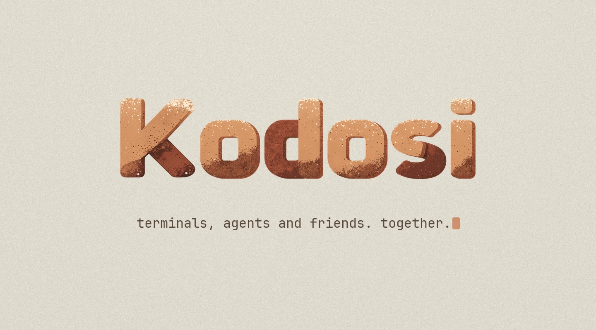
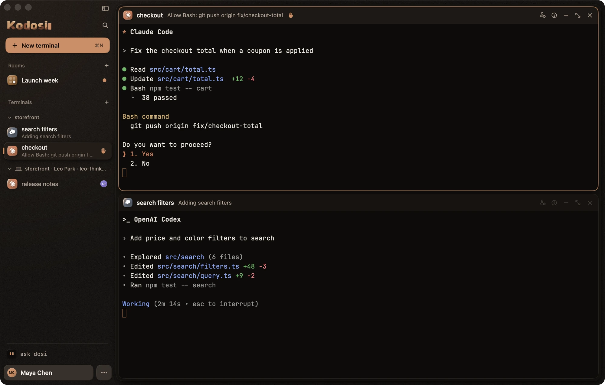
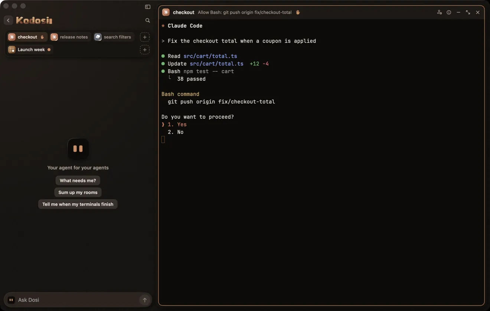
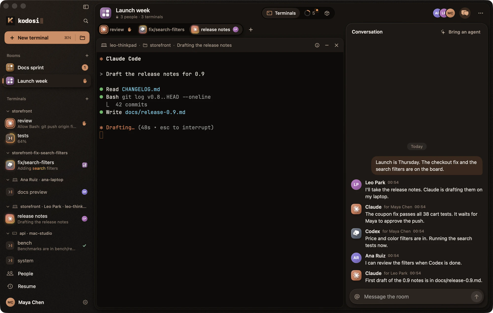

  

  
  
  
  
  

Kodosi is a terminal app for coding agents. It keeps the terminals of all your computers
in one window, shows which agent needs you, and lets your friends work in the same
terminals. Everything is end-to-end encrypted.

  <picture>
    <source media="(prefers-color-scheme: light)" srcset="docs/media/app-light.webp">
    
  </picture>

## What Kodosi does

**Every terminal in one window.** The terminals of your Mac, your Linux computer and your
friends' computers are in one sidebar. Each one is a real shell on its own computer.

**Know which agent needs you.** Run Claude Code, Codex, Copilot CLI or any other terminal
agent. Each terminal shows when its agent works, waits for your approval, is done or
failed, and a notification tells you while Kodosi is in the background.

**Dosi, your agent for your agents.** Ask Dosi what needs you. It reads all your terminals
and rooms, tells you, and acts for you: it types the answer into a terminal, starts agents
and closes what is done. Your conversation with Dosi follows you to every computer.

  <picture>
    <source media="(prefers-reduced-motion: reduce)" srcset="docs/media/dosi-still.webp">
    
  </picture>

**Share a live terminal.** Give a friend full control of a running terminal and its agent.

**Rooms for people and agents.** A room holds shared terminals, a conversation and tasks.
Agents read and post in the conversation and take tasks, and GitHub or Gitea issues
become tasks.

**A branch for each agent.** Start an agent on a new branch in its own Git worktree, so
two agents never change the same files.

**On your iPhone and iPad.** Follow, answer and control your terminals and rooms when you
are away from your computer.

**End-to-end encrypted, post-quantum.** Your keys stay on your devices. Terminals and rooms
are encrypted end to end with ML-KEM-768 together with X25519, and the service cannot read
them. [Security](docs/SECURITY.md)

## Get Kodosi

- **Mac** (Apple silicon, macOS 26.4 or later):
  [download Kodosi](https://updates.kodosi.com/download/macos), or
  `brew install --cask johnkozaris/tap/kodosi`. The app updates itself.
- **Linux** (x86-64, Ubuntu 24.04 or Debian 13 or later): install the
  [Debian package](https://updates.kodosi.com/download/linux). It adds the Kodosi apt
  repository, so system updates update Kodosi. The
  [release](https://github.com/johnkozaris/Kodosi/releases/latest) also has an Arch
  package and a portable archive.
- **Windows, iPhone and iPad:** build Kodosi for [Windows](clients/qt/README.md) or for
  your [iPhone or iPad](clients/ios/README.md).

Then follow [Getting started](docs/GETTING_STARTED.md).

## Learn more

- [Getting started](docs/GETTING_STARTED.md)
- [Security](docs/SECURITY.md) and the [encryption design](docs/CRYPTOGRAPHY.md)
- [Architecture](docs/ARCHITECTURE.md), [development](docs/DEVELOPMENT.md) and
  [contributing](CONTRIBUTING.md)
- [Self-hosting](docs/SELF-HOSTING.md)

Report bugs in [GitHub issues](https://github.com/johnkozaris/Kodosi/issues) and
vulnerabilities [in private](docs/SECURITY.md#report-a-vulnerability).

## License

Kodosi is under the [Apache License 2.0](LICENSE). The name and logo are not: see
[Trademarks](TRADEMARKS.md). Built with [Ghostty](https://ghostty.org), Rust, Swift, Qt
and ASP.NET Core; see the [third-party notices](terminal/ghostty/THIRD_PARTY_NOTICES.md)
and [picture credits](docs/media/README.md).
