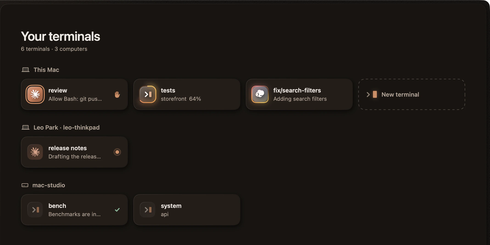
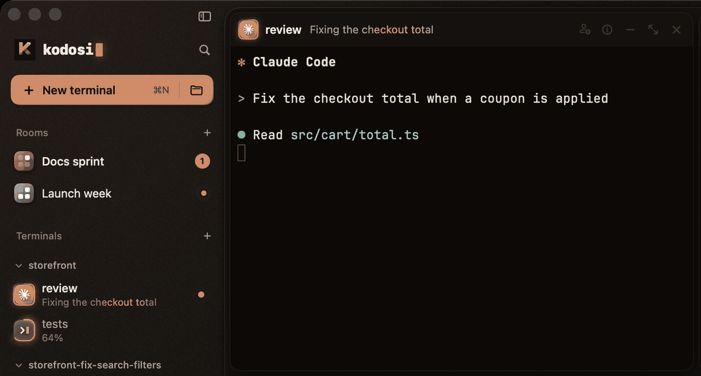
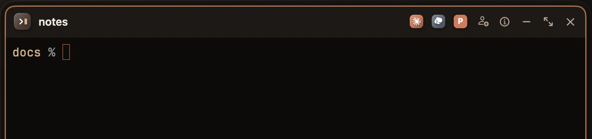
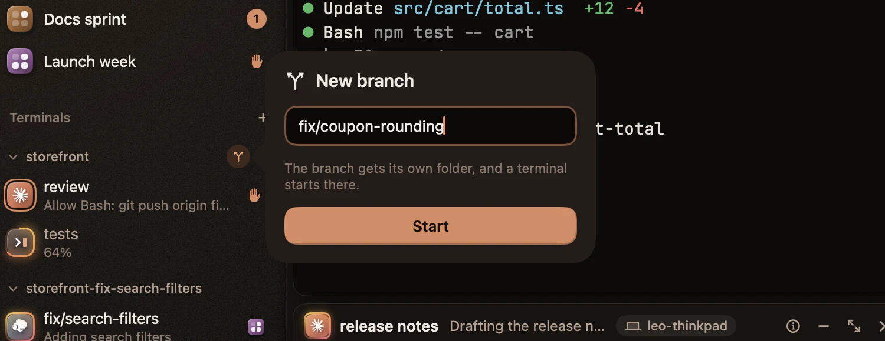
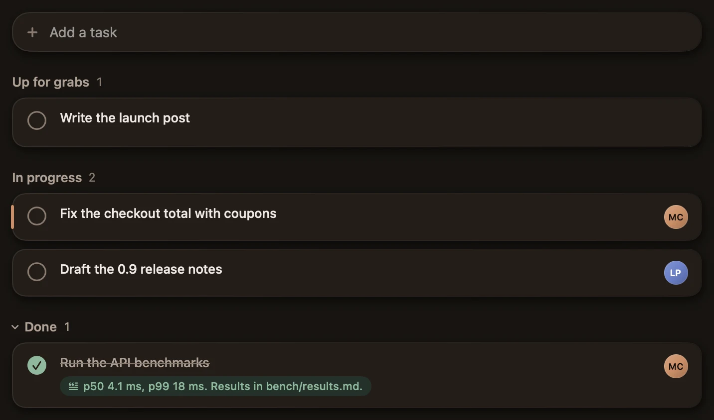
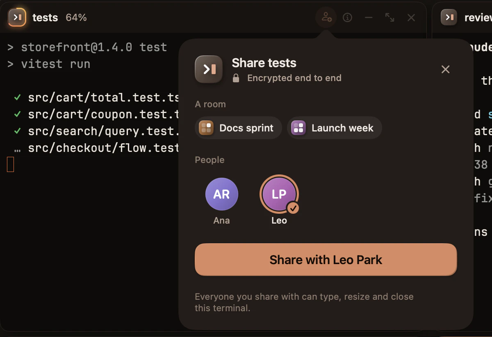

<p align="center">
  
</p>

<p align="center">
  <a href="LICENSE"></a>
  <a href="clients/macos/README.md"></a>
  <a href="clients/qt/README.md"></a>
  <a href="clients/ios/README.md"></a>
  
</p>

Kodosi is a native app where people and their coding agents work together. Your
terminals, your other computers, your friends' terminals and the agents in them are in
one place, end-to-end encrypted. The iPhone and iPad app follows the same terminals and
rooms when you are away.

<p align="center">
  <picture>
    <source media="(prefers-color-scheme: light)" srcset="docs/media/app-light.webp">
    
  </picture>
</p>

## What it does

**Every terminal, on every computer.** A terminal is a real shell on the computer that
started it. Open it from your other devices, along with the terminals friends share
with you.

<p align="center"></p>

**See which agent needs you.** Each terminal shows when its program works, waits for
you, is done or failed. A notification tells you when Kodosi is in the background.

<p align="center">
  <picture>
    <source media="(prefers-reduced-motion: reduce)" srcset="docs/media/status.webp">
    
  </picture>
</p>

**Bring your agents.** Claude Code, Codex, Copilot CLI or any terminal agent runs in its
own harness with its own settings and sign-in. Pick an agent, account, model and folder,
type a first prompt, and a new terminal starts it.

<p align="center"></p>

**A branch for each agent.** Name a branch and Kodosi starts a terminal in its own Git
worktree, so two agents never change the same files.

<p align="center"></p>

**Work together in a room.** A room holds terminals, a conversation and tasks. Share a
terminal with the room once and every member can use it. Agents join through the
bundled [room skill](runtime/skills/kodosi-room/SKILL.md), and GitHub or Gitea issues
can become tasks.

<p align="center"></p>
<p align="center"></p>

**End-to-end encrypted.** Private keys stay on your devices. The service relays
encrypted traffic and cannot read your terminals or rooms; it sees only whether each
agent works, waits or is done. [Security](docs/SECURITY.md)

<p align="center"></p>

## Build

You need a Mac with Apple silicon and macOS 26.4 or later, or Linux x86-64 (Ubuntu 24.04
recommended), plus the pinned Rust toolchain, `just` and Python 3. Kodosi also needs a
backend and an OIDC sign-in service; for development run a
[local backend](docs/DEVELOPMENT.md#run-the-backend).

```sh
just mac-build      # Mac app; then run the KodosiDesktop scheme in Xcode
just linux-build    # Linux app; then run ./clients/qt/build/dev/src/kodosi-qt
just ios-build      # iPhone and iPad app; then run the KodosiMobile scheme in Xcode
```

Platform guides: [macOS](clients/macos/README.md), [Linux and Windows](clients/qt/README.md),
[iPhone and iPad](clients/ios/README.md).

## Documentation

- [Getting started](docs/GETTING_STARTED.md): terminals, agents, sharing and rooms.
- [Development](docs/DEVELOPMENT.md) and [contributing](CONTRIBUTING.md).
- [Architecture](docs/ARCHITECTURE.md) and [self-hosting](docs/SELF-HOSTING.md).
- [Security](docs/SECURITY.md) and the [encryption design](docs/CRYPTOGRAPHY.md).

Kodosi is in active development and has no release yet. Report bugs in
[GitHub issues](https://github.com/johnkozaris/Kodosi/issues) and vulnerabilities
[in private](docs/SECURITY.md#report-a-vulnerability).

## License

Kodosi is [MIT licensed](LICENSE). The name and logo are not: see
[Trademarks](TRADEMARKS.md). Built with [Ghostty](https://ghostty.org), Rust, Swift, Qt
and ASP.NET Core; see the [third-party notices](terminal/ghostty/THIRD_PARTY_NOTICES.md)
and [picture credits](docs/media/README.md).
