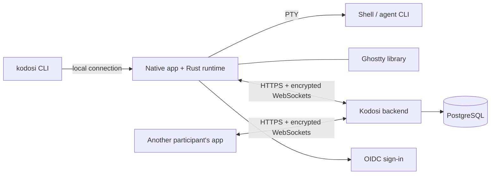

# Architecture

Each native app embeds the Rust runtime through its C API. The runtime starts shells on
a PTY (ConPTY on Windows) and owns terminal state, identity, encryption and rooms.
Ghostty is linked in-process for terminal state and rendering; native views handle
presentation, input and accessibility. The iPhone and iPad app embeds the viewer build
of the runtime and hosts no terminals.

The `kodosi` CLI talks to the running host, or starts its own in the background;
`kodosi host` runs one in the foreground. On macOS the signed app executable serves the
CLI so that it shares the app's Keychain identity.

## Terminals

The host owns each process, its terminal state and output order. A viewer gets a
checkpoint and then ordered updates over its own encrypted channel with bounded
buffering. Input whose delivery is uncertain is not replayed, and a stale view cannot
control a replacement terminal. Programs use the clipboard without a prompt: every view
of a terminal applies a clipboard write, and only the view with keyboard focus answers a
read, so the program gets one answer.

The host keeps the status that programs report (OSC 7501, or a progress bar). For each
terminal it sends the agent and state, without the program's text and without
encryption, through its device connection; the backend keeps the newest one while the
host is connected and gives it to everyone who can open the terminal.

## Backend and rooms

One ASP.NET Core process serves the HTTP APIs and WebSockets, holds live device sessions
and relay routes behind a PostgreSQL lease, and stores durable records in PostgreSQL. It
copies encrypted terminal records and keeps no terminal input.

Room messages, tasks and repository links are encrypted and signed on devices. The
backend stores ciphertext, numbers the items, and tells members' devices which room
changed; each device reads only the newer items. Issue actions run in the participant's
runtime with local credentials. See [Security](SECURITY.md) and the
[encryption design](CRYPTOGRAPHY.md).

## Contracts

`just protocol-gen` writes the desktop contract from the Rust types and
`just protocol-check` checks it. The `kodosi-ffi-c` build writes the C header, and the
Apple build checks the committed copy against it. The other contracts are written by
hand; the runtime build and tests read their versions, room limits and test vectors, and
the backend tests check the server's versions, routes and limits against them. Change a
contract together with the runtime, clients and backend.

The backend reports the oldest and the current version of the API contract and of the
terminal connection protocol on `/health/live`. An app below a range tells the person to
update Kodosi, and an app above it names the server. The channel between two devices has
its own version, `channelProtocolVersion`, which must match. After the first public
release, an older app keeps working for 60 days after a release that raises an oldest
version.

| Contract | File |
| --- | --- |
| Desktop commands and events | [desktop-runtime.json](../protocol/desktop-runtime.json) |
| Backend API | [backend-api.json](../protocol/backend-api.json) |
| Terminal connections | [terminal-connections.json](../protocol/terminal-connections.json) |
| Signature domains | [crypto-domains.json](../protocol/crypto-domains.json) |
| C API | [kodosi_runtime.h](../clients/apple/Sources/KodosiKit/kodosi_runtime.h) |
| Ghostty revisions and artifacts | [Ghostty.lock](../Ghostty.lock) |
