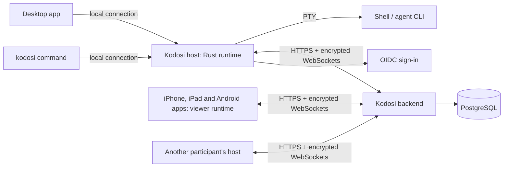

# Architecture

## Runtime and host model

Each computer runs one Kodosi host process built from the Rust runtime. The host manages PTY
shells and owns that machine's terminals, device identity, encryption, and project state. Both the
desktop app and the `kodosi` CLI connect to it locally, and whichever client runs first spawns the
host if it isn't running yet.

Every connected client receives live terminal and project state, so actions taken in one client
appear immediately in the others. If a client falls behind the event stream, it drops queued
events and fetches a fresh full snapshot instead of stalling the UI. The host tracks terminal
emulation state using Ghostty's VT library, and the apps render it with Ghostty.

Mobile apps (iOS and Android) embed the viewer build of the Rust runtime, which doesn't host
terminals. They notify the runtime on foreground, background, and network transitions. Shortly
after going to the background, the runtime closes all sockets and timers so the app uses no
background connections and relies on push notifications instead; returning to the foreground
re-establishes connections.

While an agent works in one of its terminals, the host asks the operating system to hold off the
sleep that starts by itself when nobody uses the computer, and it keeps the request for a short
time after the last agent stops. An agent that waits for its person doesn't count. Each computer
has a setting that keeps the request always, or never. The request never stops a sleep that a
person starts.

The host persists terminal snapshots as they change. After Quit, the next host instance restores
them on request with their previous screen contents and the command needed to resume each agent's
conversation. Restored terminals get a new ID that references the replaced terminal ID so remote
views follow automatically.

## Terminals

### Streaming and connections

The computer that starts a terminal owns its process, state, and output ordering. Each attached
view receives an initial checkpoint followed by ordered updates with bounded buffering. Remote
views receive updates over per-view end-to-end encrypted channels relayed through the backend.

When a viewer and host belong to the same user and can reach each other (on the same LAN or
through NAT traversal), encrypted frames move onto a direct QUIC connection between the two
devices and fall back to the relay if the direct path drops, without requiring a new checkpoint
and without dropping or duplicating frames. The relay pipe stays open so the backend can still
tear down the channel immediately if access is revoked.

If typing or another request goes unacknowledged for too long on a remote view, the viewer flags
the terminal as stalled and displays a reconnecting state while letting the user keep typing. The
host never replays input whose delivery is uncertain, and a stale view can never control a
replacement terminal. Queued work held back during a brief drop flushes once on the next channel.
Terminal traffic has priority over canvas traffic: terminal output is scheduled ahead of live
document and browser frames, and while someone is actively typing, canvas frames are throttled to
a small slice of the link.

Apps tell their host which terminals are currently visible on screen. Remote channels stay open
only while a client is viewing the terminal or sending work to it; hidden terminals keep their
last frame while receiving status and alerts through the backend.

### Sizing, input, and appearance

A terminal adopts the dimensions of whichever view last had user interaction (focus or input).
Passive resizes, or focus changes triggered merely by window activation or reconnection, don't
resize the terminal. Interactive input from UI views always takes precedence over input from the
`kodosi` CLI.

Every terminal uses its host computer's light or dark appearance across all viewing devices. The
local desktop app reports its appearance to the host (headless hosts retain their last known
appearance). The host answers terminal color and theme queries accordingly and notifies programs
subscribed to color-scheme change events.

### Status and notifications

The runtime determines each terminal's status (working, waiting, done, failed) from the running
program's own reports, and clients render that state. The host forwards only the agent type and
status to the backend, never terminal text, and the backend distributes it to everyone with access.

When a terminal enters a waiting, finished, or failed state, Kodosi notifies the owner once on the
device they're actively using:

1. Each app reports user presence (active in Kodosi, active in another app on that computer, or
   idle) to its runtime, which relays it to the backend.
2. The host sets an unseen flag on the terminal state and sends it with the status update.
3. If the owner is actively in Kodosi, only the in-app status indicator updates. If they're in
   another desktop app, that computer's runtime displays a desktop notification. If all devices
   are idle, the backend sends a mobile push notification after a short grace delay (playing a
   sound only for waiting terminals). During that delay, any computer whose display is still awake
   shows its local notification first so someone who simply paused typing can answer right there.
4. If an unseen waiting terminal still hasn't been viewed when the user steps away from all
   computers, it delivers to their phones then (and to any other computer that hasn't shown it
   yet). Each device displays a given unseen event at most once.
5. Opening the terminal on any device clears the flag on the host, dismisses the notification
   everywhere, and prevents re-notifying for that state.

### Remote host calls

A device can open an end-to-end encrypted channel to the host of another computer belonging to the
same user. It works like a view's channel but reaches the host itself, which serves launcher
queries on it (listing available agents and folders, and starting new terminals) and power calls
(putting that computer to sleep, and its stay-awake setting). The host treats it like another
client and accepts calls only from the user's own approved devices.

## Backend and projects

A single ASP.NET Core service handles the HTTP API and WebSocket relays, storing metadata and
ciphertext in PostgreSQL. Terminal streams are relayed in memory and never stored.

Client devices encrypt and sign project messages, tasks, and repository links. The backend stores
the ciphertext, assigns sequence numbers, and notifies project members when something changes so
each device fetches new items. Deleting a message publishes a new empty version from the original
author in the same slot. Clearing a chat saves a per-user watermark on the backend so all of that
user's devices hide the same messages. Repository issue actions run locally on the user's machine
using their own Git or CLI credentials. See [Security](SECURITY.md) and the
[encryption design](CRYPTOGRAPHY.md).

## Agents

Kodosi integrates with agents solely through their public CLI interfaces. Each terminal sets
environment variables pointing to Kodosi's context note and skills stored inside Kodosi's own data
directory. Kodosi leaves nothing behind in an agent's own folders: whatever it changes there while
it runs, such as the Copilot CLI settings that [PRODUCT.md](../PRODUCT.md) describes or the link to
its plugin that Antigravity CLI loads only from its own folder, it restores when it stops, and a
host that starts after a crash takes over whatever the previous one left.

When a project chat message mentions a terminal by name, the host types it into the agent running
there; `kodosi` CLI commands can similarly message agents on any computer. Live changes to a
running agent's model, effort, fast mode, or permissions are typed using the agent's own slash
commands. The host only injects input when the agent can safely accept it, never while the agent
is waiting on a human prompt or while a person is typing.

## Chat

Chat is an alternate view of a terminal alongside its raw screen. Agents feed structured events to
the host through their native extension or server protocol:

- Claude Code uses a module inside Kodosi's plugin that talks to a host socket passed via the
  terminal environment.
- Codex connects to an app server started by the host via the environment address, and the host
  attaches to that server as a second client.
- Copilot CLI loads a Node extension from Kodosi's plugin (passed on Copilot's launch command)
  that connects to the host socket, or to a named pipe on Windows because Node doesn't support
  Unix domain sockets there.
- Antigravity CLI's terminal app has no extension interface, so `kodosi acp -- agy acp` launches
  the user's own Antigravity ACP server in the terminal's folder and environment, speaks the
  Agent Client Protocol to it like an editor, and relays events to the host socket. Kodosi does
  not start this chat itself because Google does not support embedding `agy` inside
  another application on personal plans.

The host turns these reports into structured chat state: user messages, agent replies, tool calls,
pending questions, the agent's task list, and session metadata. Replies, answers, and stops flow
back over the same channel.

The host also reports which view an agent primarily runs in (terminal vs. chat, such as
Antigravity ACP chat, switching back to terminal while waiting for sign-in). Clients open on that
default view, and a user's manual toggle sticks unless the agent explicitly signals a view change
(for example, switching back to the terminal for sign-in).

Chat never reads the terminal screen or synthesizes keystrokes, so terminal UI changes in an agent
don't break it. Every event field is optional, and agents without chat hooks still work normally in
the terminal view. Chat state is treated as terminal content and rides a sub-stream of the
terminal's encrypted channel, syncing an initial snapshot followed by incremental updates.

## Canvas

The host manages each terminal's canvas: files shown by the agent plus its shared browser. The
canvas manifest syncs with terminal state to local clients and over the encrypted terminal channel
to remote devices. Reading and adding files travel over the same encrypted channel.

### Live documents

[documents/](../documents/) is an independent library with zero Kodosi imports. On the host, a
single async task owns each open document and serializes edits in order, broadcasting accepted
operations to every viewer. There is no CRDT: position-dependent edits only apply against the
latest revision, and otherwise the client rebases and retries. Failed saves return an error only
to the sender.

The host applies each client edit batch at most once and persists that record across close/reopen
cycles. If a batch is rejected or its delivery is uncertain, the viewer drops it and notifies the
user rather than risking double-application. The host maintains a journal, saves files in place,
and merges external modifications made by other programs.

Document UIs load as a single static page inside a locked-down webview with no network access.
Messages route through the app to the host (over the encrypted terminal channel for remote devices).
Agents edit live documents through the same server via `kodosi doc`. The Tauri app in
`documents/app/` is an independent desktop wrapper around the same crates.

### Shared browser

[browser/](../browser/) is also a standalone library. The host spawns one offscreen Kodosi Browser
window (Chromium via prebuilt CEF) per terminal, with no visible native window on the host
machine. The host downloads and updates the browser binary from a signed update feed. Host and
browser communicate over a versioned local protocol, and a host only connects to an engine
matching its exact protocol version.

Devices only subscribe to browser frames while the canvas browser is actually on screen. On macOS
viewing a local terminal, the browser renders directly into a Core Animation layer composited into
the app window by the window server. For remote devices and other platforms, the engine encodes a
single shared video stream whenever at least one viewer is watching. The host selects direct
compositing or video per viewer.

The viewport tracks the dimensions of the active viewing device (the one that last interacted, or
another of the same user's devices once they open the browser there). Encoding targets the
highest-DPI viewer's pixel density within encoder limits, and static pages progressively refine
until sharp. During resizes, clients hold their previous frame until Chromium finishes painting at
the new size, hiding Chromium's placeholder flashes. Slow clients drop stale frames and recover on
the next keyframe (or on macOS hosts, a small delta frame referencing only frames acknowledged by
all viewers).

Encoded frames and pointer/keyboard input travel over the terminal's encrypted channel. The agent
controls its window via `agent-browser` over a host-managed local port scoped strictly to that
terminal's tabs. Private terminals share one persistent browser profile; shared terminals each get
an isolated, ephemeral profile tied to the terminal's lifetime.

## Localization

Each component localizes its own strings. Client apps bundle their own UI translations, while the
runtime marks user-facing strings as English templates with named parameters that each client's
local runtime fills in using the app's language. The `kodosi` CLI, local host internals, and logs
stay in English. Backend error messages stay in English and are matched by the runtime against a
known table of localized templates. Sign-in pages, the account page, and transactional emails live
in the Keycloak theme under [sign-in/](../sign-in/).

## Protocol contracts

The runtime, client apps, and backend share schemas in [protocol/](../protocol/) and the generated
[C header](../clients/apple/Sources/KodosiKit/kodosi_runtime.h); update them together. The backend
advertises its supported API and terminal protocol version ranges. Outdated clients prompt the
user to update, while clients newer than the server report that the server needs an upgrade.
