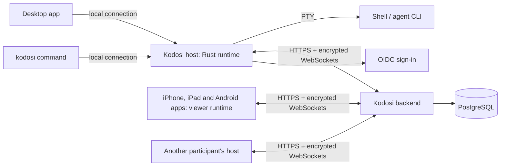

# Architecture

## Runtime and host model

Each computer runs one Kodosi host process built from the Rust runtime. The host manages PTY
shells and owns that machine's terminals, device identity, encryption, and project state. Both the
desktop app and the `kodosi` CLI connect to it locally, and whichever client runs first spawns the
host if it isn't running yet.

Every connected client receives live terminal and project state, so actions taken in one client
appear immediately in the others. If a client falls behind the event stream, it drops queued
events and fetches a fresh full snapshot instead of stalling the UI. The host tracks terminal
emulation state using Ghostty's VT library, and the apps render it with Ghostty.

Mobile apps (iOS and Android) embed the viewer build of the Rust runtime, which doesn't host
terminals. They notify the runtime on foreground, background, and network transitions. Shortly
after going to the background, the runtime closes all sockets and timers so the app uses no
background connections and relies on push notifications instead; returning to the foreground
re-establishes connections.

While an agent works in one of its terminals, the host asks the operating system to hold off the
sleep that starts by itself when nobody uses the computer, and it keeps the request for a short
time after the last agent stops. An agent that waits for its person doesn't count. Each computer
has a setting that keeps the request always while the computer is plugged in, or never. The request
never stops a sleep that a person starts.

The host persists terminal snapshots as they change. After Quit, the next host instance restores
them on request with their previous screen contents and the command needed to resume each agent's
conversation. Restored terminals get a new ID that references the replaced terminal ID so remote
views follow automatically.

Each snapshot also notes whether the terminal's agent was in the middle of a task. A host that
stops to install an update leaves a note of that, and when the next host starts soon after, those
agents continue on their own once they report that they are ready. After any other stop, the
terminal offers to continue its agent until someone does, types, or the agent works again. The host
tells the desktop apps whether a restart now would lose nothing while nobody uses its terminals,
and apps that update automatically install a waiting update then.

## Terminals

### Streaming and connections

The computer that starts a terminal owns its process, state, and output ordering. Each attached
view receives an initial checkpoint followed by ordered updates with bounded buffering. Remote
views receive updates over per-view end-to-end encrypted channels relayed through the backend.

Encrypted frames move onto a QUIC connection between the viewer's and the host's devices: a
direct one when they belong to the same user and can reach each other (on the same LAN or through
NAT traversal), and otherwise one through the backend's UDP relay, which forwards its packets
unchanged. The devices of two people meet only through the UDP relay and trade no addresses, so
neither learns the other's. Frames fall back to the relay pipe if the connection drops, without
requiring a new checkpoint and without dropping or duplicating frames. The relay pipe stays open so the backend can
still tear down the channel immediately if access is revoked.

On a QUIC connection, the video of the canvas browser and screens leaves the ordered channel, so
that a lost packet delays only its own frame. Frames travel as QUIC datagrams, split into shards
that each fit one packet. A frame has as long to arrive as its size needs at the rate that the link
carries, so a whole new screen also gets through a slow link. Frames carry Reed–Solomon parity only
after the path lost packets lately, and the host sends a missing shard again only while its frame
can still arrive in time. The viewer hands frames on in order, and a keyframe or anchor passes the
frames still missing before it. The host tells the stream of each frame that cannot arrive, and the
stream repairs the picture at once, so no viewer waits for a frame that nobody sends again.
SCReAMv2, a congestion controller made for interactive media, runs the QUIC connection: it keeps
the queue that it builds short and tells each stream the bitrate that its share of the path
carries. Loss without a queue, from a radio or a policer, lowers the bitrate only beyond what
parity and resends repair. The bitrate rises only as far as the video that was sent shows that the
path carries, so a still screen does not raise it. The streams' JSON messages, and everything on
the relay, stay in the channel.

If typing or another request goes unacknowledged for too long on a remote view, the viewer flags
the terminal as stalled and displays a reconnecting state while letting the user keep typing. The
host never replays input whose delivery is uncertain, and a stale view can never control a
replacement terminal. Queued work held back during a brief drop flushes once on the next channel.
Terminal traffic has priority over canvas traffic: terminal output is scheduled ahead of live
document and browser frames, and while someone is actively typing, canvas frames are throttled to
a small slice of the link.

Apps tell their host which terminals are currently visible on screen. Remote channels stay open
only while a client is viewing the terminal or sending work to it; hidden terminals keep their
last frame while receiving status and alerts through the backend.

### Sizing, input, and appearance

A terminal adopts the dimensions of whichever view last had user interaction (focus or input).
Passive resizes, or focus changes triggered merely by window activation or reconnection, don't
resize the terminal. Interactive input from UI views always takes precedence over input from the
`kodosi` CLI.

Every terminal uses its host computer's light or dark appearance across all viewing devices. The
local desktop app reports its appearance to the host (headless hosts retain their last known
appearance). The host answers terminal color and theme queries accordingly and notifies programs
subscribed to color-scheme change events.

### Status and notifications

The runtime determines each terminal's status (working, waiting, done, failed) from the running
program's own reports, and clients render that state. The host forwards only the agent type and
status to the backend, never terminal text, and the backend distributes it to everyone with access.

When a terminal enters a waiting, finished, or failed state, Kodosi notifies the owner once on the
device they're actively using:

1. Each app reports user presence (active in Kodosi, active in another app on that computer, or
   idle) to its runtime, which relays it to the backend.
2. The host sets an unseen flag on the terminal state and sends it with the status update.
3. If the owner is actively in Kodosi, only the in-app status indicator updates. If they're in
   another desktop app, that computer's runtime displays a desktop notification. If all devices
   are idle, the backend sends a mobile push notification after a short grace delay (playing a
   sound only for waiting terminals). During that delay, any computer whose display is still awake
   shows its local notification first so someone who simply paused typing can answer right there.
4. If an unseen waiting terminal still hasn't been viewed when the user steps away from all
   computers, it delivers to their phones then (and to any other computer that hasn't shown it
   yet). Each device displays a given unseen event at most once.
5. Opening the terminal on any device clears the flag on the host, dismisses the notification
   everywhere, and prevents re-notifying for that state.

### Remote host calls

A device can open an end-to-end encrypted channel to the host of another computer belonging to the
same user. It works like a view's channel but reaches the host itself, which serves launcher
queries on it (listing available agents and folders, and starting new terminals) and power calls
(putting that computer to sleep, its stay-awake setting, and the wake calls below). The host
treats it like another client and accepts calls only from the user's own approved devices.

### Waking a computer

A sleeping computer answers nothing, so everything that a wake needs must be known before it
sleeps. While a computer is awake, it reads how it can wake: the hardware address and network of
each card, whether the card uses a cable, the address of its router, and the wake setting of the
operating system. The user's other devices ask for this over a remote host call and keep the
answer, which also says when the computer stays awake. The backend never gets it.

The wake signal is a broadcast on the local network of the sleeping computer, so a device of the
user on that network must send it. The device that asks sends it itself when it is on that network
and its system lets an app broadcast. Otherwise it asks each awake computer of the user to send it,
through a remote host call, and a computer on another network declines. Two networks count as the
same when they have the same address range and the same router; when a router is unknown, the
public address decides. The device repeats the signal until the computer is online again, and
gives up after a time with one thing for the person to do.

What a computer reads is only an expectation. A wake test puts the computer to sleep, wakes it and
tells it the result, which the computer keeps with the card that it tested. A test counts only when
a wake signal went out and the computer itself saw a real sleep. Windows with Modern Standby stays on
while it sleeps, so its apps cannot see the sleep, and it offers no test.

## Backend and projects

A single ASP.NET Core service handles the HTTP API and WebSocket relays, storing metadata and
ciphertext in PostgreSQL. Terminal streams are relayed in memory and never stored. On one UDP port
the service answers STUN, so devices learn their public addresses, and relays QUIC packets between
the two devices of an allocation that it gives to both ends of a pipe; it forwards the packets
unchanged, as QUIC encrypts them end to end.

Client devices encrypt and sign project messages, tasks, and repository links. The backend stores
the ciphertext, assigns sequence numbers, and notifies project members when something changes so
each device fetches new items. Deleting a message publishes a new empty version from the original
author in the same slot. Clearing a chat saves a per-user watermark on the backend so all of that
user's devices hide the same messages. Repository issue actions run locally on the user's machine
using their own Git or CLI credentials. See [Security](SECURITY.md) and the
[encryption design](CRYPTOGRAPHY.md).

## Agents

Kodosi integrates with agents solely through their public CLI interfaces. Each terminal sets
environment variables pointing to Kodosi's context note and skills stored inside Kodosi's own data
directory. Kodosi leaves nothing behind in an agent's own folders: whatever it changes there while
it runs, such as the Copilot CLI settings that [PRODUCT.md](../PRODUCT.md) describes or the link to
its plugin that Antigravity CLI loads only from its own folder, it restores when it stops, and a
host that starts after a crash takes over whatever the previous one left.

When a project chat message mentions a terminal by name, the host types it into the agent running
there; `kodosi` CLI commands can similarly message agents on any computer. Live changes to a
running agent's model, effort, fast mode, or permissions are typed using the agent's own slash
commands. The host only injects input when the agent can safely accept it, never while the agent
is waiting on a human prompt or while a person is typing.

## Chat

Chat is an alternate view of a terminal alongside its raw screen. Agents feed structured events to
the host through their native extension or server protocol:

- Claude Code uses a module inside Kodosi's plugin that talks to a host socket passed via the
  terminal environment.
- Codex connects to an app server started by the host via the environment address, and the host
  attaches to that server as a second client.
- Copilot CLI loads a Node extension from Kodosi's plugin (passed on Copilot's launch command)
  that connects to the host socket, or to a named pipe on Windows because Node doesn't support
  Unix domain sockets there.
- Antigravity CLI's terminal app has no extension interface, so `kodosi acp -- agy acp` launches
  the user's own Antigravity ACP server in the terminal's folder and environment, speaks the
  Agent Client Protocol to it like an editor, and relays events to the host socket. Kodosi does
  not start this chat itself because Google does not support embedding `agy` inside
  another application on personal plans.

The host turns these reports into structured chat state: user messages, agent replies, tool calls,
pending questions, the agent's task list, and session metadata. Replies, answers, and stops flow
back over the same channel.

Each chat also lists the agents of the other terminals that its agent can reach, as its host's
terminal list has them. A message that names one with `@` reaches the agent as the person wrote it,
followed by one short Kodosi line for each named agent: its agent kind and the command that shows
its details. A hand-off asks the agent to continue another agent's work and to read that agent's
conversation with `kodosi terminal read <terminal> --conversation`, which takes it from the other
terminal's chat without a message to its agent. The host reads its own lines back out of the agent's
record, so the chat shows the person's words and the named agents apart, also after a restart.

The host also reports which view an agent primarily runs in (terminal vs. chat, such as
Antigravity ACP chat, switching back to terminal while waiting for sign-in). Clients open on that
default view, and a user's manual toggle sticks unless the agent explicitly signals a view change
(for example, switching back to the terminal for sign-in).

Chat never reads the terminal screen or synthesizes keystrokes, so terminal UI changes in an agent
don't break it. Every event field is optional, and agents without chat hooks still work normally in
the terminal view. Chat state is treated as terminal content and rides a sub-stream of the
terminal's encrypted channel, syncing an initial snapshot followed by incremental updates.

## Canvas

The host manages each terminal's canvas: files shown by the agent, its shared browser, and on a Mac
that shares it, the computer's screen. The canvas manifest syncs with terminal state to local clients and over the encrypted terminal channel
to remote devices. Reading and adding files travel over the same encrypted channel.

A terminal on a Git branch of its own counts the lines its branch changed since the branch started,
including new files that Git does not track yet, and shows the diff on its canvas when someone asks
from any device.

### Live documents

[documents/](../documents/) is an independent library with zero Kodosi imports. On the host, a
single async task owns each open document and serializes edits in order, broadcasting accepted
operations to every viewer. There is no CRDT: position-dependent edits only apply against the
latest revision, and otherwise the client rebases and retries. Failed saves return an error only
to the sender.

The host applies each client edit batch at most once and persists that record across close/reopen
cycles. If a batch is rejected or its delivery is uncertain, the viewer drops it and notifies the
user rather than risking double-application. The host maintains a journal, saves files in place,
and merges external modifications made by other programs.

Document UIs load as a single static page inside a locked-down webview with no network access.
Messages route through the app to the host (over the encrypted terminal channel for remote devices).
Agents edit live documents through the same server via `kodosi doc`. The Tauri app in
`documents/app/` is an independent desktop wrapper around the same crates.

### Shared browser

[browser/](../browser/) is also a standalone library. The host spawns one offscreen Kodosi Browser
window (Chromium via prebuilt CEF) per terminal, with no visible native window on the host
machine. The host downloads and updates the browser binary from a signed update feed. Host and
browser communicate over a versioned local protocol, and a host only connects to an engine
matching its exact protocol version. The host starts each engine with the person's privacy choices
as Chromium features, which Chromium reads only at start, so a change of choice starts the running
engines again and their windows open again at their last page.

Devices only subscribe to browser frames while the canvas browser is actually on screen. On macOS
viewing a local terminal, the browser renders directly into a Core Animation layer composited into
the app window by the window server. For remote devices and other platforms, the engine encodes a
single shared video stream whenever at least one viewer is watching. The host selects direct
compositing or video per viewer.

The viewport tracks the dimensions of the active viewing device (the one that last interacted, or
another of the same user's devices once they open the browser there). Encoding targets the
highest-DPI viewer's pixel density within encoder limits, and static pages progressively refine
until sharp. During resizes, clients hold their previous frame until Chromium finishes painting at
the new size, hiding Chromium's placeholder flashes.

Encoded frames and pointer/keyboard input travel over the terminal's encrypted channel, the frames
as datagrams of the direct connection when there is one. The agent
controls its window via `agent-browser` over a host-managed local port scoped strictly to that
terminal's tabs. Private terminals share one persistent browser profile; shared terminals each get
an isolated, ephemeral profile tied to the terminal's lifetime.

### Screens

[screen/](../screen/) is a standalone library with no Kodosi imports. Kodosi Screen, a helper
program, captures the screen and plays viewers' input, and the host links to it with the same
messages on every system. On a Mac it is an app inside Kodosi's bundle that the host opens through
Launch Services, so that macOS grants Screen Recording and Accessibility to it alone and the
programs in terminals, which inherit Kodosi's permissions, do not get them. The host and the helper
link only with a program signed by their own team, which the kernel names on each Mach message of
the handover, so a program in a terminal that starts the helper or asks for the host's link gets
nothing. On Linux and Windows the helper ships beside the `kodosi` program and runs as the host's
child: on Linux the desktop's screen sharing portal asks the person at the computer once and
remembers the grant, and on Windows no permission is needed. The host starts the helper only while
the person at the computer allows the sharing, which only the computer's own app changes. While
anyone watches, the helper shows which devices watch, in the menu bar or the tray, with a way to
stop that turns the sharing off on every canvas.

One capture serves every viewer of a computer. It shows a display or one window, sized to the view
that the person opened or used last, with as many pixels as that view shows, fewer while a phone
runs hot, and no more than the source has. A zoomed view asks for only the part it shows, so the
part stays sharp, and a device that does not control the screen shows that part too. The pointer
travels apart from the video, as a position and a shape sent once, so viewers draw it, or use it
as their own cursor, without waiting for frames.

The helper handles what recovers by itself, so viewers see one state and words only when someone
must act. It tells the host when the screen is locked, another account has the display, or the
display sleeps although the helper woke it; meanwhile nothing is captured, and the capture starts
again when the screen comes back. Opening the screen wakes its display, which stays awake while
captured. The screen stays on the canvas while its computer does not share it, so viewers say why
and watch again as soon as it is shared. An agent's window that goes away comes back on the canvas
when it returns, unless a viewer chose another source. Shortcuts go by the letter they type, so
they mean the same whatever the two keyboards' layouts are, and a Command key takes Control's place
on computers that are not Macs. While the person at the computer uses its mouse or keyboard,
viewers' input waits a moment. Text copied on the computer goes to the device in control, and a
paste on a viewer gives the computer that device's text first; the helper leaves alone what
password managers mark as private and does not send text back to where it came from.

A computer's screen belongs to its owner: only the owner's devices list it on a canvas, and the
host refuses anyone else's pipe to it, also in a terminal shared with friends.

### Video streams

[stream/](../stream/) is a standalone library for live video with no Kodosi imports: the protocol
between a stream and its viewers, the flow control that decides which viewer takes which frame, and
the encoders, chosen at run time from what the computer has (VideoToolbox with Metal conversion on
macOS, VA-API on Linux graphics that encode H.264, OpenH264 elsewhere). The browser engine and
Kodosi Screen encode with it, and the host runs its flow control. libva is loaded at run time, so a
Linux computer without it encodes in software, and a stream whose GPU fails continues in OpenH264.
VA-API also encodes HEVC where the driver reports which coding tools its encoder uses, since the
stream's own parameter sets must name them.

Each viewer declares the codecs it decodes and which of them in hardware. A stream uses HEVC only
while its source encodes it and every viewer decodes it in hardware, since decoding HEVC in
software costs more than the bits it saves; otherwise it uses H.264, which every viewer decodes.
The Linux and Windows apps decode with the FFmpeg that Qt Multimedia ships, on the GPU through
VA-API or D3D11VA, and draw the GPU's pictures without passing them through the processor.
When the viewers change, the encoder restarts in the new codec with a keyframe, and every frame
names its codec. Pictures are BT.709 limited range, tagged in the stream and converted the same
way by every client. The VA-API encoder writes its own parameter sets and slice headers, so Intel
and AMD drivers tag the colours alike and tell decoders to show each frame as it arrives. A frame
that shows only a part of its source names that part, so a viewer places each frame right while
the part changes.

A stream codes new pictures at its full rate while a viewer acts on it, and at half that rate
while people only watch. Watching then costs each device half the work and gives each frame twice
the bits, and the first act brings the full rate back at once. The capture keeps its rate, since
each encoder codes the newest picture when its time comes.

Encoders sharpen a still picture on their own, with passes that encode it again. On the Mac and
with VA-API the encoder sets each frame's quantizer instead of leaving it to the hardware's rate
control, and lets frames run only a few frame times ahead of the bitrate that the link carries. A
new screen then shows coarse at once rather than sharp a second later, passes sharpen it while the
link has room, and a frame made during the passes never waits long behind them. OpenH264 keeps its
own rate control and spends its spare bits on the same passes.

Slow viewers skip frames and recover on the next keyframe. In an HEVC stream, the encoder also marks
long-term references when every viewer declares that its decoder takes them, since some hardware
decoders freeze on them, and a viewer that missed frames recovers from an anchor: a small frame that
references only marks every viewer acknowledged. An H.264 stream has none. H.264 numbers its frames
in order, so a viewer that skipped frames sees a gap, which its decoder fills with frames that never
existed, and later frames then predict from those instead of the picture that the encoder meant.
While nothing changes, the flow control tells each viewer that has every frame it was sent that
nothing did; a viewer with a frame on its way or a gap hears nothing, since its picture is not the
newest.

The viewer's runtime keeps the rule for frames, once for every app. It reads each frame's header,
hands the app only a frame that its decoder can take, acknowledges each frame, and asks again for a
keyframe while it waits for one. The apps only decode and draw: each gets a stream's frames as
bytes, on a thread of that stream. When a picture waits for a repair for longer than a moment, or
its stream says nothing for a while, the runtime tells the app, which rests on the last picture
until the next frame or until the stream says again that nothing changed. So a picture whose stream
went silent never looks live, and a still screen never rests.

## Localization

Each component localizes its own strings. Client apps bundle their own UI translations, while the
runtime marks user-facing strings as English templates with named parameters that each client's
local runtime fills in using the app's language. The `kodosi` CLI, local host internals, and logs
stay in English. Backend error messages stay in English and are matched by the runtime against a
known table of localized templates. Sign-in pages, the account page, and transactional emails live
in the Keycloak theme under [sign-in/](../sign-in/).

## Protocol contracts

The runtime, client apps, and backend share schemas in [protocol/](../protocol/) and the generated
[C header](../clients/apple/Sources/KodosiKit/kodosi_runtime.h); update them together. The backend
advertises its supported API and terminal protocol version ranges. Outdated clients prompt the
user to update, while clients newer than the server report that the server needs an upgrade.
