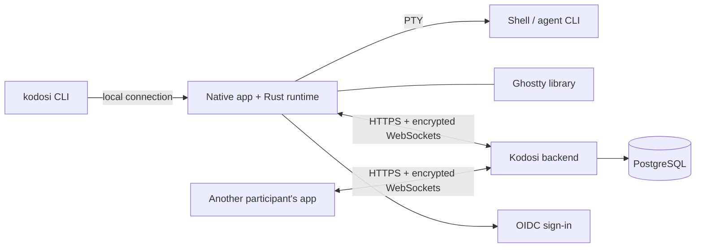

# Architecture

Each native app embeds the Rust runtime through its C API. The runtime starts shells on
a PTY (ConPTY on Windows) and owns terminal state, identity, encryption and rooms.
Ghostty is linked in-process for terminal state and rendering; native views handle
presentation, input and accessibility. The iPhone and iPad app embeds the viewer build
of the runtime and hosts no terminals.

The `kodosi` CLI talks to the running host, or starts its own in the background;
`kodosi host` runs one in the foreground. On macOS the signed app executable serves the
CLI so that it shares the app's Keychain identity.

## Terminals

The host owns each process, its terminal state and output order. A viewer gets a
checkpoint and then ordered updates over its own encrypted channel with bounded
buffering. Input whose delivery is uncertain is not replayed, and a stale view cannot
control a replacement terminal.

The host keeps the status that programs report (OSC 7501, or a progress bar). For a room
terminal it sends the agent and state, encrypted with the room key, through its device
connection; the backend keeps the newest one while the host is connected.

## Backend and rooms

One ASP.NET Core process serves the HTTP APIs and WebSockets, holds live device sessions
and relay routes behind a PostgreSQL lease, and stores durable records in PostgreSQL. It
copies encrypted terminal records and keeps no terminal input.

Room messages, tasks and repository links are encrypted and signed on devices. The
backend stores ciphertext, numbers the items, and tells members' devices which room
changed; each device reads only the newer items. Issue actions run in the participant's
runtime with local credentials. See [Security](SECURITY.md) and the
[encryption design](CRYPTOGRAPHY.md).

## Contracts

Rust generates the shared contracts. Change them with `just protocol-gen`, check them
with `just protocol-check`, and update the runtime, clients and backend together.

| Contract | File |
| --- | --- |
| Desktop commands and events | [desktop-runtime.json](../protocol/desktop-runtime.json) |
| Backend API | [backend-api.json](../protocol/backend-api.json) |
| Terminal connections | [terminal-connections.json](../protocol/terminal-connections.json) |
| Signature domains | [crypto-domains.json](../protocol/crypto-domains.json) |
| C API | [kodosi_runtime.h](../clients/apple/Sources/KodosiKit/kodosi_runtime.h) |
| Ghostty revisions and artifacts | [Ghostty.lock](../Ghostty.lock) |
