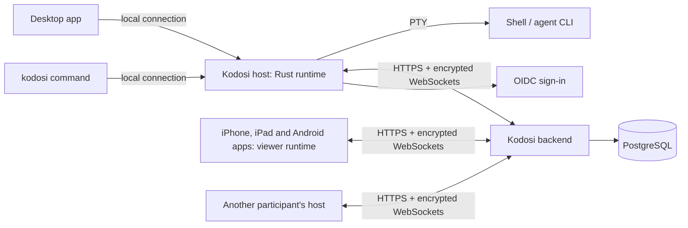

# Architecture

Each computer runs one Kodosi host, a process of the Rust runtime. The host runs shells
on a PTY and owns the computer's terminals, identity, encryption and projects. The
desktop apps and the `kodosi` command are its clients over a local connection, and the
first client that needs the host starts it. Every client gets the state of terminals and
projects, so what one client does, the others show. The host keeps terminal state with
Ghostty's terminal library, and the apps draw it with Ghostty.

The iPhone, iPad and Android apps embed the viewer build of the runtime, which hosts no
terminals.

The host saves its terminals while they change. After Quit, a new host starts them again
when an app asks, each with its earlier screen and the command that continues its
agent's conversation. A restored terminal has a new ID and names the one that it
replaces, so views on other devices follow it.

## Terminals

The computer that starts a terminal hosts it: it owns the process, the terminal state
and the order of its output. Each view gets a checkpoint and then ordered updates, with
bounded buffering. A view on another device gets them over its own end-to-end encrypted
channel, which the backend relays. The host does not replay input whose delivery is
uncertain, and a stale view cannot control a replacement terminal. Work that a short
drop of the channel holds back goes out once on the next channel.

Each app tells its host which terminals are on its screen. The channel to a terminal of
another computer is open only while a client shows the terminal or has work for it. A
hidden terminal keeps its last screen, and its state and alerts come from the backend.

The view in focus sets the size of its terminal. Input from a view is a person's, and
input from the `kodosi` command gives way while a person types.

The runtime decides what a terminal shows of its program: whether it works, what it
waits for and what it does. The program's own report decides, and each client presents
the result.

The host sends each terminal's agent and state to the backend, without its text. The
backend shows them to everyone who can open the terminal, and sends a push notification
to the owner's phones when a terminal starts to wait, finishes or fails.

A device can call another computer of the same person. The call is an end-to-end
encrypted channel like a view, but to the host itself, which answers the launcher's
requests as one more client. The host takes calls only from the person's own approved
devices.

## Backend and projects

One ASP.NET Core process serves the API and the WebSockets and stores its records in
PostgreSQL. It relays terminal traffic without storing it.

Devices encrypt and sign project messages, tasks and repository links. The backend
stores the ciphertext, numbers the items and tells members' devices that a project
changed; each device fetches the newer items. Issue actions run on the participant's
computer with its own credentials. See [Security](SECURITY.md) and the
[encryption design](CRYPTOGRAPHY.md).

## Agents

Kodosi reaches an agent only through what the agent's own CLI offers. Each terminal
carries Kodosi's note for agents and the place of Kodosi's skills in its environment, and
the host writes them into a folder of its own. Kodosi writes nothing into an agent's own
folders, so an agent outside a Kodosi terminal does not change.

The host types a project message that names one of its terminals into the agent in that
terminal, and `kodosi terminal message` sends such a line to an agent on any computer.
A change of a running agent's model, effort or permissions is also typed, as the agent's
own command. The host types only while the agent can take it: not while it waits for a
person, and not while a person types there.

## Canvas

The host keeps the canvas of each terminal: the files that its agent showed, and its
shared browser. The list travels with the terminal's state to each client, and to other
devices on the terminal's encrypted channel. An app reads a file's content, and adds a
file, over that same channel.

### Live documents

[documents/](../documents/) is a separate system: its crates and views import nothing of
Kodosi. One task on the host owns each open file. Every change goes through it in order
and then to every view, so there is no CRDT: a change that names a position is valid only
on the latest state, and otherwise the view moves its edit and sends it again. The host
keeps a journal, saves the file in place and merges what another program writes.

The views are one static page in each app, in a closed web page with no way to the
network. Their frames go through the app to the host, over the terminal's encrypted
channel from another device. Agents use the same server with `kodosi doc`. The Tauri app
in `documents/app/` is a second host of the same crates and a separate build.

### Shared browser

[browser/](../browser/) is a separate system too. The host runs one window of Kodosi
Browser for each terminal: Chromium on a ready-built CEF that draws off screen and shows
nothing on the computer. The host gets it from a signed feed and keeps it up to date.

While a device looks, the engine encodes the page as video. The frames, and the clicks
and keys that come back, travel on the terminal's encrypted channel, or straight between
two devices that can reach each other, under the same device keys. The agent drives its
window with agent-browser through a port that the host serves, where it sees only the
tabs of its own terminal.

A person's private terminals share one kept browser profile. A shared terminal has a
profile of its own, which goes with the terminal.

## Languages

Each part takes the words of the language that it shows. The apps keep their own words,
and the runtime marks each sentence for people and gives it to an app as an English
template with values, which the app's runtime fills in the app's language. The `kodosi`
command, the host and the logs use English. The backend answers in English, and the
runtime turns its known answers into such sentences. The sign-in pages, the account page
and the e-mails are the Keycloak theme in [sign-in/](../sign-in/).

## Contracts

The runtime, the apps and the backend meet at the contracts in [protocol/](../protocol/)
and the [C header](../clients/apple/Sources/KodosiKit/kodosi_runtime.h); change them
together. The backend names the range of API and terminal protocol versions that it
serves. An older app asks the person to update, and a newer one says that the server is
behind.
