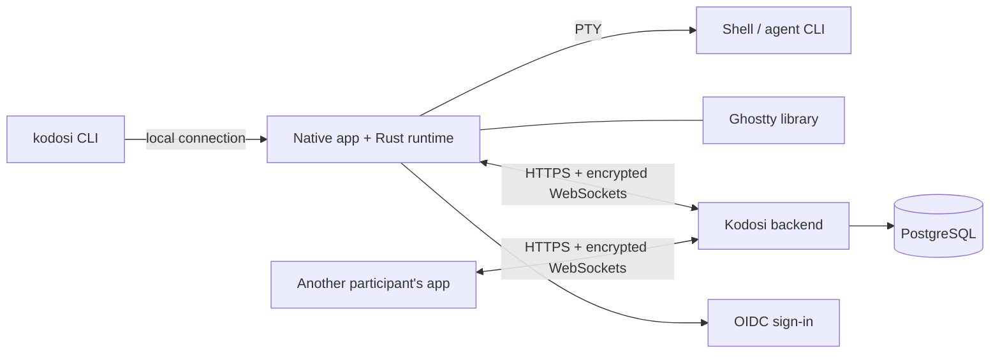

# Architecture

Each app embeds the Rust runtime, which runs shells on a PTY (ConPTY on Windows) and
owns terminals, identity, encryption and rooms. Ghostty, linked in-process, keeps
terminal state and draws it. The iPhone and iPad app embeds the viewer build and hosts
no terminals. The `kodosi` command talks to the running host, or starts one in the
background.

## Terminals

The computer that starts a terminal hosts it: it owns the process, the terminal state
and the order of its output. Each view gets a checkpoint and then ordered updates, with
bounded buffering; a view on another device gets them over its own end-to-end encrypted
channel through the backend. Input whose delivery is uncertain is not replayed, and a
stale view cannot control a replacement terminal.

The host also sends each terminal's agent and state, unencrypted and without its text,
to the backend, which shows the newest to everyone who can open the terminal while the
host is connected.

## Backend and rooms

One ASP.NET Core process serves the API and the WebSockets, holds the live connections
under a PostgreSQL lease, and stores its records in PostgreSQL. It relays terminal
traffic without storing it.

Room messages, tasks and repository links are encrypted and signed on devices. The
backend stores the ciphertext, numbers the items and tells members' devices that a room
changed; each device fetches the newer items. Issue actions run on the participant's
computer with its own credentials. See [Security](SECURITY.md) and the
[encryption design](CRYPTOGRAPHY.md).

## Contracts

The runtime, the apps and the backend meet at the contracts in [protocol/](../protocol/)
and the [C header](../clients/apple/Sources/KodosiKit/kodosi_runtime.h); change them
together. The backend's `/health/live` names the range of API and terminal protocol
versions it serves: an older app asks the person to update, and a newer one says that
the server is behind.
