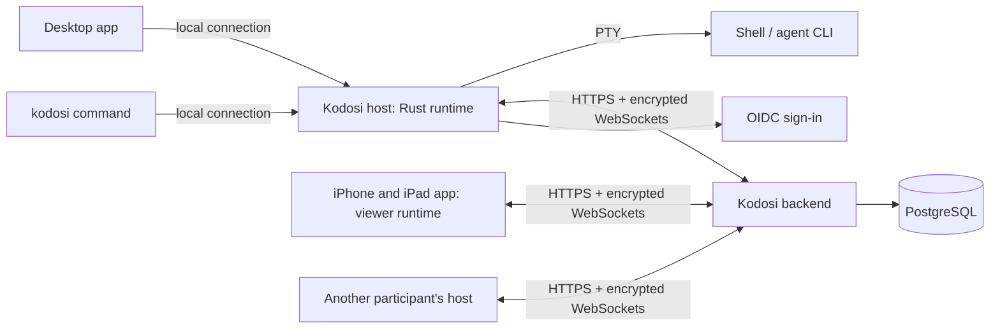

# Architecture

Each person's computer runs one Kodosi host, a process of the Rust runtime. It runs
shells on a PTY (ConPTY on Windows) and owns terminals, identity, encryption and rooms.
The desktop apps and the `kodosi` command are its clients over a local connection; the
first client that needs the host starts it in the background. Each client gets the
answers to its own requests, and every client gets the state of terminals and rooms, so
what one client does, the others show. The host keeps terminal state with Ghostty's
terminal library, and the apps draw it with Ghostty. The iPhone and iPad app embeds the
viewer build of the runtime and hosts no terminals.

Quit in a desktop app stops a background host and its terminals. A host that runs in a
terminal with `kodosi host` stops only there. An app that finds a host of an earlier
version offers to restart it.

## Terminals

The computer that starts a terminal hosts it: it owns the process, the terminal state
and the order of its output. Each view gets a checkpoint and then ordered updates, with
bounded buffering; a view on another device gets them over its own end-to-end encrypted
channel through the backend. Input whose delivery is uncertain is not replayed, and a
stale view cannot control a replacement terminal.

The view in focus sets the size of its terminal. Input from a view is a person's;
input from the `kodosi` command stops with a message while a person types in the
terminal. When a terminal stops working or starts to wait while no client shows it, the
host marks it until a client shows it.

A terminal starts with its host's environment and Kodosi's terminal variables. A host
that a client starts gets the user session's environment from Windows or the systemd
user manager, plus the client's `KODOSI` settings, and otherwise the client's
environment.

The host also sends each terminal's agent and state, unencrypted and without its text,
to the backend, which shows the newest to everyone who can open the terminal while the
host is connected.

A device can call another computer of the same person whose host is connected. The call
is an end-to-end encrypted channel like a view, but to the host itself: the caller sends
the launcher's requests (agents and choices, folders, a new terminal) as desktop
commands, and the host answers them as one more client. The host takes calls only from
the person's own approved devices and runs no other command.

## Backend and rooms

One ASP.NET Core process serves the API and the WebSockets, holds the live connections
under a PostgreSQL lease, and stores its records in PostgreSQL. It relays terminal
traffic without storing it.

Room messages, tasks and repository links are encrypted and signed on devices. The
backend stores the ciphertext, numbers the items and tells members' devices that a room
changed; each device fetches the newer items. Issue actions run on the participant's
computer with its own credentials. See [Security](SECURITY.md) and the
[encryption design](CRYPTOGRAPHY.md).

## Contracts

The runtime, the apps and the backend meet at the contracts in [protocol/](../protocol/)
and the [C header](../clients/apple/Sources/KodosiKit/kodosi_runtime.h); change them
together. The backend's `/health/live` names the range of API and terminal protocol
versions it serves: an older app asks the person to update, and a newer one says that
the server is behind.
