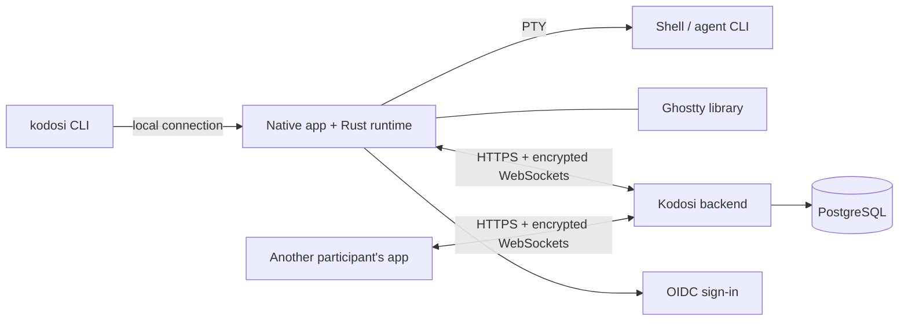

# Architecture

Each native app embeds the Rust runtime through its C API. The runtime starts shells on
a PTY (ConPTY on Windows) and owns terminal state, identity, encryption and rooms.
Ghostty, linked in-process, keeps terminal state and draws it; native views handle
input and accessibility. The iPhone and iPad app embeds the viewer build and hosts no
terminals. The `kodosi` CLI talks to the running host, or starts one in the background
(`kodosi host` in the foreground); on macOS the app executable is the CLI, so both share
the Keychain identity.

## Terminals

The host owns each process, its terminal state and output order. A viewer gets a
checkpoint and then ordered updates over its own encrypted channel with bounded
buffering. Input whose delivery is uncertain is not replayed, and a stale view cannot
control a replacement terminal. Programs write the clipboard without a prompt: every
view of a terminal applies a clipboard write. Only the view with keyboard focus answers a
read, so the program gets one answer. In the person's own terminals it answers at once; in
another person's terminal it asks first, because the answer sends the clipboard to that
person's computer. The host also sends each terminal's agent and reported state (OSC 7501
or a progress bar), unencrypted and without its text, through its device connection; the
backend keeps the newest while the host is connected and gives it to everyone who can
open the terminal.

## Backend and rooms

One ASP.NET Core process serves the HTTP APIs and WebSockets, holds live device sessions
and relay routes behind a PostgreSQL lease, and stores durable records in PostgreSQL. It
copies encrypted terminal records and keeps no terminal input.

Room messages, tasks and repository links are encrypted and signed on devices. The
backend stores ciphertext, numbers the items, and tells members' devices which room
changed; each device reads only the newer items. Issue actions run in the participant's
runtime with local credentials. See [Security](SECURITY.md) and the
[encryption design](CRYPTOGRAPHY.md).

## Contracts

`just protocol-gen` writes the desktop contract and `just protocol-check` checks it. The
`kodosi-ffi-c` build writes the C header, and the Apple build compares the committed
copy. The other contracts are written by hand; the runtime and the backend tests read
their versions, limits and test vectors. Change a contract together with the runtime,
clients and backend. `/health/live` gives the oldest and current versions of the API and
of the terminal connection protocol: an app below that range asks the person to update,
and one above it names the server that is behind.

| Contract | File |
| --- | --- |
| Desktop commands and events | [desktop-runtime.json](../protocol/desktop-runtime.json) |
| Backend API | [backend-api.json](../protocol/backend-api.json) |
| Terminal connections | [terminal-connections.json](../protocol/terminal-connections.json) |
| Signature domains | [crypto-domains.json](../protocol/crypto-domains.json) |
| C API | [kodosi_runtime.h](../clients/apple/Sources/KodosiKit/kodosi_runtime.h) |
| Ghostty revisions and artifacts | [Ghostty.lock](../Ghostty.lock) |
