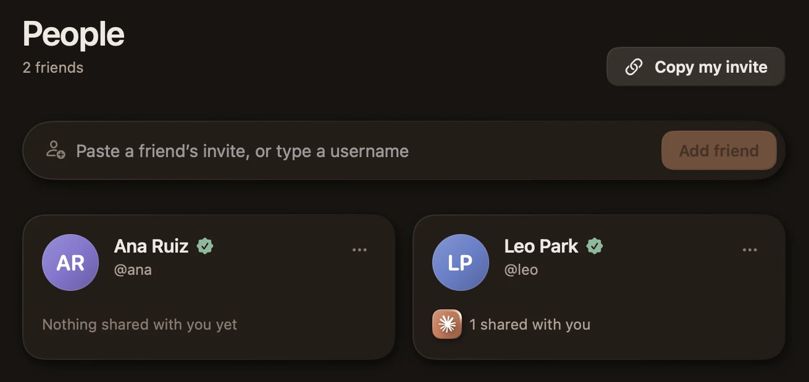

# Getting started

Build the app for your [Mac](../clients/macos/README.md),
[Linux or Windows](../clients/qt/README.md) computer, or your
[iPhone or iPad](../clients/ios/README.md). It needs a Kodosi backend and an OIDC
sign-in service; for development run a [local backend](DEVELOPMENT.md#run-the-backend).
Sign in through your browser; `kodosi auth login` shows a code to enter in any browser.

## Terminals

A terminal is a real shell on the computer that runs it. The sidebar lists your rooms
and terminals by folder and computer. Minimize hides a terminal and keeps it running;
Close ends it and its programs. Closing the window keeps the app hosting its terminals,
and Quit ends them. Terminals on other computers keep running.

After a lost connection the view returns to the current state. If Kodosi reports
uncertain input delivery, look at the terminal before you repeat a command.

## Agents

New terminal (⌘N on a Mac, Ctrl+Shift+N on Linux and Windows) opens the launcher. Pick
an agent, a folder, an account, a model and an effort, type a first prompt and press
Return: the new terminal's shell types the command. A missing agent offers its install
command, and a new account gets its own sign-in folder, such as `~/.claude-work`. Kodosi
also finds the accounts your shell sets up, such as
`alias cw='CLAUDE_CONFIG_DIR=~/.claude-work claude'`. A terminal at its prompt shows a
mark for each installed agent, which starts it with your last choice.

To give an agent its own copy of a repository, hover the repository folder in the
sidebar, select the branch button and name a branch. Kodosi starts a terminal in a new
Git worktree and removes the worktree when the terminal ends if nothing changed.
Settings › Terminal chooses where these folders go; from a shell, run
`kodosi session start --directory <repository> --branch <name>`.

## Terminal state

| You see | Meaning |
| --- | --- |
| A warm light circling the mark | Working. The mark's edge fills to show a percent. |
| A hand, question mark or key | Waiting for your approval, answer or sign-in. |
| A green check | Done. |
| A yellow warning sign | Failed. |

Everyone who can open a terminal sees its state, and small faces show who has it open.
The check and the warning go away when you open the terminal. While Kodosi is in the
background, your terminals and the ones you have open notify you when they start to
wait, finish or fail. Programs report their state through the
[Program Status Protocol](https://www.superlogical.com/rex/docs/build/program-status) or
a progress bar; a program that reports nothing shows no state.

## Devices

Sign in on the new device with the same account, and enter the code it shows in
Settings › Devices on a device you already use. An iPhone or iPad joins the same way.

Make a recovery key in Settings › Devices and keep it safe. If you lose every device,
sign in on a new one and choose "Use my recovery key" to keep your friends and rooms.
Remove a lost device from another device, and make a new recovery key if it was stolen.

## Friends and sharing

In People, send your invite, or paste a friend's invite or username. An invite lets
Kodosi verify the friend.

The share button in a terminal's header shares it with friends or rooms. Everyone you
share with gets full control, with your privileges on that computer. Your other
terminals stay private.

## Rooms

Create a room in Rooms, add friends, then start a terminal in the room or share one into
it. Members can use every shared terminal and share their own, and people who join later
get the terminals and the whole conversation. Files stay on each terminal's host. Put
tasks up for grabs, claim them, hand them back, close them with a result or reopen them.
Link GitHub or Gitea repositories to turn issues into tasks; changing such a task
updates its issue.

Agents in Kodosi terminals can use the `kodosi` command. Give your agent the room
[skill](../runtime/skills/kodosi-room/SKILL.md) through its usual way of loading skills;
`kodosi room skill` prints it. In a Kodosi terminal the command finds the room itself;
elsewhere pass `--room <name>`. GitHub actions use your `gh` sign-in or Git credential
helper; Gitea uses the credential helper, or `KODOSI_GITEA_TOKEN` for the server in
`KODOSI_GITEA_URL`. Credentials never leave your computer.

## If something does not connect

Check that the host is online with Kodosi running and that the terminal is still shared.
A new device may need approval, and a friend with a changed identity may need
verification in People.
