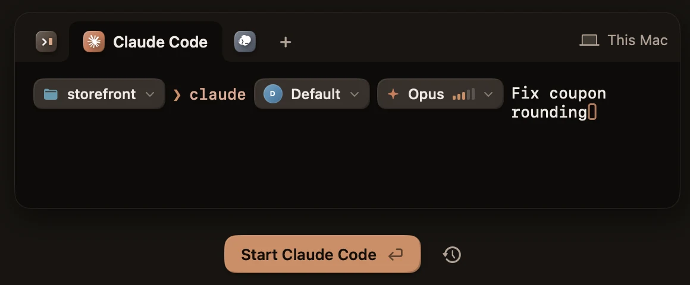
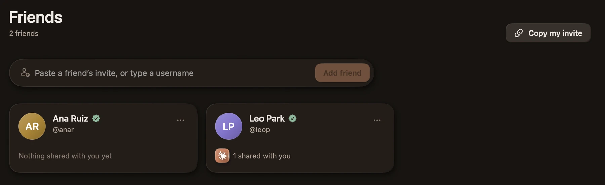

# Getting started

[Get Kodosi](../README.md#get-kodosi) for your computer. This guide uses the Mac keys; on
Linux and Windows, use Ctrl+Shift with the same letter.

## 1. Sign in

Open Kodosi and select Sign in at the bottom of the sidebar. Kodosi opens your browser,
where you sign in. In a terminal, `kodosi auth login` shows a code to enter in any
browser.

Without an account, Kodosi runs terminals on this computer. Sign in to use your other
computers, friends and rooms.

## 2. Start an agent

Select New terminal (⌘N). Choose an agent and a folder, and if you want, an account, a
model and an effort. Type a first prompt and press Return. Kodosi types the command into
the shell of the new terminal.

- If an agent is missing, the launcher shows its install command.
- A new account gets its own sign-in folder, such as `~/.claude-work`. Kodosi also finds
  the accounts that your shell sets up, such as
  `alias cw='CLAUDE_CONFIG_DIR=~/.claude-work claude'`.
- A terminal at its prompt shows a mark for each installed agent. Select a mark to start
  that agent with your last choice.
- In zsh and bash (not the bash 3.2 of macOS), ⌘↑ and ⌘↓ jump between prompts.
- ⌘-click a web address to open it in your browser (Ctrl-click on Linux and Windows). In a
  program that uses the mouse, also hold Shift.
- To give an agent its own copy of a repository, hover the repository folder in the
  sidebar, select the branch button and name a branch. Kodosi starts the terminal in a new
  Git worktree. When the terminal ends, Kodosi removes the worktree if nothing changed.
  Settings › Terminal sets where these folders go.

A terminal is a real shell on the computer that runs it. Minimize hides a terminal and
keeps it running; Close ends it and its programs. When you close the window, Kodosi and
your terminals keep running, and Kodosi's icon stays in the menu bar or the system tray;
on a desktop without a system tray, closing the window quits Kodosi. When you quit
Kodosi, your terminals stop. When you open Kodosi again, they start again in their
folders, rooms and places on the stage. Claude Code continues its conversation, and Codex
and Copilot CLI show their conversations so that you can continue one. In Settings, you
can choose what closing the window does.

## 3. See which agent needs you

The mark of each terminal shows what its program does.

| You see | It means |
| --- | --- |
| A warm light that goes around the mark | Working. The edge fills to show a percent. |
| A hand, a question mark or a key | Waiting for your approval, answer or sign-in. |
| A green check | Done. |
| A yellow warning sign | Failed. |

The check and the warning go away when you open the terminal. While Kodosi is in the
background, a notification tells you when one of your terminals starts to wait, finishes
or fails. Programs report their state with the
[Program Status Protocol](https://www.superlogical.com/rex/docs/build/program-status) or a
progress bar. A program that reports nothing shows no state.

## 4. Ask Dosi

Dosi is your agent for your other agents. Select Dosi's face at the bottom of the sidebar
(⌘J). Dosi runs on Claude Code or Codex; Settings › Dosi chooses which, with its account,
model and effort.

  <picture>
    <source media="(prefers-reduced-motion: reduce)" srcset="media/dosi-still.webp">
    
  </picture>

Ask Dosi what needs you, or ask it to do something. Dosi reads your terminals and rooms,
answers, and types, starts and closes things for you. When it needs a choice, it asks with
buttons, and you can also answer in your own words. Your conversation with Dosi is the
same on all your computers.

The line beside Dosi's face tells you when Dosi works, when it answered and when it has a
question. To remove Dosi from a computer, turn off Use Dosi in Settings › Dosi.

## 5. Add your other computers

Sign in on the new computer with the same account. It shows a code, and the computers
that you already use ask you to approve it: choose Approve on one of them and enter the
code. An iPhone or iPad joins the same way. Then each computer shows the terminals of all
your computers.

To start a terminal on another of your computers, choose that computer at the right end
of the launcher's band. The folder key then lists its recent folders, and Choose a
folder… opens the folders in its home. That computer needs Kodosi open, or `kodosi host`
running in a terminal.

Make a recovery key there too, and keep it safe. If you lose all your devices, sign in
on a new one and choose "Use my recovery key" to keep your friends and rooms. Remove a
lost device from another device. If a device was stolen, also make a new recovery key.

## 6. Work with friends

Open Friends from the menu beside your account. Send your invite, or paste the invite or
username of a friend. An invite lets Kodosi verify your friend.

To share a terminal, select the share button in its header and choose friends or rooms.
The people you share with get full control, with your privileges on that computer. Your
other terminals stay private.

A room holds shared terminals, a conversation and tasks. Select + beside Rooms, add
friends, then start a terminal in the room or share one into it.

- All members can use the shared terminals and share their own. People who join later
  get the terminals and the full conversation. Files stay on the computer of each
  terminal.
- Put tasks up for grabs, claim them, give them back, close them with a result or open
  them again.
- Link GitHub or Gitea repositories to turn issues into tasks; when you change such a
  task, Kodosi changes its issue. GitHub uses your `gh` sign-in or Git credential helper,
  and Gitea the credential helper or `KODOSI_GITEA_TOKEN` for the server in
  `KODOSI_GITEA_URL`. Your credentials stay on your computer.
- Write `@` and the name of a terminal in the chat, and Kodosi gives the agent in that
  terminal your message with your name and the room; the agent decides what to do with
  it. Agents that Kodosi starts know that they run in Kodosi, and `kodosi skill` prints
  the [skill](../runtime/skills/kodosi/SKILL.md) that lets an agent take part. In a
  Kodosi terminal, the command finds the room; elsewhere, add `--room <name>`.

## 7. Use the command line

The `kodosi` command works on the same terminals as the app, and the app shows what it
does.

| Command | What it does |
| --- | --- |
| `kodosi terminal start --agent claude --prompt "fix the failing test"` | Starts an agent with your last choice. `--account`, `--model` and `--effort` change it. |
| `kodosi terminal start --directory <repository> --branch <name>` | Starts a terminal on a new branch, in its own worktree. |
| `kodosi terminal start --computer <computer> --directory <folder>` | Starts a terminal on another of your computers. A relative folder, or one that starts with `~`, is in your home there. `kodosi devices list` shows which computers are online. |
| `kodosi agent list` | Shows the agents, their accounts and your last choice. |
| `kodosi agent usage` | Shows how much of the plan limits each signed-in Claude Code, Codex and Copilot CLI account has used. |
| `kodosi terminal list` | Shows your terminals with their names and IDs. Give either one as `<terminal>`. |
| `kodosi terminal read <terminal>` | Prints the screen. `--history` adds the lines that scrolled away. |
| `kodosi terminal message <terminal> "Can you review my branch?"` | Gives the agent in a terminal a message, with who sends it and from where. |
| `kodosi terminal input <terminal> --enter "make test"` | Types a line. |
| `kodosi terminal keys <terminal> ctrl-c` | Presses keys. |
| `kodosi terminal wait <terminal> --until done,failed` | Waits for a state. |
| `kodosi terminal show <terminal>` | Shows the terminal in the app. |
| `kodosi dosi say "What needs me?"` | Asks Dosi. `kodosi dosi show` prints the conversation, and `kodosi dosi stop` stops Dosi. |
| `kodosi skill` | Prints the skill that lets an agent work with the people and agents in Kodosi. |
| `kodosi dosi skill` | Prints the skill that lets another agent act as Dosi. |
| `kodosi host` | Keeps your terminals running after you quit the app. `kodosi host stop` stops a host that runs in the background. |

`message`, `input` and `keys` stop with a message while you type in that terminal.
`message` also stops while the agent waits for a person's answer.

## If something does not connect

Make sure that the computer of the terminal is online, with Kodosi open, and that the
terminal is still shared. A new device can need approval, and a friend with a changed
identity can need verification in Friends. After a lost connection, Kodosi shows the
current state again. When Kodosi says that a computer is offline, its terminals open
again when it is back, unless they ended there. To take such a terminal out of your list,
select its X: Hide until it's back shows it again when the computer is back, and Close
forever closes it then. If Kodosi says that it is not sure your input arrived, look at
the terminal before you type the command again.
