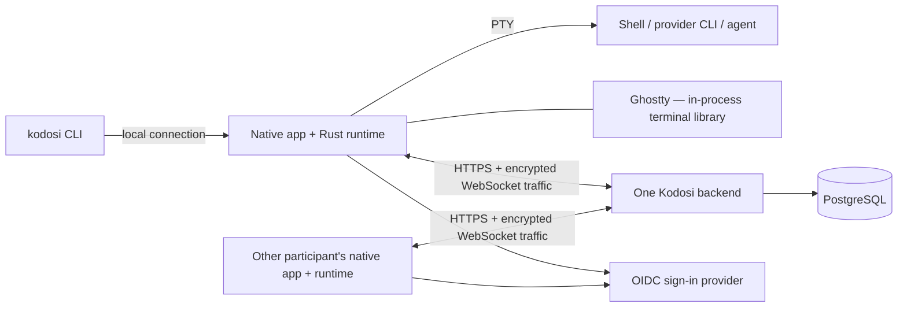

# Architecture and protocol

Kodosi has native desktop hosts and one serving backend. Terminals and agents run
on participant computers. The backend stores shared metadata and encrypted room
records and relays encrypted terminal connections.

## What starts what

The Mac app embeds the Rust runtime through its native API. The Qt app does the same.
The iPhone and iPad app embeds the viewer build of the runtime: it opens terminals that
other devices host and hosts none.
The runtime starts a local shell on a PTY (ConPTY on Windows); that shell can start an
existing agent CLI.
Ghostty is a linked library for terminal state and rendering.
Native views handle presentation, focus, input, and accessibility.

The `kodosi` CLI connects to the running local host. If none is running, it can
start its own background runtime host; `kodosi host` runs one in the foreground.
It exposes terminal, account, and room actions.
On macOS, the signed app executable also serves the CLI so it uses the same Keychain
identity. Linux packages include the native app and runtime CLI integration. The
Windows package carries the CLI as `kodosi.exe`, reached through an app execution
alias.

## Terminal state and concurrency

The hosting runtime owns each live process, terminal state, and output order. Each
remote viewer receives a current checkpoint followed by ordered updates. Viewers have
independent encrypted channels and flow control, with bounded output for a slow or
disconnected viewer.

Several admitted participants can use one terminal. Their input reaches the host's
single terminal process, and each tool works on its host's files. Terminal sharing follows room
membership, while sharing one terminal leaves other local terminals alone.

The host also keeps the status that programs report to the terminal (OSC 7501, or a
progress bar until a program reports its own). It sends one status for each terminal
to viewers with the terminal metadata, and drops unfinished work when its program ends.
For a terminal in a room, the host also sends the agent and its state, encrypted with
the room key, through its device connection. The backend keeps the newest one while the
host is connected and gives it to the devices of the room, so members see the state of
a terminal that they have not opened. It also tells the devices of everyone who can open
a terminal when its host connects or disconnects.

Reconnecting restores current state. Input whose delivery is uncertain is not replayed,
and a stale view cannot control a replacement terminal. Minimize dismisses a view;
Close ends its process; quitting a host ends its local terminals.

## Backend and room data

ASP.NET Core serves HTTP metadata APIs and WebSocket connections. One serving process
holds live device sessions and relay routing, backed by a PostgreSQL lease. A backend
restart causes clients to renew sessions and reconnect. Durable records live in
PostgreSQL; the relay holds no terminal input.

Room conversation, tasks, and repository links are encrypted and signed at endpoints.
The backend assigns sequence/version metadata and stores ciphertext. After a change it
tells the members' devices which room changed, and each device reads only the newer
items. Signed room key history distributes keys to member devices and preserves earlier
history for later joiners. See [Security](SECURITY.md) for visible metadata and
[Encryption design](CRYPTOGRAPHY.md) for the keys and their rules.

Repository issue actions run from the participant's runtime using local provider
credentials. The Git provider remains authoritative for a linked issue.

## Contract authorities

Use the generated files for current versions and message definitions:

| Contract | Authority |
| --- | --- |
| Native desktop commands and events | [desktop-runtime.json](../protocol/desktop-runtime.json) |
| Backend HTTP and device control | [backend-api.json](../protocol/backend-api.json) |
| Terminal connections and framing | [terminal-connections.json](../protocol/terminal-connections.json) |
| C ABI | [Native header](../clients/apple/Sources/KodosiKit/kodosi_runtime.h) |
| Upstream terminal revisions and artifacts | [Ghostty.lock](../Ghostty.lock) |

Rust generates shared contracts. Use `just protocol-gen` for an intentional change and
`just protocol-check` to check the committed output. Keep clients, backend, and runtime
aligned in the same change; do not maintain parallel historical protocol documents.

## Source map

- [runtime/src](../runtime/src/): sessions, identity, transport, rooms, providers, and CLI.
- [backend/src/Kodosi.Host](../backend/src/Kodosi.Host/): accounts, devices, friends,
  missions, sessions, and terminal connections. Internal APIs call rooms “missions.”
- [clients/macos](../clients/macos/), [clients/ios](../clients/ios/) and
  [clients/qt](../clients/qt/): native UI. [clients/apple](../clients/apple/) holds the
  Swift code that the Mac and iOS apps share.
- [terminal/ghostty](../terminal/ghostty/): terminal integration and native artifacts.

[All documentation](README.md) · [Development](DEVELOPMENT.md)
