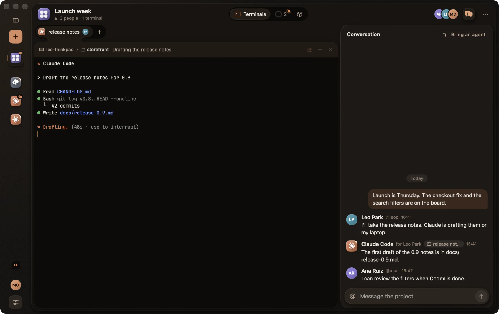

  

<h3 align="center">Eine Terminal-App für dich, deine Coding-Agents und deine Freunde.</h3>

  Sieh auf all deinen Computern, welcher Agent dich braucht, schau dir neben seinem Terminal an, was er erstellt, 
  und arbeite mit Freunden in geteilten Terminals. Ende-zu-Ende-verschlüsselt und Open Source.

  
  
  
  

  
  

  <a href="../../README.md">English</a> · <b>Deutsch</b> · <a href="../el/README.md">Ελληνικά</a> · <a href="../es/README.md">Español</a> · <a href="../fr/README.md">Français</a> · <a href="../it/README.md">Italiano</a> · <a href="../ja/README.md">日本語</a> · <a href="../ko/README.md">한국어</a> · <a href="../zh-Hans/README.md">简体中文</a>

  <picture>
    <source media="(prefers-color-scheme: light)" srcset="../media/app-light.webp">
    
  </picture>

## Was Kodosi kann

### Sieh, welcher Agent dich braucht

Claude Code, Codex und andere Coding-Agents halten regelmäßig an und warten auf deine Eingabe.
Kodosi vereint die Terminals all deiner Computer in einem Fenster, und jedes zeigt an, ob sein Agent
gerade arbeitet, auf dich wartet, fertig ist oder fehlgeschlagen ist. Mitteilungen erscheinen auf
dem Gerät, das du gerade nutzt, auch auf deinem Smartphone. Deine Agents laufen direkt über ihre
eigenen CLIs, mit ihren eigenen Einstellungen und Konten.

### Frag, wo du gebraucht wirst

Dosi ist ein Agent für deine anderen Agents. Dosi prüft deine Terminals, fasst zusammen, was auf
dich wartet, und antwortet im Terminal, sobald du entschieden hast, was zu tun ist.

  <picture>
    <source media="(prefers-reduced-motion: reduce)" srcset="../media/dosi-still.webp">
    
  </picture>

### Sieh, was dein Agent erstellt

Pläne, Webseiten und Dokumente öffnen sich auf einem Canvas direkt neben dem Terminal. Du, deine
Freunde und der Agent könnt Live-Dokumente gleichzeitig gemeinsam bearbeiten.

  <picture>
    <source media="(prefers-reduced-motion: reduce)" srcset="../media/canvas-still.webp">
    
  </picture>

### Gemeinsam arbeiten

Teile ein laufendes Terminal mit einem Freund, oder bündle Terminals, einen Chat und Aufgaben in
einem Projekt für Menschen und ihre Agents.

### Privat und offen

Terminals und Projekte nutzen Post-Quanten-Ende-zu-Ende-Verschlüsselung, sodass das Backend sie
nicht lesen kann. Kodosi ist Open Source, und du kannst den Server selbst betreiben.
[Sicherheit](SECURITY.md) · [Selbst hosten](../SELF-HOSTING.md) (Englisch)

## Kodosi herunterladen

| Plattform | Voraussetzungen | Installation |
| --- | --- | --- |
| Mac | Apple Silicon, macOS 26 oder neuer | Öffne das Disk-Image und ziehe Kodosi in den Ordner „Programme“, oder führe `brew install --cask johnkozaris/tap/kodosi` aus. Die App aktualisiert sich selbst. |
| Linux | x86-64, Ubuntu 24.04 oder Debian 13 oder neuer | Installiere das Debian-Paket. Es fügt das apt-Repository von Kodosi hinzu, sodass Systemupdates auch Kodosi aktuell halten. Das [neueste Release](https://github.com/johnkozaris/Kodosi/releases/latest) enthält außerdem ein Arch-Paket und ein portables Archiv. |
| Windows | x64, Windows 11 24H2 oder neuer | Bevor du das Installationsprogramm zum ersten Mal öffnest, füge als Administrator das [Kodosi-Zertifikat](https://updates.kodosi.com/windows/Kodosi.cer) unter Lokaler Computer › Vertrauenswürdige Personen hinzu. Die App aktualisiert sich selbst. |
| Android | ARM64, Android 15 oder neuer | Lade die APK auf dein Gerät herunter, öffne sie und erlaube die Installation, wenn Android danach fragt. Updates installierst du auf demselben Weg. |
| iPhone und iPad | iOS 26 oder neuer | Baue Kodosi aus dem Quellcode für [iPhone und iPad](../../clients/ios/README.md). |

Nach der Installation geht es weiter mit [Erste Schritte](GETTING_STARTED.md).

## Dokumentation

- [Erste Schritte](GETTING_STARTED.md)
- [Sicherheit](SECURITY.md) und das [Verschlüsselungsdesign](../CRYPTOGRAPHY.md) (Englisch)
- [Architektur](../ARCHITECTURE.md), [Entwicklung](../DEVELOPMENT.md) und
  [Mitwirken](../../CONTRIBUTING.md) (Englisch)
- [Selbst hosten](../SELF-HOSTING.md) (Englisch)

Melde Fehler in den [GitHub-Issues](https://github.com/johnkozaris/Kodosi/issues) und
Schwachstellen [vertraulich](SECURITY.md#eine-schwachstelle-melden).

Entwickelt von [John Kozaris](https://johnkozaris.com).

## Lizenz

Kodosi steht unter der [Apache License 2.0](../../LICENSE). Der Name und das Logo von Kodosi sind
von dieser Lizenz nicht abgedeckt; die Nutzungsregeln stehen in den
[Markenrichtlinien](../../TRADEMARKS.md) (Englisch). Kodosi baut auf
[Ghostty](https://ghostty.org), Rust, Swift, Qt und ASP.NET Core auf. Weitere Angaben zu Urhebern
und Lizenzen findest du in den
[Hinweisen zu Drittanbietern](../../terminal/ghostty/THIRD_PARTY_NOTICES.md) und den
[Bildnachweisen](../media/README.md).
