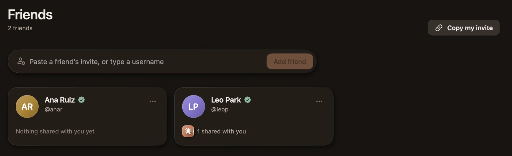

# Πρώτα βήματα

[English](../GETTING_STARTED.md) · [Deutsch](../de/GETTING_STARTED.md) · **Ελληνικά** · [Español](../es/GETTING_STARTED.md) · [Français](../fr/GETTING_STARTED.md) · [Italiano](../it/GETTING_STARTED.md) · [日本語](../ja/GETTING_STARTED.md) · [한국어](../ko/GETTING_STARTED.md) · [简体中文](../zh-Hans/GETTING_STARTED.md)

[Κατεβάστε το Kodosi](README.md#λήψη-του-kodosi) για τον υπολογιστή σας. Οι παρακάτω συντομεύσεις
χρησιμοποιούν πλήκτρα macOS: σε Linux και Windows, αντικαταστήστε το ⌘ με Ctrl+Shift, εκτός αν
αναφέρεται διαφορετικά.

## 1. Σύνδεση

Ανοίξτε το Kodosi και πατήστε **Σύνδεση** στο κάτω μέρος της πλαϊνής στήλης. Το Kodosi ανοίγει τον
browser σας για να συνδεθείτε. Από ένα τερματικό, μπορείτε να τρέξετε `kodosi auth login` για να
λάβετε έναν κωδικό συσκευής που μπορείτε να εισαγάγετε σε οποιονδήποτε browser.

Μπορείτε να τρέχετε τοπικά τερματικά χωρίς να συνδεθείτε. Συνδεθείτε για να συνδέσετε τους άλλους
υπολογιστές σας, να προσθέσετε φίλους και να χρησιμοποιήσετε έργα.

## 2. Ξεκινήστε έναν agent

Πατήστε ⌘N (ή πατήστε **Νέο τερματικό**) για να ανοίξετε το launcher. Διαλέξτε έναν agent και έναν
φάκελο, επιλέξτε προαιρετικά λογαριασμό, μοντέλο και ένταση σκέψης, γράψτε ένα αρχικό prompt και
πατήστε Return. Το Kodosi πληκτρολογεί την εντολή εκκίνησης σε ένα νέο shell.

Αν ένας agent δεν είναι ακόμα εγκατεστημένος, το launcher εμφανίζει την εντολή εγκατάστασής του.

### Γρήγοροι τρόποι για να ανοίγετε τερματικά

- Πατήστε ⌘D (Ctrl+Shift+O σε Linux και Windows) για ένα απλό shell στον φάκελο του επιλεγμένου
  τερματικού.
- Πατήστε ⌘T (Ctrl+Shift+T) για να ανοίξετε ένα νέο τερματικό με τον agent, τον λογαριασμό και τις
  ρυθμίσεις του επιλεγμένου τερματικού.
- Πατήστε το κουμπί `+` δίπλα σε έναν φάκελο στην πλαϊνή στήλη για να ξεκινήσετε ένα ακόμη
  τερματικό με τον agent που τρέχει ήδη σε αυτόν τον φάκελο, με τον ίδιο λογαριασμό και τις ίδιες
  ρυθμίσεις (ή ένα απλό shell αν δεν τρέχει κανένας εκεί).
- Σε ένα ανενεργό τερματικό στο prompt του shell, πατήστε το κουμπί ενεργειών (δύο ρυθμιστικά) στην
  κεφαλίδα για να ξεκινήσετε οποιονδήποτε εγκατεστημένο agent με τις τελευταίες σας ρυθμίσεις.

### Συντομεύσεις πληκτρολογίου

Οι συντομεύσεις ακολουθούν τις προεπιλογές του Ghostty και προσαρμόζονται στις **Ρυθμίσεις ›
Συντομεύσεις**:

- ⌘1 έως ⌘9 (Alt+1 έως Alt+9 σε Linux και Windows): μετάβαση σε τερματικό ανάλογα με τη θέση του.
- ⌥⌘ + βελάκια (Ctrl+Alt + βελάκια): μετακίνηση σε διπλανό τερματικό.
- ⌘W: κλείσιμο του επιλεγμένου τερματικού.
- ⌘↑ και ⌘↓: μετακίνηση ανάμεσα στα shell prompts σε zsh και σύγχρονο bash (όχι στο ενσωματωμένο
  bash 3.2 του macOS).

### Άδειες, λεπτομέρεια εξόδου και γρήγορη λειτουργία

- Από προεπιλογή οι agents ξεκινούν χωρίς περιορισμούς (**Απεριόριστα**), ώστε να μπορούν να
  επεξεργάζονται αρχεία και να εκτελούν εντολές χωρίς να σας ρωτούν. Εξαίρεση αποτελεί το
  Antigravity CLI, το οποίο ξεκινά στη δική του αυτόματη λειτουργία και εξακολουθεί να ρωτά πριν από
  μη αναστρέψιμες ενέργειες. Για να ζητά πρώτα άδεια ένας agent, επιλέξτε **Ερώτηση** στο μενού
  **Περισσότερα** (μετά την επιλογή μοντέλου).
- Στο **Περισσότερα** μπορείτε επίσης να ορίσετε το επίπεδο λεπτομέρειας εξόδου για τα Claude Code,
  Codex, Copilot CLI και Antigravity CLI (από προεπιλογή ξεκινούν σε **Λιτή**). Επειδή το Copilot
  CLI διαβάζει τη λεπτομέρεια μόνο από τις αποθηκευμένες του ρυθμίσεις, το Kodosi ενημερώνει
  προσωρινά τις ρυθμίσεις του Copilot όσο το Copilot CLI τρέχει σε λειτουργία **Λιτή** και τις
  επαναφέρει μετά.
- Το Claude Code και το Codex υποστηρίζουν γρήγορη λειτουργία (ταχύτερες απαντήσεις με υψηλότερο
  κόστος), την οποία ενεργοποιείτε δίπλα στις επιλογές μοντέλου και έντασης σκέψης. Η γρήγορη
  λειτουργία ισχύει μόνο για εκείνη την εκκίνηση και απενεργοποιείται ξανά την επόμενη φορά.

### Λογαριασμοί και αλλαγή εν ώρα λειτουργίας

- Όταν προσθέτετε έναν νέο λογαριασμό, του δίνεται ξεχωριστός φάκελος ρυθμίσεων, όπως
  `~/.claude-work`. Το Kodosi εντοπίζει επίσης λογαριασμούς που έχουν οριστεί μέσω shell aliases,
  όπως `alias cw='CLAUDE_CONFIG_DIR=~/.claude-work claude'`.
- Όσο τρέχει ένας agent, χρησιμοποιήστε το κουμπί ενεργειών (δύο ρυθμιστικά) στην κεφαλίδα για να
  αλλάξετε μοντέλο, ένταση σκέψης, γρήγορη λειτουργία και (στους agents που το υποστηρίζουν) άδειες,
  χωρίς επανεκκίνηση. Το Kodosi στέλνει την αντίστοιχη slash εντολή του agent μόλις ολοκληρωθεί ο
  τρέχων γύρος του. Σημειώστε ότι το Claude Code θυμάται τις αλλαγές σε μοντέλο, ένταση σκέψης και
  γρήγορη λειτουργία και για μελλοντικές συνεδρίες.

### Σύνδεσμοι, εικόνες, worktrees και θέματα

Κρατήστε πατημένο το ⌘ και κάντε κλικ σε έναν σύνδεσμο (Ctrl-κλικ σε Linux και Windows) για να τον
ανοίξετε στον προεπιλεγμένο browser της συσκευής που χρησιμοποιείτε. Κρατήστε πατημένο και το
Shift αν το πρόγραμμα που τρέχει χρησιμοποιεί το ποντίκι. Στο iPhone, πατήστε τον σύνδεσμο (η
λειτουργία είναι απενεργοποιημένη όσο ένα πρόγραμμα χρησιμοποιεί το ποντίκι). Το Kodosi σας ρωτά
πριν παραδώσει έναν σύνδεσμο σε άλλη εφαρμογή και μπλοκάρει το άνοιγμα εκτελέσιμων αρχείων, καθώς
και τοπικών διαδρομών αρχείων ή διευθύνσεων `localhost` από απομακρυσμένους υπολογιστές.

Για να δώσετε σε έναν agent ένα στιγμιότυπο οθόνης ή μια εικόνα, επικολλήστε την με ⌘V
(Ctrl+Shift+V σε Linux και Windows, ή Επικόλληση στο iPhone). Το Kodosi την αποθηκεύει στον
υπολογιστή που φιλοξενεί το τερματικό και επικολλά τη διαδρομή του αρχείου ώστε ο agent να την
επισυνάψει, δείχνοντας την πρόοδο μεταφόρτωσης για απομακρυσμένα τερματικά. Η δική του συντόμευση
επικόλλησης του agent (όπως το Ctrl+V στο Claude Code) συνεχίζει να διαβάζει το πρόχειρο του
υπολογιστή όπου τρέχει ο agent.

Για να δώσετε σε έναν agent ένα απομονωμένο αντίγραφο ενός αποθετηρίου Git, περάστε τον δείκτη πάνω
από τον φάκελο του αποθετηρίου στην πλαϊνή στήλη, πατήστε το κουμπί branch και δώστε ένα όνομα
branch. Το Kodosi ανοίγει το τερματικό σε ένα νέο Git worktree και το αφαιρεί αυτόματα όταν κλείσει
το τερματικό, αν δεν άλλαξε τίποτα. Μπορείτε να ρυθμίσετε πού αποθηκεύονται τα worktrees στις
**Ρυθμίσεις › Τερματικό**.

Η κεφαλίδα του τερματικού δείχνει πόσες γραμμές πρόσθεσε και αφαίρεσε το branch. Πατήστε τους
αριθμούς για να δείτε τις αλλαγές στο canvas.

Κάθε τερματικό είναι φωτεινό ή σκοτεινό όπως το Kodosi στον υπολογιστή που το φιλοξενεί, σε κάθε
συσκευή από την οποία το βλέπετε. Τα προγράμματα μέσα στο τερματικό λαμβάνουν ειδοποιήσεις αλλαγής
θέματος, ώστε εργαλεία όπως το Claude Code (με το `/theme` ρυθμισμένο σε Auto) να προσαρμόζονται
αυτόματα. Αν προτιμάτε σκουρόχρωμα τερματικά ενώ το ίδιο το Kodosi είναι σε φωτεινή λειτουργία,
ενεργοποιήστε την επιλογή **Τερματικά πάντα σκουρόχρωμα** στις **Ρυθμίσεις › Τερματικό**.

### Κλείσιμο, τερματισμός και άδειες στο macOS

Κάθε τερματικό είναι ένα πραγματικό shell που τρέχει στον υπολογιστή που το φιλοξενεί. Η
**Ελαχιστοποίηση** κρύβει ένα τερματικό διατηρώντας το ενεργό, ενώ το **Κλείσιμο** τερματίζει το
shell και τις θυγατρικές του διεργασίες. Όταν κλείνετε το παράθυρο της εφαρμογής, το Kodosi και τα
τερματικά σας συνεχίζουν να τρέχουν στη γραμμή μενού ή στην περιοχή ειδοποιήσεων (εκτός από
περιβάλλοντα επιφάνειας εργασίας Linux χωρίς περιοχή ειδοποιήσεων, όπου το κλείσιμο του παραθύρου
τερματίζει το Kodosi). Μπορείτε να αλλάξετε τη συμπεριφορά κλεισίματος του παραθύρου στις
**Ρυθμίσεις**.

Όταν τερματίζετε το Kodosi, τα τερματικά σας σταματούν και το Kodosi αποθηκεύει την κατάσταση της
οθόνης τους τοπικά στον υπολογιστή σας (ποτέ στον διακομιστή). Την επόμενη φορά που θα ανοίξετε το
Kodosi, τα τερματικά σας ανοίγουν ξανά στους ίδιους φακέλους, στα ίδια έργα και στις ίδιες θέσεις
στη σκηνή, με την προηγούμενη οθόνη και το ιστορικό κύλισης πάνω από ένα νέο prompt (στα Windows,
κάντε κύλιση προς τα πάνω για να το δείτε). Τα Claude Code, Codex και Copilot CLI συνεχίζουν αυτόματα
τις συζητήσεις τους, και σε macOS και Linux διατηρούν επίσης το μοντέλο, την ένταση σκέψης, τη
γρήγορη λειτουργία, τις άδειες και τη λεπτομέρεια εξόδου που είχατε επιλέξει. Αν το Kodosi δεν
μπορεί να αναγνωρίσει ποια συζήτηση έτρεχε ένας agent, ο agent εμφανίζει τη λίστα των συζητήσεών του
για να διαλέξετε μία.

Το Kodosi εγκαθιστά τις ενημερώσεις μόνο του όταν κανείς δεν το χρησιμοποιεί, κανένας agent δεν
δουλεύει και κανένα άλλο πρόγραμμα δεν τρέχει σε τερματικό. Για να επιλέγετε εσείς τη στιγμή,
απενεργοποιήστε την **Αυτόματη ενημέρωση** στις **Ρυθμίσεις › Γενικά**. Όταν κάνετε εσείς
επανεκκίνηση για μια ενημέρωση, οι agents που βρίσκονταν στη μέση μιας εργασίας συνεχίζουν μετά.
Μετά από οποιαδήποτε άλλη διακοπή, ένας τέτοιος agent περιμένει μέχρι να πατήσετε **Συνέχεια** στο
τερματικό του.

Στο macOS, τα προγράμματα μέσα στο Kodosi κληρονομούν τις άδειες του macOS που έχουν δοθεί στο
Kodosi, όπως σε κάθε άλλη εφαρμογή τερματικού. Αν το macOS εμποδίσει ένα πρόγραμμα να τροποποιήσει
μια άλλη εφαρμογή, ενεργοποιήστε το Kodosi στη **Διαχείριση εφαρμογών** (προσβάσιμη από τις
**Ρυθμίσεις › Γενικά**). Από εκεί μπορείτε επίσης να δώσετε άδεια για **Έλεγχο συσκευής και
πρόσβαση σε δεδομένα** (με την ονομασία **Προσβασιμότητα** πριν από το macOS 27) και **Εγγραφή
οθόνης και ήχου συστήματος** για εργαλεία που αυτοματοποιούν εφαρμογές ή καταγράφουν την οθόνη.

## 3. Δείτε ποιος agent σας χρειάζεται

Το εικονίδιο κάθε τερματικού δείχνει την τρέχουσα κατάστασή του:

| Ένδειξη | Σημασία |
| --- | --- |
| Ζεστό φως που περιφέρεται γύρω από το εικονίδιο | Δουλεύει (ένας δακτύλιος που γεμίζει δείχνει το ποσοστό προόδου όταν αναφέρεται). |
| Χέρι, ερωτηματικό ή κλειδί | Περιμένει την έγκριση, την απάντηση ή τη σύνδεσή σας. |
| Πράσινο τικ | Τελείωσε. |
| Κίτρινο τρίγωνο προειδοποίησης | Απέτυχε. |

Το τικ και η προειδοποίηση εξαφανίζονται μόλις ανοίξετε το τερματικό σε οποιαδήποτε συσκευή σας.

Όταν ένα τερματικό αρχίζει να περιμένει, τελειώνει ή αποτυγχάνει, το Kodosi σας ειδοποιεί μία φορά,
στη συσκευή που χρησιμοποιείτε εκείνη τη στιγμή:

- Αν το Kodosi είναι στο προσκήνιο, βλέπετε απλώς την ένδειξη κατάστασης.
- Αν χρησιμοποιείτε άλλη εφαρμογή σε υπολογιστή, το Kodosi εμφανίζει ειδοποίηση επιφάνειας εργασίας
  εκεί.
- Αν λείπετε από όλους τους υπολογιστές σας, το Kodosi στέλνει ειδοποίηση push στο τηλέφωνό σας. Αν
  ένα τερματικό που περιμένει παραμένει αδιάβαστο τη στιγμή που απομακρύνεστε από τον υπολογιστή
  σας, η ειδοποίηση προωθείται τότε στο τηλέφωνό σας.

Μόνο τα τερματικά που περιμένουν αναπαράγουν ήχο ειδοποίησης. Μπορείτε να σιγάσετε τις ειδοποιήσεις
ανά συσκευή στις **Ρυθμίσεις**. Τα προγράμματα αναφέρουν την κατάστασή τους μέσω του
[Program Status Protocol](https://www.superlogical.com/rex/docs/build/program-status) ή τυπικών
ακολουθιών προόδου τερματικού: τα προγράμματα που δεν αναφέρουν κατάσταση απλώς δεν εμφανίζουν
ένδειξη.

### Προβολή συνομιλίας

Τα τερματικά που τρέχουν Claude Code, καθώς και Codex ή Copilot CLI όταν ξεκινούν μέσα από το
Kodosi, προσφέρουν επίσης προβολή **Συνομιλία** στην κεφαλίδα του τερματικού. Η συνομιλία εμφανίζει
τα μηνύματά σας, τις απαντήσεις και τη χρήση εργαλείων από τον agent, καθώς και τυχόν εκκρεμείς
ερωτήσεις με κουμπιά επιλογής. Μπορείτε να απαντήσετε ή να σταματήσετε τον agent απευθείας από τη
συνομιλία. Αν πληκτρολογήσετε δικό σας κείμενο ενώ ο agent κάνει μια ερώτηση, του υποδεικνύετε τι να
κάνει αντ' αυτού. Ό,τι κάνετε στη συνομιλία εκτελείται και στο υποκείμενο τερματικό.

Στη συνομιλία, πληκτρολογήστε `@` για να αναφέρετε έναν άλλο agent σας που τρέχει, ώστε να μιλήσουν
μεταξύ τους: το Kodosi λέει στον agent της συνομιλίας ποιος είναι και πώς να του στείλει μήνυμα. Για
να παραδώσετε τη δουλειά ενός agent στον agent της συνομιλίας, σύρετε το τερματικό του πάνω στη
συνομιλία και επιλέξτε **Παράδοση** ή, σε κινητό, πατήστε παρατεταμένα τον agent στη λίστα `@`. Ο
agent της συνομιλίας διαβάζει τη συζήτηση του άλλου agent και συνεχίζει τη δουλειά· ο άλλος agent
δεν λαμβάνει κανένα μήνυμα.

Με το Claude Code, το γρανάζι κάτω από το πεδίο μηνύματος ή η εντολή `/config` ανοίγει τις ρυθμίσεις
του Claude Code. Το Claude Code ελέγχει και αποθηκεύει κάθε αλλαγή και λέει γιατί, όταν δεν τη
δέχεται.

Σε Mac, iPhone, iPad και Android, κάντε κλικ ή πατήστε στο μικρόφωνο δίπλα στο πεδίο μηνύματος για
να μιλήσετε αντί να πληκτρολογήσετε. Τα λόγια σας εμφανίζονται ως μήνυμά σας όσο μιλάτε και
στέλνονται μετά από μια μεγαλύτερη παύση, ώστε να μπορείτε να σκεφτείτε· κάντε κλικ ή πατήστε στην
**Αποστολή** για να σταλούν νωρίτερα. Η ομιλία μετατρέπεται σε κείμενο στη συσκευή σας και κανένας
ήχος δεν φεύγει από αυτήν.

## 4. Δείτε τι δείχνει ένας agent στο canvas

Οι agents μπορούν να εμφανίζουν σελίδες HTML, Markdown, εικόνες, PDF, έγγραφα Office, υπολογιστικά
φύλλα, παρουσιάσεις ή web εφαρμογές που τρέχουν σε ένα **canvas** δίπλα στο τερματικό, καθώς και να
χειρίζονται έναν κοινόχρηστο browser. Από προεπιλογή, το canvas ανοίγει αυτόματα όταν ο agent
εμφανίζει ή ενημερώνει κάτι ενώ βλέπετε το τερματικό του (εκτός αν το κλείσατε εσείς). Για να το
ανοίγετε μόνο εσείς, απενεργοποιήστε το **Αυτόματο άνοιγμα του canvas** στις **Ρυθμίσεις ›
Γενικά**.

Τα Claude Code, Copilot CLI και Antigravity CLI γνωρίζουν πώς να χρησιμοποιούν το canvas ακόμα και
όταν τα ξεκινάτε χειροκίνητα, ενώ τα Codex, Cursor και OpenCode το γνωρίζουν όταν ξεκινούν από το
Kodosi (το OpenCode σε macOS και Linux). Για οποιονδήποτε άλλον agent, πείτε του να τρέξει
`kodosi skill canvas`.

Μόλις το canvas αποκτήσει περιεχόμενο, στην κεφαλίδα του τερματικού προστίθενται κουμπιά για
**Αρχεία** και **Browser**, με μια χάλκινη τελεία όποτε υπάρχει κάτι νέο:

- Πατήστε οποιοδήποτε από τα δύο κουμπιά για να ανοίξετε το canvas δίπλα στο τερματικό.
- Πατήστε **Περισσότερος χώρος** για να καταλάβει το canvas όλη τη σκηνή, συρρικνώνοντας το
  τερματικό σε μια γωνία.
- Κλείστε ένα πλαίσιο με το `×` πάνω στο κουμπί του και ανοίξτε το ξανά με το `+`.
- Ανοίξτε τον browser χειροκίνητα από το **Άνοιγμα browser** στο μενού ενεργειών, ή προσθέστε
  αρχεία μέσω της επιλογής **Προσθήκη αρχείου…** (ή σύροντάς τα πάνω στο canvas), η οποία αντιγράφει
  το αρχείο και στον φάκελο του τερματικού.
- Στο iPhone, το κουμπί του canvas βρίσκεται στη γραμμή του τερματικού και ένα πλαίσιο ειδοποίησης
  ανακοινώνει τα νέα ή ενημερωμένα στοιχεία με ένα κουμπί **Άνοιγμα**.

### Ζωντανά έγγραφα και σελίδες

- Τα έγγραφα (`.docx`), τα υπολογιστικά φύλλα (`.xlsx`), οι παρουσιάσεις (`.pptx`), τα PDF και τα
  αρχεία κειμένου είναι ζωντανά: εσείς, όσοι μοιράζονται το τερματικό και ο agent μπορείτε να τα
  επεξεργάζεστε ταυτόχρονα, ενώ παραμένουν κανονικά αρχεία στον δίσκο. Όταν ένα έγγραφο περιέχει
  παρακολουθούμενες αλλαγές, η γραμμή εργαλείων διαθέτει επιλογή για να τις αποδεχτείτε ή να τις
  απορρίψετε. Στις **Ρυθμίσεις › Έγγραφα** μπορείτε να ενεργοποιείτε ή να απενεργοποιείτε μεμονωμένες
  προβολές, να εναλλάσσεστε ανάμεσα σε προβολή σελίδων και ρέοντος κειμένου, και να ενεργοποιείτε
  σκοτεινές σελίδες στη σκοτεινή λειτουργία.
- Οι σελίδες HTML στο canvas τρέχουν εντελώς εκτός σύνδεσης, χωρίς πρόσβαση στο δίκτυο. Οι σύνδεσμοι
  σε σελίδες, έγγραφα, φύλλα, διαφάνειες και PDF ανοίγουν στον δικό σας browser με τους ίδιους
  κανόνες ασφαλείας όπως οι σύνδεσμοι του τερματικού (⌘-κλικ ή Ctrl-κλικ μέσα σε επεξεργάσιμες
  προβολές, απλό κλικ αλλού, πάτημα στο iPhone). Οι εσωτερικοί σύνδεσμοι προς διαφάνειες ή κελιά
  μεταβαίνουν απευθείας εκεί.
- Επιλέξτε κείμενο σε μια σελίδα ή σε ένα έγγραφο και πατήστε **Ερώτηση γι' αυτό** για να σταλούν
  το όνομα του αρχείου και το επιλεγμένο κείμενο απευθείας στο τερματικό, ώστε να γράψετε την
  ερώτησή σας.
- Κάντε δεξί κλικ στην καρτέλα ενός αρχείου (ή παρατεταμένο πάτημα σε κινητό) για να αποθηκεύσετε
  ένα αντίγραφο, να αφαιρέσετε το συγκεκριμένο ή όλα τα αρχεία από το canvas, ή να μετακινήσετε το
  αρχείο στον Κάδο του υπολογιστή που φιλοξενεί το τερματικό.

### Κοινόχρηστος browser

- Κάντε κλικ και πληκτρολογήστε μέσα στον κοινόχρηστο browser όπως σε έναν κανονικό browser. Ο agent
  βλέπει τις ίδιες σελίδες και συνδέσεις, και η έξοδος της επόμενης εντολής browser που εκτελεί τού
  λέει ότι χρησιμοποιήσατε τον browser.
- Μετά από 10 λεπτά αδράνειας, ο browser μπαίνει σε αναστολή και ανοίγει ξανά την τελευταία του
  σελίδα όταν τον χρησιμοποιήσετε ξανά εσείς ή ο agent. Την πρώτη φορά που ανοίγετε κοινόχρηστο
  browser σε έναν υπολογιστή, το Kodosi κατεβάζει αυτόματα το Kodosi Browser, γι' αυτό παίρνει
  λίγο χρόνο.
- Για να επαναχρησιμοποιείτε τις υπάρχουσες συνδέσεις των browser σας στα ιδιωτικά σας τερματικά,
  πατήστε **Αντιγραφή** δίπλα σε έναν browser στις **Ρυθμίσεις › Browser**. Πατήστε **Αφαίρεση** για
  να διαγράψετε όσα αντιγράψατε, ή **Αφαίρεση όλων** για να διαγράψετε όλες τις συνδέσεις και τα
  δεδομένα ιστοτόπων από όλα τα ιδιωτικά τερματικά. Στο macOS, αν το λειτουργικό σύστημα περιορίζει
  την πρόσβαση στα δεδομένα ενός browser (όπως του Safari), πατήστε **Να επιτρέπεται…** δίπλα στον
  συγκεκριμένο browser για να παραχωρήσετε Πλήρη πρόσβαση στον δίσκο.
- Επίσης στις **Ρυθμίσεις › Browser**, οι **Προβλέψεις φορμών από την Google** επιτρέπουν στο Kodosi
  Browser να ρωτά την Google σε τι χρησιμεύουν τα πεδία μιας φόρμας, και τα
  **Cookies μεταξύ ιστοτόπων** επιτρέπουν σε έναν ιστότοπο που εμφανίζεται μέσα στη σελίδα ενός
  άλλου ιστοτόπου, όπως ένα βίντεο του YouTube, να σας αναγνωρίζει εκεί. Και οι δύο ρυθμίσεις μένουν
  απενεργοποιημένες μέχρι να τις ενεργοποιήσετε. Το Kodosi Browser ξεκινά ξανά όταν αλλάζετε μία από
  αυτές, και οι ανοιχτές σελίδες του φορτώνουν ξανά.
- Όσοι έχουν πρόσβαση σε ένα τερματικό βλέπουν το canvas του και μοιράζονται τον browser του. Το
  κλείσιμο του τερματικού καθαρίζει το canvas του και διαγράφει τις συνδέσεις του browser για
  κοινόχρηστα τερματικά.

### Η οθόνη ενός υπολογιστή

- Για να βλέπετε και να ελέγχετε έναν υπολογιστή από το τηλέφωνό σας ή από άλλον υπολογιστή,
  ενεργοποιήστε την κοινή χρήση σε εκείνον τον υπολογιστή: σε Mac, το **Να βλέπουν και να ελέγχουν
  αυτό το Mac οι άλλες συσκευές μου** στις **Ρυθμίσεις › Γενικά**, και σε Linux και Windows, το **Να
  βλέπουν και να ελέγχουν αυτόν τον υπολογιστή οι άλλες συσκευές μου** στις
  **Ρυθμίσεις › Λογαριασμός**.
  - Σε Mac, το macOS σάς ζητά τότε να επιτρέψετε στο Kodosi Screen, μέρος του Kodosi, να καταγράφει
    και να ελέγχει την οθόνη. Μόνο το Kodosi Screen παίρνει αυτές τις άδειες, οπότε τα προγράμματα
    στα τερματικά σας δεν τις παίρνουν. Αν το macOS δεν σας ρωτήσει, το **Να επιτρέπεται…** στις
    ίδιες ρυθμίσεις δείχνει πού θα τις ενεργοποιήσετε.
  - Στο Linux, η κοινή χρήση λειτουργεί με KDE Plasma 6 και GNOME σε Wayland. Στο KDE αρκεί να
    ενεργοποιήσετε την κοινή χρήση· το GNOME ρωτά μία φορά αν το Kodosi μπορεί να μοιράζεται την
    οθόνη και θυμάται την απάντησή σας.
  - Τα Windows δεν χρειάζονται καμία άδεια. Το Kodosi δεν μπορεί να ελέγξει προγράμματα που
    εκτελούνται ως διαχειριστής, και η οθόνη εμφανίζεται κλειδωμένη όσο τα Windows ζητούν έγκριση
    διαχειριστή. Το εικονίδιο που δείχνει ποιος παρακολουθεί μπορεί να κρύβεται πίσω από το ^ στη
    γραμμή εργασιών μέχρι να το καρφιτσώσετε.
- Επιλέξτε **Άνοιγμα οθόνης** στο μενού ενεργειών ενός τερματικού σε εκείνον τον υπολογιστή, ή
  αφήστε τον agent του να εκτελέσει `kodosi show screen`. Διαλέξτε άλλη οθόνη ή, σε Mac, ένα μόνο
  παράθυρο πάνω από την οθόνη, κάντε τσίμπημα για μεγέθυνση, και δείξτε, κάντε κλικ και
  πληκτρολογήστε σαν να καθόσασταν μπροστά στον υπολογιστή. Οι συντομεύσεις λειτουργούν με βάση το
  γράμμα που πατάτε, και το ⌘ λειτουργεί ως Ctrl σε Linux και Windows. Το κείμενο που αντιγράφετε
  εκεί καταλήγει στη συσκευή σας, και ό,τι επικολλάτε έρχεται από τη συσκευή σας.
- Όταν η οθόνη δεν μπορεί να εμφανιστεί, λέει τον λόγο σε μία γραμμή: ο υπολογιστής είναι
  κλειδωμένος, σε κατάσταση ύπνου, εκτός σύνδεσης ή σε άλλο λογαριασμό, ή η κοινή χρήση είναι
  ανενεργή. Μόλις αλλάξει αυτό, εμφανίζεται ξανά από μόνη της.
- Μόνο οι δικές σας συσκευές βλέπουν την οθόνη, ακόμη και σε ένα τερματικό που μοιράζεστε με φίλους.
  Όσο κάποιος παρακολουθεί, η γραμμή μενού ή η περιοχή ειδοποιήσεων του υπολογιστή δείχνει ποιες
  συσκευές παρακολουθούν, με ένα κουμπί που σταματά την κοινή χρήση μέχρι να την ενεργοποιήσει ξανά
  κάποιος στον υπολογιστή.

## 5. Ρωτήστε το Dosi

Το Dosi είναι ο agent σας για τον συντονισμό των υπόλοιπων agents σας. Πατήστε το πρόσωπο του Dosi
στο κάτω μέρος της πλαϊνής στήλης (ή πατήστε ⌘J). Το Dosi τρέχει με Claude Code ή Codex, το οποίο
ρυθμίζετε μαζί με τον λογαριασμό, το μοντέλο και την ένταση σκέψης στις **Ρυθμίσεις › Dosi**.

  <picture>
    <source media="(prefers-reduced-motion: reduce)" srcset="../media/dosi-still.webp">
    
  </picture>

Ρωτήστε το Dosi τι χρειάζεται την προσοχή σας ή ζητήστε του να αναλάβει κάτι. Μπορεί να ελέγχει τα
τερματικά και τα έργα σας, να απαντά σε ερωτήσεις, να ξεκινά ή να κλείνει τερματικά και να μεταφέρει
μηνύματα. Όταν χρειάζεται κάποια απόφαση, το Dosi εμφανίζει κουμπιά με επιλογές δίπλα σε ένα πεδίο
για να απαντήσετε με δικά σας λόγια.

Η συζήτησή σας με το Dosi παραμένει συγχρονισμένη σε όλες τις συσκευές σας. Σε iPhone και iPad,
επιλέξτε πάνω από το πεδίο κειμένου σε ποιον υπολογιστή θα στείλετε μήνυμα στο Dosi (από προεπιλογή
επιλέγεται αυτός που απάντησε τελευταίος). Τα μηνύματα προς έναν υπολογιστή εκτός σύνδεσης μπαίνουν
σε ουρά μέχρι να συνδεθεί ξανά, και μπορείτε να ακυρώσετε ένα μήνυμα σε αναμονή με το **Να μην
σταλεί**.

Η γραμμή κατάστασης δίπλα στο πρόσωπο του Dosi δείχνει πότε δουλεύει, πότε απάντησε ή πότε
περιμένει απάντηση σε μια ερώτηση. Αν δεν έχει εγκατασταθεί ακόμα κανένας agent στον συγκεκριμένο
υπολογιστή, εμφανίζει **Ρύθμιση του Dosi** και ανοίγει τις **Ρυθμίσεις › Dosi**. Για να
απενεργοποιήσετε το Dosi σε έναν υπολογιστή, κλείστε τη **Χρήση του Dosi** στις **Ρυθμίσεις ›
Dosi**.

## 6. Προσθέστε τους άλλους υπολογιστές και τα τηλέφωνά σας

Συνδεθείτε στον νέο υπολογιστή με τον ίδιο λογαριασμό. Εμφανίζει έναν κωδικό επαλήθευσης και οι
υπάρχουσες συσκευές σας ζητούν να τον εγκρίνετε. Πατήστε **Έγκριση** σε έναν εγκεκριμένο υπολογιστή
και εισαγάγετε τον κωδικό, ή σαρώστε τον από ένα εγκεκριμένο τηλέφωνο.

Η προσθήκη ενός τηλεφώνου ή tablet γίνεται με μία σάρωση: σε έναν εγκεκριμένο υπολογιστή, ανοίξτε
τις **Ρυθμίσεις**, πατήστε **Εμφάνιση κωδικού** στην ενότητα **Προσθήκη συσκευής** και σαρώστε τον
με τη νέα συσκευή. Μόλις εγκριθεί, τα τερματικά όλων των υπολογιστών σας εμφανίζονται παντού.

### Απομακρυσμένη εκκίνηση τερματικών

Για να ξεκινήσετε ένα τερματικό σε άλλον υπολογιστή, επιλέξτε τον στη δεξιά πλευρά της γραμμής του
launcher. Το μενού φακέλων εμφανίζει τότε τους πρόσφατους φακέλους αυτού του μηχανήματος, ενώ η
επιλογή **Επιλογή φακέλου…** σας επιτρέπει να περιηγηθείτε στον αρχικό του κατάλογο. Σε iPhone και
iPad, πατήστε `+` στα **Τερματικά** ή δίπλα σε έναν συγκεκριμένο υπολογιστή. Στον υπολογιστή
προορισμού πρέπει να είναι ανοιχτό το Kodosi (ή να τρέχει το `kodosi host` σε ένα τερματικό).

Όταν δύο από τις συσκευές σας μπορούν να επικοινωνήσουν απευθείας μεταξύ τους, η κίνηση τερματικού
και browser μεταφέρεται peer-to-peer για χαμηλότερη καθυστέρηση. Σε τοπικό δίκτυο, τα macOS, iOS
και Android ζητούν μία φορά άδεια πρόσβασης στο τοπικό δίκτυο: αν την απορρίψετε, η κίνηση περνά
εναλλακτικά από τον διακομιστή αναμετάδοσης.

### Ύπνος και αποτροπή ύπνου

Ένας υπολογιστής δεν μπαίνει μόνος του σε ύπνο όσο ένας agent δουλεύει σε κάποιο τερματικό του, και
μπορεί να μπει ξανά σε ύπνο λίγα λεπτά αφού σταματήσουν οι agents του. Ένας agent που περιμένει την
απάντησή σας δεν τον κρατά ξύπνιο. Για να το αλλάξετε, επιλέξτε στην **Αποτροπή ύπνου**, στις
**Ρυθμίσεις › Γενικά** αυτού του υπολογιστή: **Όσο δουλεύουν οι agents**, **Πάντα** ή **Ποτέ**. Το
**Πάντα** κρατά έναν υπολογιστή ξύπνιο μόνο όσο είναι στην πρίζα· με μπαταρία, μένει ξύπνιος όσο
δουλεύουν agents. Μπορείτε πάντα να θέσετε εσείς έναν υπολογιστή σε ύπνο.

Για να θέσετε έναν άλλο υπολογιστή σας σε ύπνο, ανοίξτε τις **Ρυθμίσεις**, κάντε κλικ στο **⋯**
δίπλα του, στην ενότητα **Οι συσκευές σας**, και επιλέξτε **Ύπνος…**. Σε τηλέφωνο, πατήστε τον
υπολογιστή για να ανοίξει η σελίδα του. Τα τερματικά του σταματούν προσωρινά μέχρι να ξυπνήσει. Όταν
τίποτα δεν θα μπορούσε να τον ξυπνήσει ξανά, το Kodosi σάς το λέει πρώτα. Στο ίδιο μενού, ή στη
σελίδα, επιλέγετε πότε μένει ξύπνιος αυτός ο υπολογιστής.

### Αφύπνιση υπολογιστή

Για να ξυπνήσετε έναν υπολογιστή που βρίσκεται σε ύπνο, κάντε κλικ στο **Αφύπνιση** δίπλα του στις
**Ρυθμίσεις** (σε τηλέφωνο, στη σελίδα του), σε ένα από τα τερματικά του ή στη λίστα υπολογιστών
ενός νέου τερματικού. Το σήμα αφύπνισης πρέπει να έρθει μέσα από το δίκτυο του υπολογιστή που
κοιμάται. Το Kodosi το στέλνει από τη συσκευή που χρησιμοποιείτε, όταν αυτή βρίσκεται στο ίδιο
δίκτυο, και διαφορετικά από έναν άλλο υπολογιστή σας εκεί που είναι ξύπνιος. Ένα iPhone ή iPad το
ζητά πάντα από έναν υπολογιστή σας.

Ένας υπολογιστής ξυπνά μέσω καλωδίου δικτύου, όχι μέσω Wi-Fi, και μόνο όταν το επιτρέπει το σύστημά
του. Οι **Ρυθμίσεις** δείχνουν για κάθε υπολογιστή τι αναμένει το Kodosi, ή τη μία ρύθμιση που
πρέπει να αλλάξετε:

- Σε Mac, ενεργοποιήστε την επιλογή **Αφύπνιση για πρόσβαση δικτύου** στις Ρυθμίσεις συστήματος.
- Σε Windows, επιτρέψτε στον προσαρμογέα δικτύου να αφυπνίζει τον υπολογιστή, στη Διαχείριση
  Συσκευών.
- Σε Linux, ενεργοποιήστε το Wake-on-LAN για την ενσύρματη σύνδεση.

Ένα Mac στέλνει το σήμα αφύπνισης μόνο αν το Kodosi επιτρέπεται να χρησιμοποιεί το τοπικό δίκτυο.
Επιτρέψτε το στις Ρυθμίσεις συστήματος, στο **Απόρρητο και ασφάλεια**.

Για να βεβαιωθείτε, επιλέξτε **Δοκιμή αφύπνισης…** στο μενού ενός ξύπνιου υπολογιστή (σε τηλέφωνο,
στη σελίδα του). Το Kodosi τον θέτει σε ύπνο, τον ξυπνά και κρατά το αποτέλεσμα. Μείνετε κοντά στον
υπολογιστή στην πρώτη δοκιμή: αν δεν ξυπνήσει, ξυπνήστε τον με το χέρι. Ένας υπολογιστής Windows με
Modern Standby δεν έχει **Δοκιμή αφύπνισης…**, επειδή τα Windows δεν δείχνουν στις εφαρμογές πότε
μπαίνει σε ύπνο.

### Κλειδιά ανάκτησης

Δημιουργήστε ένα κλειδί ανάκτησης στις **Ρυθμίσεις** και φυλάξτε το σε ασφαλές μέρος. Αν χάσετε ποτέ
όλες τις συσκευές σας, συνδεθείτε σε μια νέα και επιλέξτε **«Χρήση του κλειδιού ανάκτησής μου»** για
να διατηρήσετε τους φίλους και τα έργα σας. Αφαιρέστε τις χαμένες συσκευές από οποιαδήποτε συσκευή
σας έχει απομείνει. Αν μια συσκευή κλάπηκε, δημιουργήστε στη συνέχεια και ένα νέο κλειδί ανάκτησης.

## 7. Δουλέψτε με φίλους

Ανοίξτε τους **Φίλους** από το μενού δίπλα στον λογαριασμό σας. Στείλτε την πρόσκλησή σας
ή επικολλήστε την πρόσκληση ή το όνομα χρήστη ενός φίλου. Όταν χρησιμοποιείτε πρόσκληση, το Kodosi
επαληθεύει αυτόματα την ταυτότητα του φίλου σας. Στο κινητό μπορείτε να εμφανίσετε την πρόσκλησή σας
ως κωδικό QR για να τη σαρώσει ένας φίλος με την κάμερά του ή μέσα από το Kodosi, και πάλι όμως
επιβεβαιώνει ότι σας εμπιστεύεται πριν σταλεί το αίτημα.

### Κοινή χρήση τερματικού

Ανοίξτε το μενού ενεργειών στην κεφαλίδα ενός τερματικού, πατήστε **Κοινή χρήση** και επιλέξτε
φίλους ή έργα. Όποιος έχει πρόσβαση αποκτά πλήρη έλεγχο με τα δικά σας δικαιώματα λειτουργικού
συστήματος σε εκείνον τον υπολογιστή. Τα υπόλοιπα τερματικά σας παραμένουν ιδιωτικά. Μπορείτε να
μοιράζεστε από οποιαδήποτε συσκευή σας, ακόμη και από το κινητό, όσο ο υπολογιστής που τρέχει το
τερματικό είναι συνδεδεμένος. Το Kodosi σας ζητά επιβεβαίωση κάθε φορά που κάποιος νέος αποκτά
πρόσβαση.

### Έργα

Ένα έργο συγκεντρώνει τερματικά από οποιονδήποτε φάκελο ή υπολογιστή, μαζί με μια κοινή συζήτηση και
μια λίστα εργασιών. Πατήστε `+` δίπλα στα **Έργα**, ξεκινήστε τερματικά μέσα στο έργο (ή μοιραστείτε
υπάρχοντα σε αυτό) και προσκαλέστε φίλους όταν είστε έτοιμοι.

- Κάθε μέλος μπορεί να χρησιμοποιεί τα κοινόχρηστα τερματικά και να μοιράζεται τα δικά του. Όσοι
  προστίθενται αργότερα βλέπουν αμέσως τα τερματικά του έργου και ολόκληρο το ιστορικό της
  συζήτησης. Τα αρχεία παραμένουν στον υπολογιστή που φιλοξενεί κάθε τερματικό.
- Δημιουργήστε ελεύθερες εργασίες, αναλάβετέ τες, αποδεσμεύστε τες, κλείστε τες με μια συνοπτική
  σημείωση ή ανοίξτε τες ξανά.
- Συνδέστε αποθετήρια GitHub ή Gitea για να συγχρονίζετε τα issues με τις εργασίες: η ενημέρωση μιας
  συνδεδεμένης εργασίας ενημερώνει και το αντίστοιχο issue. Το GitHub χρησιμοποιεί τη σύνδεσή σας
  στο `gh` ή το Git credential helper, ενώ το Gitea χρησιμοποιεί το Git credential helper ή τη
  μεταβλητή `KODOSI_GITEA_TOKEN` μαζί με την `KODOSI_GITEA_URL`. Τα διαπιστευτήριά σας δεν φεύγουν
  ποτέ από τον υπολογιστή σας.
- Αναφέρετε ένα τερματικό στη συζήτηση με `@<terminal-name>` για να παραδοθεί το μήνυμά σας (με το
  όνομά σας και το έργο) απευθείας στον agent που τρέχει εκεί, και ο agent αποφασίζει πώς θα
  απαντήσει. Τα Claude Code, Copilot CLI και Antigravity CLI μέσα στο Kodosi (καθώς και τα Codex,
  Cursor και OpenCode όταν ξεκινούν από το Kodosi, με το OpenCode σε macOS και Linux) γνωρίζουν
  αυτόματα ότι τρέχουν στο Kodosi. Τρέξτε `kodosi skill` για να εκτυπώσετε το
  [skill](../../runtime/skills/kodosi/SKILL.md) για οποιονδήποτε άλλον agent. Μέσα σε τερματικό του
  Kodosi, οι εντολές έργων εντοπίζουν αυτόματα το τρέχον έργο: εκτός αυτού, περάστε
  `--project <name>`.
- Η διαγραφή ενός μηνύματος που στείλατε εσείς ή ο agent σας το αντικαθιστά με ένδειξη διαγραφής για
  όλους. Η **Εκκαθάριση συνομιλίας** κρύβει το ιστορικό μέχρι εκείνο το σημείο σε όλες τις συσκευές
  σας, αφήνοντάς το ανέπαφο για τα υπόλοιπα μέλη.

## 8. Χρησιμοποιήστε τη γραμμή εντολών

Το `kodosi` CLI ελέγχει ακριβώς τα ίδια τερματικά με την εφαρμογή υπολογιστή, και οι αλλαγές
εμφανίζονται αμέσως στην εφαρμογή.

| Εντολή | Τι κάνει |
| --- | --- |
| `kodosi terminal start --agent claude --prompt "fix the failing test"` | Ξεκινά έναν agent με τις τελευταίες σας ρυθμίσεις. Παρακάμψτε τες με `--account`, `--model`, `--effort`, `--fast`, `--permissions` και `--output`. |
| `kodosi terminal start --directory <repository> --branch <name>` | Ξεκινά ένα τερματικό σε νέο branch, μέσα στο δικό του Git worktree. |
| `kodosi terminal start --computer <computer> --directory <folder>` | Ξεκινά ένα τερματικό σε άλλον υπολογιστή σας. Οι σχετικές διαδρομές και το `~` αντιστοιχούν στον αρχικό σας κατάλογο εκεί. Χρησιμοποιήστε `kodosi devices list` για να δείτε ποιοι υπολογιστές είναι σε σύνδεση. |
| `kodosi agent list` | Εμφανίζει τους εγκατεστημένους agents, τους λογαριασμούς τους και τις τελευταίες σας ρυθμίσεις. |
| `kodosi agent usage` | Δείχνει την τρέχουσα χρήση προγράμματος και τους χρόνους επαναφοράς για τους συνδεδεμένους λογαριασμούς Claude Code, Codex και Copilot CLI. |
| `kodosi terminal list` | Εμφανίζει τα τερματικά με τα ονόματα και τα αναγνωριστικά τους (δώστε οποιοδήποτε από τα δύο ως `<terminal>`). |
| `kodosi terminal read <terminal>` | Εκτυπώνει το τρέχον περιεχόμενο της οθόνης. Προσθέστε `--history` για να συμπεριληφθεί και το ιστορικό κύλισης ή `--conversation` για να εκτυπωθεί αντί γι' αυτό η συζήτηση του agent, όπως τη δείχνει η συνομιλία. |
| `kodosi terminal message <terminal> "Can you review my branch?"` | Στέλνει ένα μήνυμα στον agent ενός τερματικού, με στοιχεία αποστολέα και προέλευσης. |
| `kodosi terminal agent <terminal> --model sonnet` | Αλλάζει το μοντέλο, την ένταση σκέψης, τη γρήγορη λειτουργία ή τις άδειες ενός agent που τρέχει. |
| `kodosi terminal input <terminal> --enter "make test"` | Πληκτρολογεί κείμενο σε ένα τερματικό. |
| `kodosi terminal keys <terminal> ctrl-c` | Στέλνει πατήματα πλήκτρων σε ένα τερματικό. |
| `kodosi terminal wait <terminal> --until done,failed` | Περιμένει μέχρι το τερματικό να περάσει σε μία από τις καθορισμένες καταστάσεις. |
| `kodosi terminal show <terminal>` | Εστιάζει στο τερματικό μέσα στην εφαρμογή. |
| `kodosi dosi say "What needs me?"` | Στέλνει ένα μήνυμα στο Dosi. Χρησιμοποιήστε `kodosi dosi show` για να εκτυπώσετε τη συζήτηση και `kodosi dosi stop` για να ακυρώσετε έναν γύρο. |
| `kodosi show <file>` | Ανοίγει ένα αρχείο στο canvas αυτού του τερματικού, το οποίο ανοίγει για όσους βλέπουν το τερματικό. Χρησιμοποιήστε `kodosi show <address>` για να ανοίξετε μια διεύθυνση URL στον κοινόχρηστο browser του, `kodosi show browser` για να εμφανίσετε τον browser όπως είναι, `kodosi show screen` ή `kodosi show window <words>` για να δείξετε την οθόνη του υπολογιστή στις συσκευές του κατόχου του, `kodosi canvas` για να δείτε τα στοιχεία του canvas και `kodosi canvas remove <file>` για να αφαιρέσετε κάποιο. |
| `kodosi browser open <address>` | Ανοίγει μια διεύθυνση URL στον κοινόχρηστο browser αυτού του τερματικού (λειτουργούν επίσης όλες οι υπόλοιπες εντολές του agent-browser). |
| `kodosi skill` | Εκτυπώνει το skill που επιτρέπει σε έναν agent να συνεργάζεται στο Kodosi, ενώ το `kodosi skill canvas` εκτυπώνει το skill για το canvas. |
| `kodosi dosi skill` | Εκτυπώνει το skill που επιτρέπει σε άλλον agent να λειτουργεί ως Dosi. |
| `kodosi devices sleep <computer>` | Θέτει έναν άλλο υπολογιστή σας σε ύπνο. Τα τερματικά του σταματούν προσωρινά μέχρι να ξυπνήσει. Με το `kodosi devices keep-awake` και `agents`, `always` ή `never` επιλέγετε πότε αυτός ο υπολογιστής μένει ξύπνιος. |
| `kodosi devices wake <computer>` | Ξυπνά έναν υπολογιστή σας που βρίσκεται σε ύπνο και περιμένει μέχρι να συνδεθεί. Το `kodosi devices test-wake <computer>` θέτει έναν υπολογιστή σε ύπνο, τον ξυπνά και κρατά το αποτέλεσμα. Το `kodosi devices list` δείχνει τι αναμένει το Kodosi από κάθε υπολογιστή. |
| `kodosi host` | Τρέχει τον host ανεξάρτητα, ώστε τα τερματικά να συνεχίζουν να λειτουργούν αφού κλείσετε την εφαρμογή. Χρησιμοποιήστε `kodosi host stop` για να σταματήσετε έναν host που τρέχει στο παρασκήνιο. |

Οι εντολές `message`, `input` και `keys` αρνούνται να εκτελεστούν όσο πληκτρολογείτε ενεργά στο
συγκεκριμένο τερματικό. Η εντολή `message` αρνείται επίσης να εκτελεστεί όσο ο agent περιμένει
απάντηση από άνθρωπο.

## Αν κάτι δεν συνδέεται

- Βεβαιωθείτε ότι ο υπολογιστής που φιλοξενεί το τερματικό είναι σε σύνδεση με το Kodosi ανοιχτό,
  και ότι το τερματικό εξακολουθεί να είναι κοινόχρηστο.
- Μια συσκευή που προστέθηκε πρόσφατα ενδέχεται να περιμένει ακόμα έγκριση, ή ένας φίλος του οποίου
  η ταυτότητα άλλαξε μπορεί να χρειάζεται επανεπαλήθευση στους **Φίλους**.
- Μετά από μια χαμένη σύνδεση, το Kodosi δείχνει ξανά την τρέχουσα κατάσταση. Αν ένα απομακρυσμένο
  τερματικό εμφανίζει **Εκτός σύνδεσης**, αυτή η συσκευή δεν μπορεί να επικοινωνήσει με τον
  διακομιστή: ελέγξτε τη σύνδεσή σας στο δίκτυο. Το Kodosi επανασυνδέεται αυτόματα, ή μπορείτε να
  πατήσετε **Δοκιμάστε ξανά** για άμεση προσπάθεια.
- Όταν ένας υπολογιστής που φιλοξενεί τερματικά βγαίνει εκτός σύνδεσης, τα τερματικά του
  επανασυνδέονται αυτόματα μόλις επιστρέψει (εκτός αν έκλεισαν στο μεταξύ). Για να αφαιρέσετε ένα
  τερματικό εκτός σύνδεσης από τη λίστα σας, πατήστε το `×` του: η **Απόκρυψη μέχρι να επιστρέψει**
  το κρύβει προσωρινά, ενώ το **Οριστικό κλείσιμο** το κλείνει οριστικά μόλις επανασυνδεθεί ο
  υπολογιστής.
- Αν το Kodosi σας προειδοποιήσει ότι η παράδοση της εισόδου σας δεν ήταν βέβαιη, ελέγξτε την οθόνη
  του τερματικού πριν εκτελέσετε ξανά την εντολή.
