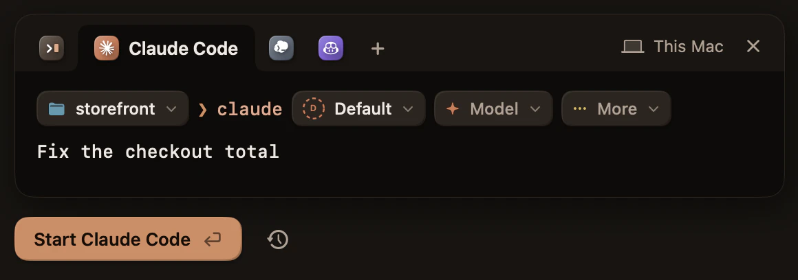
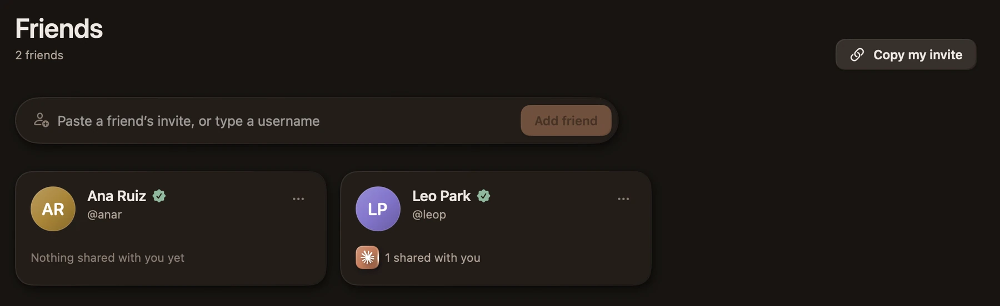

# Πρώτα βήματα

[English](../GETTING_STARTED.md) · [Deutsch](../de/GETTING_STARTED.md) · **Ελληνικά** · [Español](../es/GETTING_STARTED.md) · [Français](../fr/GETTING_STARTED.md) · [Italiano](../it/GETTING_STARTED.md) · [日本語](../ja/GETTING_STARTED.md) · [한국어](../ko/GETTING_STARTED.md) · [简体中文](../zh-Hans/GETTING_STARTED.md)

[Κατεβάστε το Kodosi](README.md#λήψη-του-kodosi) για τον υπολογιστή σας. Αυτός ο οδηγός
χρησιμοποιεί τα πλήκτρα του Mac· σε Linux και Windows, χρησιμοποιήστε Ctrl+Shift με το ίδιο
γράμμα.

## 1. Σύνδεση

Ανοίξτε το Kodosi και επιλέξτε Σύνδεση στο κάτω μέρος της πλαϊνής στήλης. Το Kodosi ανοίγει
τον browser σας, όπου συνδέεστε. Σε ένα τερματικό, το `kodosi auth login` δείχνει έναν κωδικό
για να τον εισαγάγετε σε οποιονδήποτε browser.

Χωρίς λογαριασμό, το Kodosi τρέχει τερματικά σε αυτόν τον υπολογιστή. Συνδεθείτε για να
χρησιμοποιήσετε τους άλλους υπολογιστές σας, τους φίλους και τα δωμάτια.

## 2. Ξεκινήστε έναν agent

Επιλέξτε Νέο τερματικό (⌘N). Διαλέξτε έναν agent και έναν φάκελο και, αν θέλετε, λογαριασμό,
μοντέλο και ένταση σκέψης. Πληκτρολογήστε ένα πρώτο prompt και πατήστε Return. Το Kodosi
πληκτρολογεί την εντολή στο shell του νέου τερματικού.

- Για ένα απλό τερματικό, πατήστε ⌘T (Ctrl+Shift+T σε Linux και Windows). Ανοίγει αμέσως
  στον φάκελο του επιλεγμένου τερματικού.
- Τα πλήκτρα ακολουθούν το Ghostty. Τα ⌘1 έως ⌘9 επιλέγουν ένα τερματικό (Alt+1 έως Alt+9
  σε Linux και Windows), το ⌥⌘ με ένα βέλος επιλέγει το διπλανό (Ctrl+Alt με ένα βέλος) και
  το ⌘W κλείνει το επιλεγμένο τερματικό. Οι Ρυθμίσεις › Συντομεύσεις δείχνουν κάθε πλήκτρο
  και το αλλάζουν.
- Αν λείπει ένας agent, το launcher δείχνει την εντολή εγκατάστασής του.
- Ένας νέος λογαριασμός παίρνει τον δικό του φάκελο σύνδεσης, όπως `~/.claude-work`. Το
  Kodosi βρίσκει επίσης τους λογαριασμούς που ορίζει το shell σας, όπως
  `alias cw='CLAUDE_CONFIG_DIR=~/.claude-work claude'`.
- Σε ένα τερματικό που περιμένει στο prompt του, το κουμπί ενεργειών (δύο ρυθμιστικά) στην
  κεφαλίδα του δείχνει τους εγκατεστημένους agents. Επιλέξτε έναν για να τον ξεκινήσετε με
  την τελευταία σας επιλογή.
- Σε zsh και bash (όχι στο bash 3.2 του macOS), τα ⌘↑ και ⌘↓ πηγαίνουν από prompt σε prompt.
- Κάντε ⌘-κλικ σε έναν σύνδεσμο για να τον ανοίξετε (Ctrl-κλικ σε Linux και Windows). Σε
  πρόγραμμα που χρησιμοποιεί το ποντίκι, κρατήστε πατημένο και το Shift. Στο iPhone, πατήστε
  τον σύνδεσμο· ένα πάτημα δεν ανοίγει σύνδεσμο σε πρόγραμμα που χρησιμοποιεί το ποντίκι. Ο
  σύνδεσμος ανοίγει στον δικό σας browser, στη συσκευή που χρησιμοποιείτε. Το Kodosi ρωτά
  πριν ανοίξει έναν σύνδεσμο σε άλλη εφαρμογή. Δεν ανοίγει αρχείο που μπορεί να τρέξει
  πρόγραμμα, ούτε αρχείο ή διεύθυνση `localhost` ενός τερματικού σε άλλον υπολογιστή.
- Για να δώσετε σε έναν agent μια εικόνα, όπως ένα στιγμιότυπο οθόνης, επικολλήστε την με
  ⌘V (Ctrl+Shift+V σε Linux και Windows, Επικόλληση στο iPhone). Το Kodosi την αποθηκεύει
  στον υπολογιστή του τερματικού και επικολλά τη διαδρομή του αρχείου της, και ο agent την
  επισυνάπτει. Ένα τερματικό σε άλλον υπολογιστή δείχνει πόση από την εικόνα έφτασε. Το
  δικό του πλήκτρο του agent για εικόνες, όπως το Ctrl+V στο Claude Code, διαβάζει το
  πρόχειρο του υπολογιστή όπου τρέχει ο agent.
- Για να δώσετε σε έναν agent το δικό του αντίγραφο ενός αποθετηρίου, περάστε τον δείκτη
  πάνω από τον φάκελο του αποθετηρίου στην πλαϊνή στήλη, επιλέξτε το κουμπί branch και δώστε
  όνομα σε ένα branch. Το Kodosi ξεκινά το τερματικό σε νέο Git worktree. Όταν το τερματικό
  τελειώσει, το Kodosi αφαιρεί το worktree αν δεν άλλαξε τίποτα. Οι Ρυθμίσεις › Τερματικό
  ορίζουν πού πηγαίνουν αυτοί οι φάκελοι.

Ένα τερματικό είναι ένα πραγματικό shell στον υπολογιστή που το τρέχει. Η Ελαχιστοποίηση
κρύβει ένα τερματικό και το αφήνει να τρέχει· το Κλείσιμο το τερματίζει μαζί με τα
προγράμματά του. Όταν κλείνετε το παράθυρο, το Kodosi και τα τερματικά σας συνεχίζουν να
τρέχουν και το εικονίδιο του Kodosi μένει στη γραμμή μενού ή στην περιοχή ειδοποιήσεων· σε
επιφάνεια εργασίας χωρίς περιοχή ειδοποιήσεων, το κλείσιμο του παραθύρου τερματίζει το
Kodosi. Όταν τερματίζετε το Kodosi, τα τερματικά σας σταματούν. Το Kodosi αποθηκεύει ό,τι
δείχνουν στον υπολογιστή σας και πουθενά αλλού. Όταν ανοίξετε ξανά το Kodosi, ξεκινούν πάλι
στους φακέλους, στα δωμάτια και στις θέσεις τους στη σκηνή, με την προηγούμενη οθόνη και το
ιστορικό τους πάνω από ένα νέο prompt (στα Windows, κάντε κύλιση προς τα πάνω για να το δείτε).
Τα Claude Code, Codex και Copilot CLI συνεχίζουν τις συζητήσεις τους, και σε Mac ή σε Linux
κρατούν το μοντέλο και την ένταση σκέψης που επιλέξατε. Όταν το Kodosi δεν μπορεί να καταλάβει
ποια συζήτηση έδειχνε ένας agent, ο agent δείχνει τις συζητήσεις του για να συνεχίσετε μία.
Στις Ρυθμίσεις επιλέγετε τι κάνει το κλείσιμο του παραθύρου.

Σε Mac, τα προγράμματα στα τερματικά σας έχουν τις άδειες που δίνετε στο Kodosi, όπως σε
κάθε εφαρμογή τερματικού. Όταν το macOS λέει ότι εμπόδισε το Kodosi να τροποποιήσει
εφαρμογές, ένα πρόγραμμα σε ένα τερματικό προσπάθησε να αλλάξει μια άλλη εφαρμογή. Για να το
επιτρέψετε, ενεργοποιήστε το Kodosi στη Διαχείριση εφαρμογών· οι Ρυθμίσεις › Γενικά την
ανοίγουν. Εκεί επιτρέπετε επίσης τον Έλεγχο συσκευής και πρόσβαση σε δεδομένα
(Προσβασιμότητα πριν από το macOS 27) και την Εγγραφή οθόνης και ήχου συστήματος, για
προγράμματα που ελέγχουν εφαρμογές ή βλέπουν την οθόνη.

## 3. Δείτε ποιος agent σας χρειάζεται

Το εικονίδιο κάθε τερματικού δείχνει τι κάνει το πρόγραμμά του.

| Βλέπετε | Σημαίνει |
| --- | --- |
| Ένα ζεστό φως που κάνει κύκλους γύρω από το εικονίδιο | Δουλεύει. Το περίγραμμα γεμίζει για να δείξει ποσοστό. |
| Ένα χέρι, ένα ερωτηματικό ή ένα κλειδί | Περιμένει την έγκριση, την απάντηση ή τη σύνδεσή σας. |
| Ένα πράσινο τικ | Τελείωσε. |
| Ένα κίτρινο σήμα προειδοποίησης | Απέτυχε. |

Το τικ και η προειδοποίηση φεύγουν όταν ανοίγετε το τερματικό. Όσο το Kodosi είναι στο
παρασκήνιο, μια ειδοποίηση σας λέει πότε ένα από τα τερματικά σας αρχίζει να περιμένει,
τελειώνει ή αποτυγχάνει. Τα προγράμματα αναφέρουν την κατάστασή τους με το
[Program Status Protocol](https://www.superlogical.com/rex/docs/build/program-status) ή με
μια γραμμή προόδου. Ένα πρόγραμμα που δεν αναφέρει τίποτα δεν δείχνει κατάσταση.

## 4. Δείτε τι δείχνει ένας agent

Ένας agent μπορεί να σας δείξει μια σελίδα, Markdown, μια εικόνα, ένα PDF, ένα έγγραφο, ένα
φύλλο ή μια παρουσίαση στο canvas του τερματικού του και να χρησιμοποιήσει έναν browser που
μοιράζεστε μαζί του. Οι agents που ξεκινά το Kodosi ξέρουν πώς· σε άλλον agent πείτε να
διαβάσει το `kodosi skill canvas`. Όταν το canvas έχει κάτι, η κεφαλίδα του τερματικού δείχνει
ένα κουμπί για τα αρχεία του και ένα για τον browser του, με μια χάλκινη τελεία για τα νέα.
Επιλέξτε ένα για να ανοίξετε το canvas δίπλα στο τερματικό· το Περισσότερος χώρος δίνει στο
canvas τη σκηνή και κρατά το τερματικό μικρό στη γωνία του. Κλείστε ένα μέρος με το × στο
κουμπί του και ανοίξτε το ξανά με το +. Το Άνοιγμα browser στο κουμπί ενεργειών ανοίγει τον
browser πριν τον χρησιμοποιήσει ο agent, και η Προσθήκη αρχείου… βάζει ένα αρχείο στο canvas
και στον φάκελο του τερματικού· μπορείτε επίσης να αφήσετε ένα αρχείο πάνω στο canvas. Στο
iPhone, το κουμπί του canvas είναι στη γραμμή του τερματικού.

- Ένα έγγραφο, ένα φύλλο, μια παρουσίαση, ένα PDF ή ένα αρχείο κειμένου είναι ζωντανό:
  εσείς, τα άτομα στο τερματικό και ο agent το επεξεργάζεστε ταυτόχρονα, και παραμένει ένα
  κανονικό αρχείο στον φάκελό του. Όταν ένα έγγραφο έχει παρακολουθούμενες αλλαγές, η γραμμή
  του έχει ένα κουμπί που τις αποδέχεται ή τις απορρίπτει. Οι Ρυθμίσεις › Έγγραφα
  ενεργοποιούν ή απενεργοποιούν κάθε προβολή, δείχνουν τα έγγραφα ως σελίδες ή ως κείμενο
  που προσαρμόζεται στο canvas και κάνουν τις σελίδες σκοτεινές όταν το Kodosi είναι
  σκοτεινό.
- Μια σελίδα δεν έχει δίκτυο. Οι σύνδεσμοι σε σελίδες, έγγραφα, φύλλα, παρουσιάσεις και PDF
  ανοίγουν στον δικό σας browser με τους ίδιους κανόνες όπως οι σύνδεσμοι του τερματικού.
  Όπου μπορείτε να επεξεργαστείτε, κάντε ⌘-κλικ σε έναν σύνδεσμο (Ctrl-κλικ σε Linux και
  Windows)· αλλού τον ανοίγει ένα κλικ, και στο iPhone ένα πάτημα. Ένας σύνδεσμος προς μια
  διαφάνεια ή ένα κελί του ίδιου αρχείου πηγαίνει εκεί.
- Επιλέξτε λέξεις σε μια σελίδα ή σε ένα έγγραφο και μετά Ερώτηση γι' αυτό. Το Kodosi
  πληκτρολογεί το αρχείο και τις λέξεις στο τερματικό, και εσείς γράφετε την ερώτηση.
- Κάντε κλικ και πληκτρολογήστε στον κοινόχρηστο browser όπως στον δικό σας. Ο agent βλέπει
  τις ίδιες σελίδες και συνδέσεις, και η επόμενη εντολή του τού λέει ότι χρησιμοποιήσατε τον
  browser. Μετά από 10 λεπτά χωρίς χρήση ο browser κοιμάται, και ανοίγει ξανά την τελευταία
  του σελίδα όταν τον κοιτάξετε ή όταν τον χρησιμοποιήσει ο agent. Ο πρώτος browser σε έναν
  υπολογιστή κατεβάζει το Kodosi Browser, γι' αυτό παίρνει λίγο χρόνο.
- Για να χρησιμοποιήσετε τις συνδέσεις σας στα ιδιωτικά σας τερματικά, επιλέξτε Αντιγραφή
  δίπλα σε έναν browser στις Ρυθμίσεις › Browser. Η Αφαίρεση παίρνει πίσω ό,τι αντιγράψατε,
  και η Αφαίρεση όλων αφαιρεί κάθε σύνδεση και όλα τα δεδομένα ιστοτόπων των ιδιωτικών σας
  τερματικών. Σε Mac, όταν το macOS κρατά τις συνδέσεις ενός browser μακριά από το Kodosi,
  όπως του Safari, επιλέξτε Να επιτρέπεται… δίπλα στον browser για να δώσετε στο Kodosi
  Πλήρη πρόσβαση στον δίσκο.
- Στο ίδιο δίκτυο, η εικόνα του browser πηγαίνει απευθείας ανάμεσα στις συσκευές σας. Τα
  macOS και iOS ζητούν μία φορά πρόσβαση στο τοπικό δίκτυο· χωρίς αυτήν, η εικόνα περνά από
  την υπηρεσία.
- Όλοι όσοι μπορούν να ανοίξουν το τερματικό βλέπουν το canvas του και χρησιμοποιούν τον
  browser του. Όταν το τερματικό κλείσει, το canvas του και οι συνδέσεις του browser
  χάνονται.

## 5. Ρωτήστε το Dosi

Το Dosi είναι ο agent σας για τους άλλους agents σας. Επιλέξτε το πρόσωπο του Dosi στο κάτω
μέρος της πλαϊνής στήλης (⌘J). Το Dosi τρέχει με Claude Code ή Codex· οι Ρυθμίσεις › Dosi
επιλέγουν ποιο, μαζί με τον λογαριασμό, το μοντέλο και την ένταση σκέψης.

  <picture>
    <source media="(prefers-reduced-motion: reduce)" srcset="../media/dosi-still.webp">
    
  </picture>

Ρωτήστε το Dosi τι σας χρειάζεται ή ζητήστε του να κάνει κάτι. Το Dosi διαβάζει τα τερματικά
και τα δωμάτιά σας, απαντά, και πληκτρολογεί, ξεκινά και κλείνει πράγματα για εσάς. Όταν
χρειάζεται μια επιλογή, ρωτά με κουμπιά, και μπορείτε επίσης να απαντήσετε με δικά σας λόγια.
Η συζήτησή σας με το Dosi είναι ίδια σε όλες τις συσκευές σας. Σε iPhone ή iPad, η καρτέλα
Dosi γράφει στο Dosi του υπολογιστή που επιλέγετε πάνω από το μήνυμα, αρχικά εκείνου που
απάντησε τελευταίος. Ένα μήνυμα για υπολογιστή εκτός σύνδεσης περιμένει μέχρι να ανοίξει
ξανά το Kodosi, και το Να μην σταλεί το παίρνει πίσω.

Η γραμμή δίπλα στο πρόσωπο του Dosi σας λέει πότε δουλεύει, πότε απάντησε και πότε έχει μια
ερώτηση. Σε υπολογιστή χωρίς agent, γράφει Ρύθμιση του Dosi και ανοίγει τις Ρυθμίσεις › Dosi.
Για να αφαιρέσετε το Dosi από έναν υπολογιστή, απενεργοποιήστε τη Χρήση του Dosi στις
Ρυθμίσεις › Dosi.

## 6. Προσθέστε τους άλλους υπολογιστές σας

Συνδεθείτε στον νέο υπολογιστή με τον ίδιο λογαριασμό. Δείχνει έναν κωδικό, και οι
υπολογιστές που ήδη χρησιμοποιείτε σας ζητούν να τον εγκρίνετε. Επιλέξτε Έγκριση σε έναν από
αυτούς και εισαγάγετε τον κωδικό. Ένα iPhone ή iPad μπαίνει με τον ίδιο τρόπο. Μετά, κάθε
υπολογιστής δείχνει τα τερματικά όλων των υπολογιστών σας.

Για να ξεκινήσετε ένα τερματικό σε άλλον από τους υπολογιστές σας, επιλέξτε αυτόν τον
υπολογιστή στη δεξιά άκρη της λωρίδας του launcher. Το κουμπί φακέλου δείχνει τότε τους
πρόσφατους φακέλους του, και η Επιλογή φακέλου… ανοίγει τους φακέλους στον αρχικό του
κατάλογο. Σε iPhone ή iPad, επιλέξτε + στα Τερματικά ή το + δίπλα σε έναν από τους
υπολογιστές σας. Σε εκείνον τον υπολογιστή πρέπει να είναι ανοιχτό το Kodosi ή να τρέχει το
`kodosi host` σε ένα τερματικό.

Δημιουργήστε εκεί και ένα κλειδί ανάκτησης και φυλάξτε το καλά. Αν χάσετε όλες τις συσκευές
σας, συνδεθείτε σε μια νέα και επιλέξτε «Χρήση του κλειδιού ανάκτησής μου» για να κρατήσετε
τους φίλους και τα δωμάτιά σας. Αφαιρέστε μια χαμένη συσκευή από άλλη συσκευή. Αν μια
συσκευή κλάπηκε, δημιουργήστε επίσης νέο κλειδί ανάκτησης.

## 7. Δουλέψτε με φίλους

Ανοίξτε τους Φίλους από το μενού δίπλα στον λογαριασμό σας. Στείλτε την πρόσκλησή σας ή
επικολλήστε την πρόσκληση ή το όνομα χρήστη ενός φίλου. Με μια πρόσκληση, το Kodosi μπορεί
να επαληθεύσει τον φίλο σας.

Για να μοιραστείτε ένα τερματικό, επιλέξτε Κοινή χρήση στο κουμπί ενεργειών της κεφαλίδας
του και διαλέξτε φίλους ή δωμάτια. Τα άτομα με τα οποία το μοιράζεστε παίρνουν πλήρη έλεγχο,
με τα δικαιώματά σας σε εκείνον τον υπολογιστή. Τα άλλα τερματικά σας μένουν ιδιωτικά.

Ένα δωμάτιο έχει κοινόχρηστα τερματικά, μια συζήτηση και εργασίες. Επιλέξτε + δίπλα στα
Δωμάτια, προσθέστε φίλους και μετά ξεκινήστε ένα τερματικό στο δωμάτιο ή μοιραστείτε ένα σε
αυτό.

- Όλα τα μέλη μπορούν να χρησιμοποιούν τα κοινόχρηστα τερματικά και να μοιράζονται τα δικά
  τους. Όσοι μπαίνουν αργότερα παίρνουν τα τερματικά και όλη τη συζήτηση. Τα αρχεία μένουν
  στον υπολογιστή κάθε τερματικού.
- Βάλτε εργασίες στη διάθεση όλων, αναλάβετέ τες, αποδεσμεύστε τες, κλείστε τες με ένα
  αποτέλεσμα ή ανοίξτε τες ξανά.
- Συνδέστε αποθετήρια GitHub ή Gitea για να γίνουν τα issues εργασίες· όταν αλλάζετε μια
  τέτοια εργασία, το Kodosi αλλάζει το issue της. Το GitHub χρησιμοποιεί τη σύνδεσή σας στο
  `gh` ή τον Git credential helper, και το Gitea τον credential helper ή το
  `KODOSI_GITEA_TOKEN` για τον διακομιστή του `KODOSI_GITEA_URL`. Τα διαπιστευτήριά σας
  μένουν στον υπολογιστή σας.
- Γράψτε `@` και το όνομα ενός τερματικού στο chat, και το Kodosi δίνει στον agent εκείνου του
  τερματικού το μήνυμά σας, με το όνομά σας και το δωμάτιο· ο agent αποφασίζει τι θα κάνει
  με αυτό. Οι agents που ξεκινά το Kodosi ξέρουν ότι τρέχουν στο Kodosi, και το `kodosi skill`
  τυπώνει το [skill](../../runtime/skills/kodosi/SKILL.md) που επιτρέπει σε έναν agent να
  συμμετέχει. Σε τερματικό του Kodosi, η εντολή βρίσκει το δωμάτιο· αλλού, προσθέστε
  `--room <name>`.

## 8. Χρησιμοποιήστε τη γραμμή εντολών

Η εντολή `kodosi` δουλεύει στα ίδια τερματικά με την εφαρμογή, και η εφαρμογή δείχνει τι κάνει.

| Εντολή | Τι κάνει |
| --- | --- |
| `kodosi terminal start --agent claude --prompt "fix the failing test"` | Ξεκινά έναν agent με την τελευταία σας επιλογή. Τα `--account`, `--model` και `--effort` την αλλάζουν. |
| `kodosi terminal start --directory <repository> --branch <name>` | Ξεκινά ένα τερματικό σε νέο branch, στο δικό του worktree. |
| `kodosi terminal start --computer <computer> --directory <folder>` | Ξεκινά ένα τερματικό σε άλλον από τους υπολογιστές σας. Ένας σχετικός φάκελος, ή ένας που αρχίζει με `~`, είναι στον αρχικό σας κατάλογο εκεί. Το `kodosi devices list` δείχνει ποιοι υπολογιστές είναι σε σύνδεση. |
| `kodosi agent list` | Δείχνει τους agents, τους λογαριασμούς τους και την τελευταία σας επιλογή. |
| `kodosi agent usage` | Δείχνει πόσο από τα όρια του προγράμματος έχει χρησιμοποιήσει κάθε συνδεδεμένος λογαριασμός Claude Code, Codex και Copilot CLI. |
| `kodosi terminal list` | Δείχνει τα τερματικά σας με τα ονόματα και τα αναγνωριστικά τους. Δώστε ένα από τα δύο ως `<terminal>`. |
| `kodosi terminal read <terminal>` | Τυπώνει την οθόνη. Το `--history` προσθέτει τις γραμμές που κύλησαν εκτός. |
| `kodosi terminal message <terminal> "Can you review my branch?"` | Δίνει στον agent ενός τερματικού ένα μήνυμα, με το ποιος το στέλνει και από πού. |
| `kodosi terminal input <terminal> --enter "make test"` | Πληκτρολογεί μια γραμμή. |
| `kodosi terminal keys <terminal> ctrl-c` | Πατά πλήκτρα. |
| `kodosi terminal wait <terminal> --until done,failed` | Περιμένει μια κατάσταση. |
| `kodosi terminal show <terminal>` | Δείχνει το τερματικό στην εφαρμογή. |
| `kodosi dosi say "What needs me?"` | Ρωτά το Dosi. Το `kodosi dosi show` τυπώνει τη συζήτηση, και το `kodosi dosi stop` σταματά το Dosi. |
| `kodosi show <file>` | Δείχνει ένα αρχείο στο canvas αυτού του τερματικού. Το `kodosi canvas` δείχνει τι εμφανίζει, και το `kodosi canvas remove <file>` αφαιρεί ένα αρχείο. |
| `kodosi browser open <address>` | Ανοίγει μια σελίδα στον κοινόχρηστο browser αυτού του τερματικού. Δουλεύουν και οι άλλες εντολές του agent-browser. |
| `kodosi skill` | Τυπώνει το skill που επιτρέπει σε έναν agent να δουλεύει με τους ανθρώπους και τους agents στο Kodosi. Το `kodosi skill canvas` τυπώνει το skill για το canvas. |
| `kodosi dosi skill` | Τυπώνει το skill που επιτρέπει σε άλλον agent να ενεργεί ως Dosi. |
| `kodosi host` | Κρατά τα τερματικά σας σε λειτουργία αφού κλείσετε την εφαρμογή. Το `kodosi host stop` σταματά έναν host που τρέχει στο παρασκήνιο. |

Τα `message`, `input` και `keys` σταματούν με ένα μήνυμα όσο πληκτρολογείτε σε εκείνο το
τερματικό. Το `message` σταματά επίσης όσο ο agent περιμένει απάντηση από ένα άτομο.

## Αν κάτι δεν συνδέεται

Βεβαιωθείτε ότι ο υπολογιστής του τερματικού είναι σε σύνδεση, με το Kodosi ανοιχτό, και ότι
το τερματικό είναι ακόμη κοινόχρηστο. Μια νέα συσκευή μπορεί να χρειάζεται έγκριση, και ένας
φίλος με αλλαγμένη ταυτότητα μπορεί να χρειάζεται επαλήθευση στους Φίλους. Μετά από μια
χαμένη σύνδεση, το Kodosi δείχνει ξανά την τρέχουσα κατάσταση. Όταν το Kodosi λέει ότι ένας
υπολογιστής είναι εκτός σύνδεσης, τα τερματικά του ανοίγουν ξανά όταν επιστρέψει, εκτός αν
τερματίστηκαν εκεί. Για να βγάλετε ένα τέτοιο τερματικό από τη λίστα σας, επιλέξτε το X του.
Η Απόκρυψη μέχρι να επιστρέψει το δείχνει ξανά όταν ο υπολογιστής επιστρέψει, και το Οριστικό
κλείσιμο το κλείνει τότε. Αν το Kodosi λέει ότι δεν είναι σίγουρο πως έφτασε αυτό που
πληκτρολογήσατε, κοιτάξτε το τερματικό πριν πληκτρολογήσετε ξανά την εντολή.
