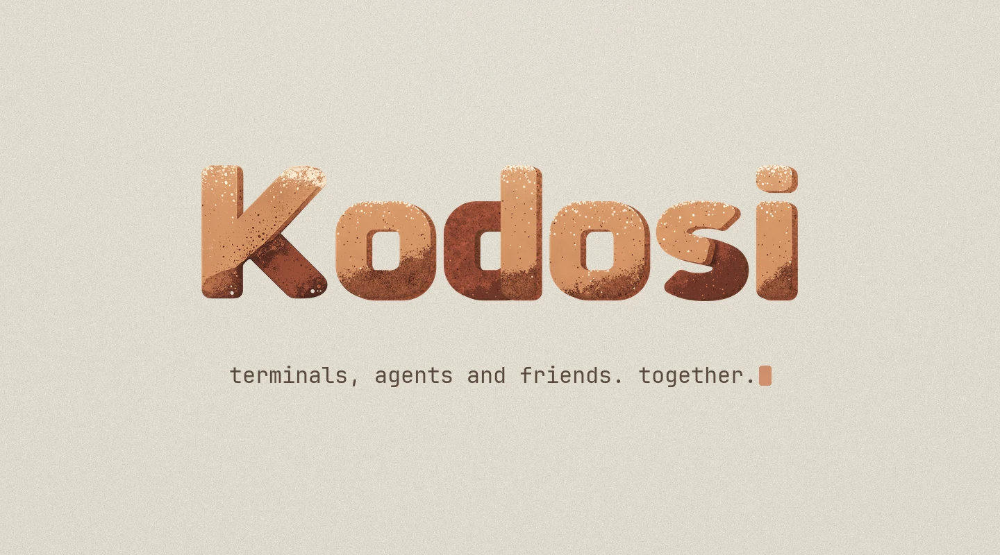

  

<h3 align="center">Μια εφαρμογή τερματικού για εσάς, τους coding agents σας και τους φίλους σας.</h3>

  Δείτε ποιος agent σας χρειάζεται σε όλους τους υπολογιστές σας, δείτε τι φτιάχνει δίπλα στο τερματικό του 
  και δουλέψτε σε κοινόχρηστα τερματικά με τους φίλους σας. Με κρυπτογράφηση από άκρο σε άκρο και ανοιχτό κώδικα.

  
  
  
  

  
  

  <a href="../../README.md">English</a> · <a href="../de/README.md">Deutsch</a> · <b>Ελληνικά</b> · <a href="../es/README.md">Español</a> · <a href="../fr/README.md">Français</a> · <a href="../it/README.md">Italiano</a> · <a href="../ja/README.md">日本語</a> · <a href="../ko/README.md">한국어</a> · <a href="../zh-Hans/README.md">简体中文</a>

  <picture>
    <source media="(prefers-color-scheme: light)" srcset="../media/app-light.webp">
    
  </picture>

## Τι κάνει το Kodosi

### Δείτε ποιος agent σας χρειάζεται

Το Claude Code, το Codex και άλλοι coding agents συχνά σταματούν και περιμένουν απάντηση από εσάς.
Το Kodosi συγκεντρώνει τα τερματικά από όλους τους υπολογιστές σας σε ένα παράθυρο, και κάθε
τερματικό δείχνει αν ο agent του δουλεύει, σας περιμένει, τελείωσε ή απέτυχε. Οι ειδοποιήσεις
φτάνουν στη συσκευή που χρησιμοποιείτε εκείνη τη στιγμή, ακόμα και στο τηλέφωνό σας. Οι agents σας
τρέχουν απευθείας μέσω των δικών τους CLI, με τις δικές τους ρυθμίσεις και τους δικούς τους
λογαριασμούς.

### Ρωτήστε τι σας χρειάζεται

Το Dosi είναι ένας agent για τους υπόλοιπους agents σας. Ελέγχει τα τερματικά σας, συνοψίζει τι σας
περιμένει και απαντά στο τερματικό μόλις αποφασίσετε τι θέλετε να γίνει.

  <picture>
    <source media="(prefers-reduced-motion: reduce)" srcset="../media/dosi-still.webp">
    
  </picture>

### Δείτε τι φτιάχνει ο agent σας

Σχέδια, ιστοσελίδες και έγγραφα ανοίγουν σε ένα canvas ακριβώς δίπλα στο τερματικό. Εσείς, οι φίλοι
σας και ο agent μπορείτε να επεξεργάζεστε ζωντανά έγγραφα μαζί, ταυτόχρονα.

  <picture>
    <source media="(prefers-reduced-motion: reduce)" srcset="../media/canvas-still.webp">
    
  </picture>

### Δουλέψτε μαζί

Μοιραστείτε ένα ζωντανό τερματικό με έναν φίλο, ή συγκεντρώστε τερματικά, μια συζήτηση και εργασίες
σε ένα έργο για ανθρώπους και τους agents τους.

### Ιδιωτικό και ανοιχτό

Τα τερματικά και τα έργα χρησιμοποιούν μετακβαντική κρυπτογράφηση από άκρο σε άκρο, ώστε το backend
να μην μπορεί να τα διαβάσει. Το Kodosi είναι ανοιχτού κώδικα και μπορείτε να τρέξετε τον διακομιστή
μόνοι σας.
[Ασφάλεια](SECURITY.md) · [Δικός σας διακομιστής](../SELF-HOSTING.md) (στα αγγλικά)

## Λήψη του Kodosi

| Πλατφόρμα | Απαιτήσεις | Εγκατάσταση |
| --- | --- | --- |
| Mac | Apple silicon, macOS 26 ή νεότερο | Ανοίξτε την εικόνα δίσκου και σύρετε το Kodosi στις Εφαρμογές, ή τρέξτε `brew install --cask johnkozaris/tap/kodosi`. Η εφαρμογή ενημερώνεται μόνη της. |
| Linux | x86-64, Ubuntu 24.04 ή Debian 13 ή νεότερο | Εγκαταστήστε το πακέτο Debian. Προσθέτει το αποθετήριο apt του Kodosi ώστε οι ενημερώσεις του συστήματος να διατηρούν το Kodosi ενημερωμένο. Η [τελευταία έκδοση](https://github.com/johnkozaris/Kodosi/releases/latest) περιλαμβάνει επίσης πακέτο για Arch και ένα φορητό αρχείο. |
| Windows | x64, Windows 11 24H2 ή νεότερο | Πριν ανοίξετε το πρόγραμμα εγκατάστασης για πρώτη φορά, προσθέστε ως διαχειριστής το [πιστοποιητικό του Kodosi](https://updates.kodosi.com/windows/Kodosi.cer) στο Τοπικός υπολογιστής › Αξιόπιστα άτομα. Η εφαρμογή ενημερώνεται μόνη της. |
| Android | ARM64, Android 15 ή νεότερο | Κατεβάστε το APK στη συσκευή σας, ανοίξτε το και επιτρέψτε την εγκατάσταση όταν σας το ζητήσει το Android. Οι ενημερώσεις εγκαθίστανται με τον ίδιο τρόπο. |
| iPhone και iPad | iOS 26 ή νεότερο | Κάντε build το Kodosi από τον πηγαίο κώδικα για [iPhone και iPad](../../clients/ios/README.md). |

Μόλις ολοκληρωθεί η εγκατάσταση, συνεχίστε στα [Πρώτα βήματα](GETTING_STARTED.md).

## Τεκμηρίωση

- [Πρώτα βήματα](GETTING_STARTED.md)
- [Ασφάλεια](SECURITY.md) και ο [σχεδιασμός της κρυπτογράφησης](../CRYPTOGRAPHY.md) (στα αγγλικά)
- [Αρχιτεκτονική](../ARCHITECTURE.md), [ανάπτυξη](../DEVELOPMENT.md) και
  [συνεισφορά](../../CONTRIBUTING.md) (στα αγγλικά)
- [Δικός σας διακομιστής](../SELF-HOSTING.md) (στα αγγλικά)

Αναφέρετε σφάλματα στα [GitHub issues](https://github.com/johnkozaris/Kodosi/issues) και ευπάθειες
[ιδιωτικά](SECURITY.md#αναφορά-ευπάθειας).

Δημιουργήθηκε από τον [John Kozaris](https://johnkozaris.com).

## Άδεια

Το Kodosi διατίθεται με την [Άδεια Apache 2.0](../../LICENSE). Το όνομα και το λογότυπο του Kodosi
δεν καλύπτονται από αυτή την άδεια: δείτε τα [Εμπορικά σήματα](../../TRADEMARKS.md) (στα αγγλικά)
για τους κανόνες χρήσης. Το Kodosi είναι φτιαγμένο με [Ghostty](https://ghostty.org), Rust, Swift,
Qt και ASP.NET Core. Δείτε τις [σημειώσεις τρίτων](../../terminal/ghostty/THIRD_PARTY_NOTICES.md)
και τις [πηγές των πολυμέσων](../media/README.md) για τις αναφορές δημιουργών.
