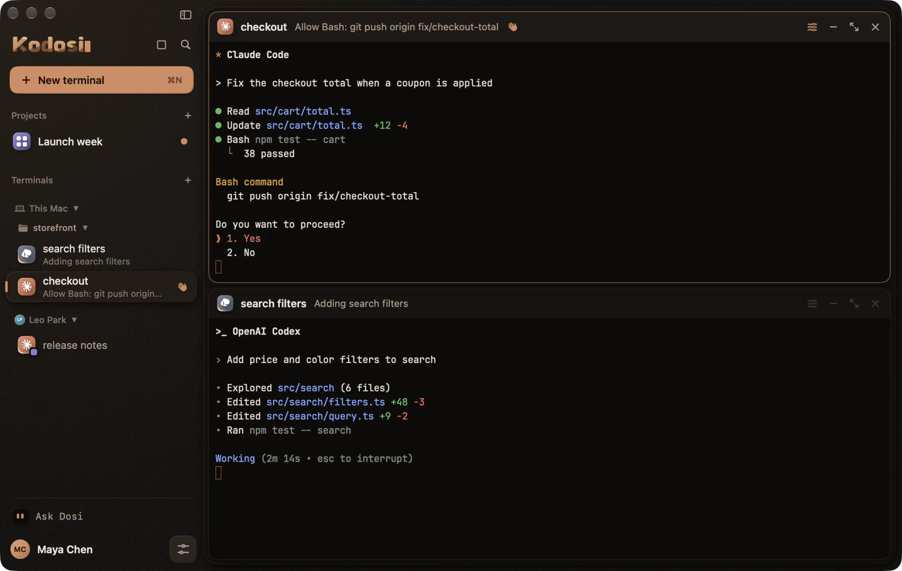

  

<h3 align="center">Una app de terminal para ti, tus agentes de programación y tus amigos.</h3>

  Comprueba qué agente te necesita en todos tus ordenadores, mira lo que crea junto a su terminal 
  y trabaja en terminales compartidos con tus amigos. Cifrado de extremo a extremo y de código abierto.

  
  
  
  

  
  

  <a href="../../README.md">English</a> · <a href="../de/README.md">Deutsch</a> · <a href="../el/README.md">Ελληνικά</a> · <b>Español</b> · <a href="../fr/README.md">Français</a> · <a href="../it/README.md">Italiano</a> · <a href="../ja/README.md">日本語</a> · <a href="../ko/README.md">한국어</a> · <a href="../zh-Hans/README.md">简体中文</a>

  <picture>
    <source media="(prefers-color-scheme: light)" srcset="../media/app-light.webp">
    
  </picture>

## Qué hace Kodosi

### Mira qué agente te necesita

Claude Code, Codex y otros agentes de programación se detienen con frecuencia a esperar tu
respuesta. Kodosi reúne los terminales de todos tus ordenadores en una sola ventana, y cada uno
muestra si su agente está trabajando, esperándote, ha terminado o ha fallado. Las notificaciones
llegan al dispositivo que estés usando en ese momento, incluido tu teléfono. Tus agentes se
ejecutan directamente a través de sus propias CLI, con sus propios ajustes y cuentas.

### Pregunta qué te necesita

Dosi es un agente para tus otros agentes. Revisa tus terminales, resume qué está esperando tu
atención y responde en el terminal en cuanto decides qué hacer.

  <picture>
    <source media="(prefers-reduced-motion: reduce)" srcset="../media/dosi-still.webp">
    
  </picture>

### Mira lo que crea tu agente

Los planes, páginas web y documentos se abren en un lienzo justo al lado del terminal. Tú, tus
amigos y el agente podéis editar documentos en directo a la vez.

  <picture>
    <source media="(prefers-reduced-motion: reduce)" srcset="../media/canvas-still.webp">
    
  </picture>

### Trabaja en equipo

Comparte un terminal en marcha con un amigo, o reúne terminales, un chat y tareas en un proyecto
para personas y sus agentes.

### Privado y abierto

Los terminales y los proyectos usan cifrado poscuántico de extremo a extremo, por lo que el
servidor no puede leerlos. Kodosi es de código abierto y puedes ejecutar el servidor por tu
cuenta.
[Seguridad](SECURITY.md) · [Alojamiento propio](../SELF-HOSTING.md) (en inglés)

## Descargar Kodosi

| Plataforma | Requisitos | Instalación |
| --- | --- | --- |
| Mac | Apple silicon, macOS 26 o posterior | Abre la imagen de disco y arrastra Kodosi a Aplicaciones, o ejecuta `brew install --cask johnkozaris/tap/kodosi`. La app se actualiza sola. |
| Linux | x86-64, Ubuntu 24.04 o Debian 13 o posterior | Instala el paquete Debian. Añade el repositorio apt de Kodosi para que las actualizaciones del sistema mantengan Kodosi al día. La [última versión](https://github.com/johnkozaris/Kodosi/releases/latest) también incluye un paquete para Arch y un archivo portable. |
| Windows | x64, Windows 11 24H2 o posterior | Antes de abrir el instalador por primera vez, añade como administrador el [certificado de Kodosi](https://updates.kodosi.com/windows/Kodosi.cer) a Equipo local › Personas de confianza. La app se actualiza sola. |
| Android | ARM64, Android 15 o posterior | Descarga el APK en tu dispositivo, ábrelo y permite la instalación cuando Android te lo pida. Las actualizaciones se instalan del mismo modo. |
| iPhone y iPad | iOS 26 o posterior | Compila Kodosi desde el código fuente para [iPhone y iPad](../../clients/ios/README.md). |

Una vez instalado, ve a [Primeros pasos](GETTING_STARTED.md).

## Documentación

- [Primeros pasos](GETTING_STARTED.md)
- [Seguridad](SECURITY.md) y el [diseño del cifrado](../CRYPTOGRAPHY.md) (en inglés)
- [Arquitectura](../ARCHITECTURE.md), [desarrollo](../DEVELOPMENT.md) y [cómo contribuir](../../CONTRIBUTING.md) (en inglés)
- [Alojamiento propio](../SELF-HOSTING.md) (en inglés)

Informa de errores en las [issues de GitHub](https://github.com/johnkozaris/Kodosi/issues) y
comunica las vulnerabilidades [en privado](SECURITY.md#informar-de-una-vulnerabilidad).

Creado por [John Kozaris](https://johnkozaris.com).

## Licencia

Kodosi se distribuye bajo la [licencia Apache 2.0](../../LICENSE). El nombre y el logotipo de
Kodosi no están cubiertos por esa licencia; consulta las [marcas registradas](../../TRADEMARKS.md)
(en inglés) para ver las normas de uso. Kodosi está desarrollado con
[Ghostty](https://ghostty.org), Rust, Swift, Qt y ASP.NET Core. Consulta los
[avisos de terceros](../../terminal/ghostty/THIRD_PARTY_NOTICES.md) y los
[créditos de las imágenes](../media/README.md) para ver las atribuciones.
