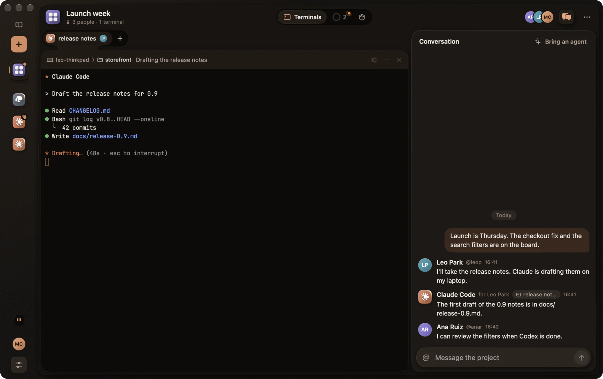

# Prise en main

[English](../GETTING_STARTED.md) · [Deutsch](../de/GETTING_STARTED.md) · [Ελληνικά](../el/GETTING_STARTED.md) · [Español](../es/GETTING_STARTED.md) · **Français** · [Italiano](../it/GETTING_STARTED.md) · [日本語](../ja/GETTING_STARTED.md) · [한국어](../ko/GETTING_STARTED.md) · [简体中文](../zh-Hans/GETTING_STARTED.md)

[Téléchargez Kodosi](README.md#obtenir-kodosi) pour votre ordinateur. Ce guide utilise les
touches du Mac ; sous Linux et Windows, utilisez Ctrl+Maj avec la même lettre.

## 1. Se connecter

Ouvrez Kodosi et choisissez Se connecter en bas de la barre latérale. Kodosi ouvre votre
navigateur, où vous vous connectez. Dans un terminal, `kodosi auth login` affiche un code à
saisir dans n'importe quel navigateur.

Sans compte, Kodosi exécute des terminaux sur cet ordinateur. Connectez-vous pour utiliser vos
autres ordinateurs, vos amis et vos projets.

## 2. Lancer un agent

Choisissez Nouveau terminal (⌘N). Choisissez un agent et un dossier et, si vous voulez, un
compte, un modèle et un effort. Tapez un premier prompt et appuyez sur Retour. Kodosi tape la
commande dans le shell du nouveau terminal.

- Pour un terminal simple, appuyez sur ⌘D (Ctrl+Maj+O sous Linux et Windows). Il s'ouvre
  aussitôt dans le dossier du terminal sélectionné. ⌘T (Ctrl+Maj+T) l'ouvre avec l'agent du
  terminal sélectionné, avec le même compte et les mêmes choix.
- Les touches suivent Ghostty. ⌘1 à ⌘9 sélectionnent un terminal (Alt+1 à Alt+9 sous Linux
  et Windows), ⌥⌘ avec une flèche sélectionne celui d'à côté (Ctrl+Alt avec une flèche) et ⌘W
  ferme le terminal sélectionné. Réglages › Raccourcis liste chaque touche et permet de la
  changer.
- S'il manque un agent, le lanceur affiche sa commande d'installation.
- Les agents démarrent en Accès total. Ils modifient des fichiers et lancent des commandes
  sans vous demander. Pour qu'un agent demande d'abord, choisissez Demander dans Plus, après
  le modèle. Vous y choisissez aussi la verbosité, ce que Claude Code, Codex et Copilot CLI
  montrent de leur travail ; ils commencent en Discrète. Copilot CLI ne lit sa verbosité que
  dans ses propres réglages ; Kodosi les modifie donc tant que Copilot CLI tourne en
  Discrète, puis les rétablit.
- Un nouveau compte a son propre dossier de connexion, par exemple `~/.claude-work`. Kodosi
  trouve aussi les comptes que votre shell configure, comme
  `alias cw='CLAUDE_CONFIG_DIR=~/.claude-work claude'`.
- Dans un terminal qui attend à son prompt, le bouton d'actions (deux curseurs) de son
  en-tête liste les agents installés. Choisissez-en un pour le lancer avec votre dernier
  choix.
- Pendant qu'un agent tourne, le même bouton d'actions change son modèle et son effort et,
  pour certains agents, ses autorisations, avec les propres commandes de l'agent, sans le
  relancer. Un changement attend la fin du tour de l'agent, et Claude Code garde aussi le
  modèle et l'effort pour ses prochaines sessions.
- Dans zsh et bash (pas le bash 3.2 de macOS), ⌘↑ et ⌘↓ sautent d'un prompt à l'autre.
- Faites ⌘-clic sur un lien pour l'ouvrir (Ctrl-clic sous Linux et Windows). Dans un
  programme qui utilise la souris, maintenez aussi Maj. Sur l'iPhone, touchez le lien ; un
  toucher n'ouvre pas de lien dans un programme qui utilise la souris. Le lien s'ouvre dans
  votre propre navigateur, sur l'appareil que vous utilisez. Kodosi demande avant d'ouvrir un
  lien dans une autre app. Il n'ouvre pas un fichier qui peut exécuter un programme, ni un
  fichier ou une adresse `localhost` d'un terminal sur un autre ordinateur.
- Pour donner une image à un agent, comme une capture d'écran, collez-la avec ⌘V
  (Ctrl+Maj+V sous Linux et Windows, Coller sur l'iPhone). Kodosi l'enregistre sur
  l'ordinateur du terminal et colle le chemin de son fichier, et l'agent la joint. Un
  terminal sur un autre ordinateur montre quelle part de l'image est arrivée. La touche de
  l'agent pour les images, comme Ctrl+V dans Claude Code, lit le presse-papiers de
  l'ordinateur où l'agent s'exécute.
- Pour donner à un agent sa propre copie d'un dépôt, survolez le dossier du dépôt dans la
  barre latérale, choisissez le bouton de branche et nommez une branche. Kodosi lance le
  terminal dans un nouveau worktree Git. Quand le terminal se termine, Kodosi retire le
  worktree si rien n'a changé. Réglages › Terminal définit où vont ces dossiers.

Un terminal est un vrai shell sur l'ordinateur qui l'exécute. Réduire masque un terminal et le
laisse tourner ; Fermer le termine avec ses programmes. Quand vous fermez la fenêtre, Kodosi et
vos terminaux continuent de tourner, et l'icône de Kodosi reste dans la barre des menus ou la
zone de notification ; sur un bureau sans zone de notification, fermer la fenêtre quitte
Kodosi. Quand vous quittez Kodosi, vos terminaux s'arrêtent. Kodosi enregistre ce qu'ils
affichent sur votre ordinateur et nulle part ailleurs. Quand vous rouvrez Kodosi, ils
redémarrent dans leurs dossiers, leurs projets et leurs places sur la scène, avec leur écran et
leur historique précédents au-dessus d'un nouveau prompt (sous Windows, faites défiler vers le
haut pour les voir). Claude Code, Codex et Copilot CLI reprennent leurs conversations et, sur
un Mac ou sous Linux, gardent le modèle, l'effort, les autorisations et la sortie que vous avez
choisis. Quand Kodosi ne peut pas savoir quelle conversation un agent affichait, l'agent
affiche ses conversations pour que vous en repreniez une. Dans les Réglages, vous choisissez ce
que fait la fermeture de la fenêtre.

Sur un Mac, les programmes de vos terminaux ont les autorisations que vous donnez à Kodosi,
comme dans toute app de terminal. Quand macOS indique avoir empêché Kodosi de modifier des
apps, un programme d'un terminal a essayé de changer une autre app. Pour le permettre,
activez Kodosi dans Gestion des apps ; Réglages › Général l'ouvre. Vous y autorisez aussi le
Contrôle de l’appareil et accès aux données (Accessibilité avant macOS 27) et
l’Enregistrement de l’écran et des sons du système, pour les programmes qui contrôlent des
apps ou voient l’écran.

## 3. Voir quel agent a besoin de vous

L'icône de chaque terminal montre ce que fait son programme.

| Vous voyez | Cela signifie |
| --- | --- |
| Une lumière chaude qui tourne autour de l'icône | En cours. Le bord se remplit pour montrer un pourcentage. |
| Une main, un point d'interrogation ou une clé | En attente de votre approbation, de votre réponse ou de votre connexion. |
| Une coche verte | Terminé. |
| Un panneau d'avertissement jaune | Échec. |

La coche et l'avertissement disparaissent quand vous ouvrez le terminal. Pendant que Kodosi
est en arrière-plan, une notification vous prévient quand l'un de vos terminaux se met à
attendre, termine ou échoue. Les programmes indiquent leur état avec le
[Program Status Protocol](https://www.superlogical.com/rex/docs/build/program-status) ou une
barre de progression. Un programme qui n'indique rien n'affiche pas d'état.

## 4. Voir ce que montre un agent

Un agent peut vous montrer une page, du Markdown, une image, un PDF, un document, une feuille,
une présentation ou l'app qu'il exécute sur le canvas de son terminal, et utiliser un
navigateur que vous partagez avec lui. Le canvas s'ouvre avec ce que montre l'agent pendant que
vous regardez son terminal, et quand un fichier du canvas ou le navigateur change, sauf si vous
l'avez fermé. Pour ne l'ouvrir que vous-même, désactivez Ouvrir le canvas automatiquement dans
Réglages › Général. Claude Code et Copilot CLI savent comment faire, même quand vous les lancez
vous-même, tout comme un Codex lancé par Kodosi ; demandez à un autre agent de lire `kodosi
skill canvas`. Quand le canvas contient quelque chose, l'en-tête du terminal affiche un bouton
pour ses fichiers et un pour son navigateur, avec un point cuivré pour les nouveautés.
Choisissez-en un pour ouvrir le canvas à côté du terminal ; Plus d'espace donne la scène au
canvas et garde le terminal petit dans son coin. Fermez une partie avec le × de son bouton, et
rouvrez-la avec +. Ouvrir le navigateur, dans le bouton d'actions, ouvre le navigateur avant
que l'agent ne l'utilise, et Ajouter un fichier… place un fichier sur le canvas et dans le
dossier du terminal ; vous pouvez aussi déposer un fichier sur le canvas. Sur l'iPhone, le
bouton du canvas est dans la barre du terminal, et un bandeau indique ce que l'agent montre ou
change, avec Ouvrir.

- Un document, une feuille, une présentation, un PDF ou un fichier texte est en direct :
  vous, les personnes du terminal et l'agent le modifiez en même temps, et il reste un
  fichier normal dans son dossier. Quand un document contient des modifications suivies, sa
  barre a un bouton qui les accepte ou les refuse. Réglages › Documents active ou désactive
  chaque visionneuse, affiche les documents en pages ou en texte adapté au canvas, et
  assombrit les pages quand Kodosi est sombre.
- Une page n'a pas de réseau. Les liens des pages, documents, feuilles, présentations et PDF
  s'ouvrent dans votre propre navigateur, avec les mêmes règles que les liens du terminal. Là
  où vous pouvez modifier, faites ⌘-clic sur un lien (Ctrl-clic sous Linux et Windows) ;
  ailleurs, un clic l'ouvre, et sur l'iPhone un toucher. Un lien vers une diapositive ou une
  cellule du même fichier y mène directement.
- Sélectionnez des mots sur une page ou dans un document, puis Poser une question. Kodosi tape
  le fichier et les mots dans le terminal, et vous écrivez la question.
- Cliquez et tapez dans le navigateur partagé comme dans le vôtre. L'agent voit les mêmes
  pages et les mêmes connexions, et sa prochaine commande lui indique que vous avez utilisé le
  navigateur. Après 10 minutes sans utilisation, le navigateur s'endort, et il rouvre sa
  dernière page quand vous le regardez ou quand l'agent l'utilise. Le premier navigateur d'un
  ordinateur télécharge Kodosi Browser, ce qui prend un moment.
- Pour utiliser vos connexions dans vos terminaux privés, choisissez Copier à côté d'un
  navigateur dans Réglages › Navigateur. Retirer enlève ce que vous avez copié, et Tout
  supprimer supprime chaque connexion et toutes les données de sites de vos terminaux
  privés. Sur un Mac, quand macOS protège de Kodosi les connexions d'un navigateur, comme
  celles de Safari, sélectionnez Autoriser… à côté du navigateur pour donner à Kodosi
  l'accès complet au disque.
- Sur un même réseau, l'image du navigateur passe directement entre vos appareils. macOS et
  iOS demandent une fois l'accès au réseau local ; sans lui, l'image passe par le service.
- Toutes les personnes qui peuvent ouvrir le terminal voient son canvas et utilisent son
  navigateur. Quand le terminal se ferme, son canvas et les connexions du navigateur
  disparaissent.

## 5. Demander à Dosi

Dosi est votre agent pour vos autres agents. Choisissez le visage de Dosi en bas de la barre
latérale (⌘J). Dosi fonctionne avec Claude Code ou Codex ; Réglages › Dosi choisit lequel,
avec son compte, son modèle et son effort.

  <picture>
    <source media="(prefers-reduced-motion: reduce)" srcset="../media/dosi-still.webp">
    
  </picture>

Demandez à Dosi ce qui a besoin de vous, ou demandez-lui de faire quelque chose. Dosi lit vos
terminaux et vos projets, répond, et tape, lance et ferme des choses pour vous. Quand il a
besoin d'un choix, il demande avec des boutons, et vous pouvez aussi répondre avec vos propres
mots. Votre conversation avec Dosi est la même sur tous vos appareils. Sur un iPhone ou un
iPad, l'onglet Dosi écrit à Dosi sur l'ordinateur que vous choisissez au-dessus du message,
d'abord celui qui a répondu en dernier. Un message pour un ordinateur hors ligne attend qu'il
exécute de nouveau Kodosi, et Ne pas envoyer le reprend.

La ligne à côté du visage de Dosi vous indique quand Dosi travaille, quand il a répondu et
quand il a une question. Sur un ordinateur sans agent, elle affiche Configurer Dosi et ouvre
Réglages › Dosi. Pour retirer Dosi d'un ordinateur, désactivez Utiliser Dosi dans
Réglages › Dosi.

## 6. Ajouter vos autres ordinateurs

Connectez-vous sur le nouvel ordinateur avec le même compte. Il affiche un code, et les
ordinateurs que vous utilisez déjà vous demandent de l'approuver. Choisissez Approuver sur l'un
d'eux et saisissez le code, ou scannez le code avec Kodosi sur un téléphone que vous utilisez
déjà.

Un nouveau téléphone ou une nouvelle tablette se joint en un seul scan. Sur un ordinateur que
vous utilisez déjà, ouvrez les Réglages, choisissez « Afficher un code » sous « Ajouter un
appareil » et scannez le code avec le nouveau téléphone. Ensuite, chaque ordinateur affiche les
terminaux de tous vos ordinateurs.

Pour lancer un terminal sur un autre de vos ordinateurs, choisissez cet ordinateur à
l'extrémité droite de la bande du lanceur. Le bouton de dossier liste alors ses dossiers
récents, et Choisir un dossier… ouvre les dossiers de son dossier personnel. Sur un iPhone ou
un iPad, choisissez + dans Terminaux, ou le + à côté de l'un de vos ordinateurs. Cet
ordinateur doit avoir Kodosi ouvert, ou `kodosi host` en cours dans un terminal.

Créez aussi une clé de récupération et gardez-la en lieu sûr. Si vous perdez tous vos
appareils, connectez-vous sur un nouveau et choisissez « Utiliser ma clé de récupération »
pour garder vos amis et vos projets. Retirez un appareil perdu depuis un autre appareil. Si un
appareil a été volé, créez aussi une nouvelle clé de récupération.

## 7. Travailler avec des amis

Ouvrez Amis depuis le menu à côté de votre compte. Envoyez votre invitation, ou collez
l'invitation ou le nom d'utilisateur d'un ami. Une invitation permet à Kodosi de vérifier
votre ami. Sur un téléphone, montrez votre invitation sous forme de code : votre ami le
scanne avec son appareil photo ou dans Kodosi, et confirme qu'il vous fait confiance avant
l'envoi de la demande.

Pour partager un terminal, choisissez Partager dans le bouton d'actions de son en-tête et
choisissez des amis ou des projets. Les personnes avec qui vous partagez en ont le contrôle
total, avec vos privilèges sur cet ordinateur. Vos autres terminaux restent privés.

Un projet rassemble des terminaux de n'importe quel dossier et ordinateur, avec une
conversation et des tâches. Choisissez + à côté de Projets, puis lancez un terminal dans le
projet ou partagez-en un dedans, et invitez des amis quand vous le souhaitez.

- Tous les membres peuvent utiliser les terminaux partagés et partager les leurs. Les
  personnes qui arrivent plus tard reçoivent les terminaux et toute la conversation. Les
  fichiers restent sur l'ordinateur de chaque terminal.
- Proposez des tâches, prenez-les, libérez-les, fermez-les avec un résultat ou rouvrez-les.
- Associez des dépôts GitHub ou Gitea pour transformer les issues en tâches ; quand vous
  modifiez une de ces tâches, Kodosi modifie son issue. GitHub utilise votre connexion `gh`
  ou le credential helper de Git, et Gitea le credential helper ou `KODOSI_GITEA_TOKEN` pour
  le serveur de `KODOSI_GITEA_URL`. Vos identifiants restent sur votre ordinateur.
- Écrivez `@` et le nom d'un terminal dans le chat, et Kodosi donne votre message à l'agent de
  ce terminal, avec votre nom et le projet ; l'agent décide de ce qu'il en fait. Claude Code et
  Copilot CLI dans un terminal Kodosi, et un Codex lancé par Kodosi, savent qu'ils tournent
  dans Kodosi, et `kodosi skill` affiche le [skill](../../runtime/skills/kodosi/SKILL.md) qui
  permet à un agent de participer. Dans un terminal Kodosi, la commande trouve le projet ;
  ailleurs, ajoutez `--project <name>`.

## 8. Utiliser la ligne de commande

La commande `kodosi` agit sur les mêmes terminaux que l'app, et l'app montre ce qu'elle fait.

| Commande | Ce qu'elle fait |
| --- | --- |
| `kodosi terminal start --agent claude --prompt "fix the failing test"` | Lance un agent avec votre dernier choix. `--account`, `--model`, `--effort`, `--permissions` et `--output` le modifient. |
| `kodosi terminal start --directory <repository> --branch <name>` | Lance un terminal sur une nouvelle branche, dans son propre worktree. |
| `kodosi terminal start --computer <computer> --directory <folder>` | Lance un terminal sur un autre de vos ordinateurs. Un dossier relatif, ou qui commence par `~`, se trouve dans votre dossier personnel là-bas. `kodosi devices list` montre quels ordinateurs sont en ligne. |
| `kodosi agent list` | Affiche les agents, leurs comptes et votre dernier choix. |
| `kodosi agent usage` | Affiche la part des limites du forfait utilisée par chaque compte connecté de Claude Code, Codex et Copilot CLI. |
| `kodosi terminal list` | Affiche vos terminaux avec leurs noms et leurs ID. Donnez l'un ou l'autre comme `<terminal>`. |
| `kodosi terminal read <terminal>` | Affiche l'écran. `--history` ajoute les lignes qui ont défilé. |
| `kodosi terminal message <terminal> "Can you review my branch?"` | Donne un message à l'agent d'un terminal, avec qui l'envoie et d'où. |
| `kodosi terminal agent <terminal> --model sonnet` | Change le modèle, l'effort ou les autorisations de l'agent d'un terminal pendant qu'il tourne. |
| `kodosi terminal input <terminal> --enter "make test"` | Tape une ligne. |
| `kodosi terminal keys <terminal> ctrl-c` | Appuie sur des touches. |
| `kodosi terminal wait <terminal> --until done,failed` | Attend un état. |
| `kodosi terminal show <terminal>` | Affiche le terminal dans l'app. |
| `kodosi dosi say "What needs me?"` | Pose une question à Dosi. `kodosi dosi show` affiche la conversation, et `kodosi dosi stop` arrête Dosi. |
| `kodosi show <file>` | Affiche un fichier sur le canvas de ce terminal, qui s'ouvre pour les personnes qui le regardent ; `kodosi show <address>` affiche une adresse web dans son navigateur. `kodosi canvas` liste ce qu'il affiche, et `kodosi canvas remove <file>` retire un fichier. |
| `kodosi browser open <address>` | Ouvre une page dans le navigateur partagé de ce terminal. Les autres commandes d'agent-browser fonctionnent aussi. |
| `kodosi skill` | Affiche le skill qui permet à un agent de travailler avec les personnes et les agents de Kodosi. `kodosi skill canvas` affiche le skill du canvas. |
| `kodosi dosi skill` | Affiche le skill qui permet à un autre agent d'agir comme Dosi. |
| `kodosi host` | Garde vos terminaux actifs après avoir quitté l'app. `kodosi host stop` arrête un hôte qui tourne en arrière-plan. |

`message`, `input` et `keys` s'arrêtent avec un message pendant que vous tapez dans ce
terminal. `message` s'arrête aussi pendant que l'agent attend la réponse d'une personne.

## Si quelque chose ne se connecte pas

Vérifiez que l'ordinateur du terminal est en ligne, avec Kodosi ouvert, et que le terminal est
toujours partagé. Un nouvel appareil peut avoir besoin d'une approbation, et un ami dont
l'identité a changé peut avoir besoin d'une vérification dans Amis. Après une perte de
connexion, Kodosi affiche de nouveau l'état actuel. Quand un terminal d'un autre ordinateur
indique Hors ligne, cet appareil ne joint pas le serveur : vérifiez son réseau. Kodosi se
reconnecte tout seul, et Réessayer se connecte aussitôt. Quand Kodosi indique qu'un ordinateur
est hors ligne, ses terminaux se rouvrent à son retour, sauf s'ils se sont terminés là-bas.
Pour retirer un tel terminal de votre liste, choisissez son X. Masquer jusqu'à son retour
l'affiche de nouveau quand l'ordinateur revient, et Fermer définitivement le ferme alors. Si
Kodosi indique ne pas être sûr que votre saisie soit arrivée, regardez le terminal avant de
retaper la commande.
