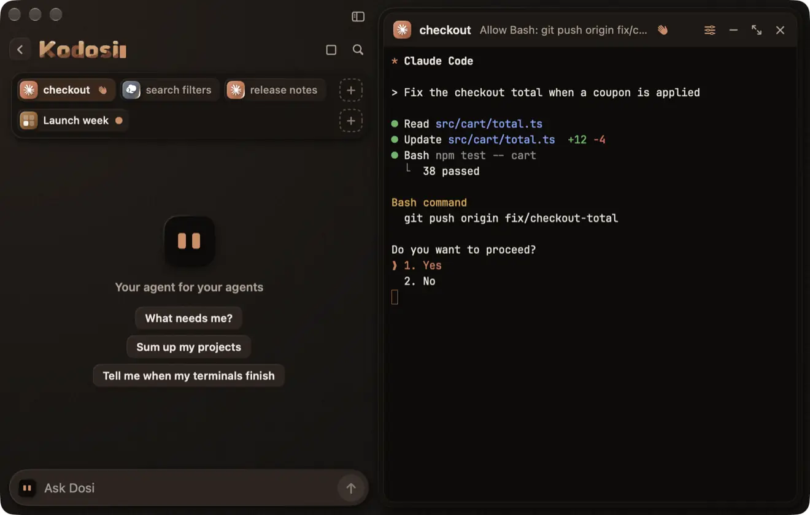

# Primi passi

[English](../GETTING_STARTED.md) · [Deutsch](../de/GETTING_STARTED.md) · [Ελληνικά](../el/GETTING_STARTED.md) · [Español](../es/GETTING_STARTED.md) · [Français](../fr/GETTING_STARTED.md) · **Italiano** · [日本語](../ja/GETTING_STARTED.md) · [한국어](../ko/GETTING_STARTED.md) · [简体中文](../zh-Hans/GETTING_STARTED.md)

[Scarica Kodosi](README.md#scarica-kodosi) per il tuo computer. Le scorciatoie qui sotto usano i
tasti di macOS; su Linux e Windows sostituisci ⌘ con Ctrl+Maiusc, salvo diversa indicazione.

## 1. Accedi

Apri Kodosi e fai clic su **Accedi** in fondo alla barra laterale. Kodosi apre il browser per
completare l'accesso. Da terminale puoi eseguire `kodosi auth login` per ottenere un codice
dispositivo da inserire in qualsiasi browser.

Puoi usare terminali locali anche senza accedere. Accedi per collegare gli altri tuoi computer,
aggiungere amici e usare i progetti.

## 2. Avvia un agente

Premi ⌘N (o fai clic su **Nuovo terminale**) per aprire il launcher. Scegli un agente e una
cartella, imposta se vuoi un account, un modello e un livello di ragionamento, inserisci un prompt
iniziale e premi Invio. Kodosi digita il comando di avvio in una nuova shell.

Se un agente non è ancora installato, il launcher mostra il relativo comando di installazione.

### Modi rapidi per aprire i terminali

- Premi ⌘D (Ctrl+Maiusc+O su Linux e Windows) per aprire una shell semplice nella cartella del
  terminale selezionato.
- Premi ⌘T (Ctrl+Maiusc+T) per aprire un nuovo terminale con l'agente, l'account e le impostazioni
  del terminale selezionato.
- Fai clic sul pulsante `+` accanto a una cartella nella barra laterale per avviare un altro
  terminale con l'agente già in esecuzione in quella cartella, con lo stesso account e le stesse
  impostazioni (o una shell semplice se non ce n'è nessuno).
- In un terminale fermo al prompt della shell, fai clic sul pulsante delle azioni (due cursori)
  nell'intestazione per avviare qualsiasi agente installato con le ultime impostazioni usate.

### Scorciatoie da tastiera

Le scorciatoie riprendono quelle predefinite di Ghostty e si possono personalizzare in
**Impostazioni › Scorciatoie**:

- Da ⌘1 a ⌘9 (da Alt+1 ad Alt+9 su Linux e Windows): passa a un terminale in base alla posizione.
- ⌥⌘ + tasti freccia (Ctrl+Alt + tasti freccia): spostati su un terminale adiacente.
- ⌘W: chiudi il terminale selezionato.
- ⌘↑ e ⌘↓: salta da un prompt della shell all'altro in zsh e nelle versioni recenti di bash (non
  in bash 3.2 integrato in macOS).

### Autorizzazioni, verbosità e modalità veloce

- Per impostazione predefinita gli agenti partono senza restrizioni, quindi possono modificare file
  ed eseguire comandi senza chiedere conferma. Fa eccezione Antigravity CLI, che si avvia nella
  propria modalità automatica e chiede comunque conferma prima di azioni irreversibili. Per far sì
  che un agente chieda prima l'autorizzazione, seleziona **Chiedi** in **Altro** (dopo il
  selettore del modello).
- Sempre in **Altro** puoi regolare la verbosità dell'output per Claude Code, Codex, Copilot CLI e
  Antigravity CLI (il valore predefinito è **Essenziale**). Poiché Copilot CLI legge la verbosità
  solo dalle proprie impostazioni salvate, Kodosi aggiorna temporaneamente la configurazione di
  Copilot mentre Copilot CLI è in esecuzione in modalità Essenziale e la ripristina al termine.
- Claude Code e Codex supportano una modalità veloce (risposte più rapide a un costo maggiore),
  attivabile accanto ai selettori di modello e livello di ragionamento. Vale solo per quel singolo
  avvio e si disattiva di nuovo al lancio successivo.

### Account e modifiche al volo

- Quando aggiungi un nuovo account, Kodosi gli assegna una cartella di configurazione separata,
  come `~/.claude-work`. Rileva inoltre gli account definiti tramite alias nella shell, ad esempio
  `alias cw='CLAUDE_CONFIG_DIR=~/.claude-work claude'`.
- Mentre un agente è in esecuzione, usa il pulsante delle azioni (due cursori) nell'intestazione
  per cambiare modello, livello di ragionamento, modalità veloce e (per gli agenti supportati)
  autorizzazioni senza riavviarlo. Kodosi invia il comando slash dell'agente stesso al termine del
  turno in corso. Tieni presente che Claude Code ricorda le modifiche a modello, livello di
  ragionamento e modalità veloce anche per le sessioni future.

### Link, immagini, worktree e temi

Tieni premuto ⌘ e fai clic su un link (Ctrl-clic su Linux e Windows) per aprirlo nel browser
predefinito del dispositivo che stai usando; tieni premuto anche Maiusc se il programma in
esecuzione cattura il mouse. Su iPhone, tocca il link (funzione disabilitata mentre un programma
cattura il mouse). Kodosi chiede conferma prima di passare un link a un'altra app e blocca
l'apertura di file eseguibili, nonché di percorsi di file locali o URL `localhost` provenienti da
computer remoti.

Per condividere uno screenshot o un'immagine con un agente, incollala con ⌘V (Ctrl+Maiusc+V su
Linux e Windows, oppure Incolla su iPhone). Kodosi la salva sul computer host del terminale e
incolla il percorso del file così che l'agente possa allegarla, mostrando l'avanzamento del
caricamento per i terminali remoti. La scorciatoia di incolla propria dell'agente (come Ctrl+V in
Claude Code) continua invece a leggere gli appunti del computer su cui l'agente è in esecuzione.

Per dare a un agente una copia isolata di un repository Git, passa il puntatore sulla cartella del
repository nella barra laterale, fai clic sul pulsante del branch e inserisci un nome per il
branch. Kodosi apre il terminale in un nuovo worktree Git e lo rimuove automaticamente alla
chiusura del terminale se non ci sono state modifiche. Puoi configurare dove salvare i worktree in
**Impostazioni › Terminale**.

L'intestazione del terminale mostra quante righe il branch ha aggiunto e rimosso. Fai clic sui
numeri per vedere le modifiche nel canvas.

Ogni terminale è chiaro o scuro come Kodosi sul suo computer host, su tutti i dispositivi da cui
lo visualizzi. I programmi nel terminale ricevono le notifiche del tema, quindi strumenti come
Claude Code (con `/theme` impostato su Auto) si adattano automaticamente. Se preferisci terminali
scuri anche quando Kodosi usa la modalità chiara, attiva **Mantieni i terminali scuri** in
**Impostazioni › Terminale**.

### Chiusura, uscita e autorizzazioni su macOS

Ogni terminale è una vera shell in esecuzione sul proprio computer host. **Riduci a icona**
nasconde il terminale mantenendolo attivo; **Chiudi** termina la shell e tutti i suoi processi
figli. Chiudendo la finestra dell'app, Kodosi e i tuoi terminali restano attivi nella barra dei
menu o nell'area di notifica (tranne sui desktop Linux privi di area di notifica, dove chiudere la
finestra chiude Kodosi). Puoi cambiare questo comportamento in **Impostazioni**.

Quando esci da Kodosi, i terminali si arrestano e Kodosi salva localmente sul tuo computer lo stato
del loro schermo (mai sul server). Alla riapertura, i terminali si riaprono nelle stesse cartelle,
negli stessi progetti e nelle stesse posizioni sulla scena, con lo schermo e la cronologia
precedenti sopra un nuovo prompt (su Windows scorri verso l'alto per vederli). Claude Code, Codex
e Copilot CLI riprendono automaticamente le loro conversazioni e, su macOS e Linux, mantengono
anche modello, livello di ragionamento, modalità veloce, autorizzazioni e verbosità scelti in
precedenza. Se Kodosi non riesce a individuare quale conversazione fosse attiva, l'agente elenca le
proprie conversazioni per farti scegliere quale riprendere.

Kodosi installa gli aggiornamenti da solo quando nessuno lo usa, nessun agente è al lavoro e nessun
altro programma è in esecuzione in un terminale. Per scegliere tu il momento, disattiva **Aggiorna
automaticamente** in **Impostazioni › Generale**. Se riavvii tu per un aggiornamento, gli agenti che
erano a metà di un'attività proseguono dopo. Dopo qualsiasi altra interruzione, un agente del genere
aspetta finché non premi **Continua** nel suo terminale.

Su macOS, i programmi in esecuzione dentro Kodosi ereditano le autorizzazioni di sistema concesse a
Kodosi, come in qualsiasi altra app di terminale. Se macOS impedisce a un programma di modificare
un'altra app, abilita Kodosi in **Gestione app** (accessibile da **Impostazioni › Generale**).
Nella stessa schermata puoi concedere anche **Controllo del dispositivo e accesso ai dati**
(chiamato **Accessibilità** prima di macOS 27) e **Registrazione schermo e audio di sistema** per
gli strumenti che automatizzano altre app o catturano lo schermo.

## 3. Scopri quale agente ha bisogno di te

L'icona di ogni terminale indica il suo stato attuale:

| Indicatore | Significato |
| --- | --- |
| Luce calda che ruota attorno all'icona | Al lavoro (un anello che si riempie mostra la percentuale di avanzamento quando disponibile). |
| Mano, punto interrogativo o chiave | In attesa della tua approvazione, di una risposta o dell'accesso. |
| Spunta verde | Completato. |
| Triangolo di avviso giallo | Non riuscito. |

La spunta e l'avviso scompaiono non appena apri quel terminale su un qualsiasi dispositivo.

Quando un terminale passa in attesa, termina o non riesce, Kodosi ti avvisa una sola volta sul
dispositivo che stai usando in quel momento:

- Se Kodosi è in primo piano, vedi semplicemente l'indicatore di stato.
- Se stai usando un'altra app sul computer, Kodosi mostra lì una notifica desktop.
- Se sei lontano da tutti i tuoi computer, Kodosi invia una notifica push al telefono. Se un
  terminale in attesa non è ancora stato visto quando ti allontani dal computer, la notifica viene
  inoltrata al telefono in quel momento.

Solo i terminali in attesa riproducono un suono di notifica. Puoi silenziare le notifiche per
singolo dispositivo in **Impostazioni**. I programmi comunicano il proprio stato tramite il
[Program Status Protocol](https://www.superlogical.com/rex/docs/build/program-status) o le
sequenze standard di avanzamento del terminale; i programmi che non comunicano alcuno stato non
mostrano alcun indicatore.

### Vista Chat

I terminali con Claude Code, oppure con Codex e Copilot CLI avviati da Kodosi, offrono anche una
vista **Chat** nell'intestazione del terminale. La chat mostra i tuoi messaggi, le risposte e
l'attività degli strumenti dell'agente, oltre alle domande in sospeso con pulsanti selezionabili.
Puoi rispondere o fermare l'agente direttamente dalla chat; se scrivi un testo personalizzato mentre
l'agente sta ponendo una domanda, gli indichi cosa fare in alternativa. Tutto ciò che fai in chat
avviene anche nel terminale sottostante.

Nella chat, digita `@` per menzionare un altro dei tuoi agenti in esecuzione, così i due possono
parlarsi: Kodosi dice all'agente della chat chi è e come scrivergli. Per passare il lavoro di un
agente all'agente della chat, trascina il terminale di quell'agente sulla chat e scegli **Passa le
consegne** oppure, sul telefono, tieni premuto l'agente nell'elenco `@`. L'agente della chat legge
la conversazione dell'altro agente e prosegue il lavoro; l'altro agente non riceve alcun messaggio.

Con Claude Code, l'ingranaggio sotto il campo del messaggio, oppure `/config`, apre le impostazioni
di Claude Code. Claude Code controlla e salva ogni modifica e spiega il motivo quando non ne accetta
una.

Su Mac, iPhone, iPad e Android, fai clic sul microfono accanto al campo del messaggio, o toccalo,
per parlare invece di scrivere. Le tue parole compaiono come tuo messaggio mentre parli e vengono
inviate dopo una lunga pausa, così puoi fermarti a pensare; fai clic su **Invia**, o toccalo, per
inviarle prima. La voce diventa testo sul tuo dispositivo e nessun audio lo lascia.

## 4. Guarda cosa mostra l'agente sul canvas

Gli agenti possono mostrare pagine HTML, Markdown, immagini, PDF, documenti Office, fogli di
calcolo, presentazioni o web app in esecuzione su un **canvas** accanto al terminale, oltre a
pilotare un browser condiviso. Per impostazione predefinita, il canvas si apre automaticamente
quando l'agente mostra o aggiorna qualcosa mentre stai guardando quel terminale (a meno che tu non
lo abbia chiuso). Per aprirlo solo tu, disattiva **Apri il canvas automaticamente** in
**Impostazioni › Generale**.

Claude Code, Copilot CLI e Antigravity CLI sanno usare il canvas anche se avviati manualmente,
mentre Codex, Cursor e OpenCode lo sanno fare quando vengono avviati da Kodosi (OpenCode su macOS e
Linux). Per qualsiasi altro agente, chiedigli di eseguire `kodosi skill canvas`.

Quando il canvas contiene qualcosa, nell'intestazione del terminale compaiono i pulsanti **File** e
**Browser**, con un pallino color rame ogni volta che c'è una novità:

- Fai clic su uno dei due pulsanti per aprire il canvas accanto al terminale.
- Fai clic su **Più spazio** per espandere il canvas su tutta la scena riducendo il terminale in un
  angolo.
- Chiudi un pannello con la `×` sul relativo pulsante e riaprilo con `+`.
- Apri il browser manualmente tramite **Apri browser** nel menu delle azioni, oppure aggiungi file
  con **Aggiungi un file…** (o trascinandoli sul canvas), operazione che copia il file anche nella
  cartella del terminale.
- Su iPhone il pulsante del canvas si trova nella barra del terminale, e un banner segnala gli
  elementi nuovi o aggiornati con un pulsante **Apri**.

### Documenti dal vivo e pagine

- Documenti (`.docx`), fogli di calcolo (`.xlsx`), presentazioni (`.pptx`), PDF e file di testo
  sono dal vivo: tu, chiunque condivida il terminale e l'agente potete modificarli
  contemporaneamente, mentre restano normali file su disco. Quando un documento contiene revisioni,
  la barra degli strumenti offre un comando per accettarle o rifiutarle. In **Impostazioni ›
  Documenti** puoi attivare o disattivare i singoli visualizzatori, scegliere tra visualizzazione
  impaginata e testo scorrevole, e attivare le pagine scure in modalità scura.
- Le pagine HTML sul canvas vengono eseguite completamente offline, senza accesso alla rete. I link
  in pagine, documenti, fogli di calcolo, slide e PDF si aprono nel tuo browser seguendo le stesse
  regole di sicurezza dei link del terminale (⌘-clic o Ctrl-clic nelle viste modificabili; clic
  normale altrove; tocco su iPhone). I link interni verso slide o celle portano direttamente alla
  destinazione.
- Evidenzia del testo in una pagina o in un documento e fai clic su **Fai una domanda su questo**
  per inviare subito nel terminale il nome del file e il testo selezionato, così da scrivere la tua
  domanda.
- Fai clic destro sulla scheda di un file (o tieni premuto su dispositivo mobile) per salvare una
  copia, rimuovere quel file o tutti i file dal canvas, oppure spostare il file nel Cestino del
  computer host.

### Browser condiviso

- Fai clic e digita nel browser condiviso esattamente come in un browser normale. L'agente vede le
  stesse pagine e gli stessi accessi, e l'output del suo successivo comando del browser gli dice che
  hai usato il browser.
- Dopo 10 minuti di inattività il browser entra in sospensione e riapre l'ultima pagina quando tu o
  l'agente lo usate di nuovo. La prima volta che apri un browser condiviso su un computer, Kodosi
  scarica automaticamente Kodosi Browser, quindi ci vuole qualche istante.
- Per riutilizzare gli accessi dei tuoi browser nei terminali privati, fai clic su **Copia** accanto
  a un browser in **Impostazioni › Browser**. Fai clic su **Rimuovi** per eliminare ciò che hai
  copiato, oppure **Rimuovi tutto** per cancellare tutti gli accessi e i dati dei siti dai terminali
  privati. Su macOS, se il sistema limita l'accesso ai dati di un browser (come Safari), fai clic su
  **Consenti…** accanto a quel browser per concedere l'Accesso completo al disco.
- Sempre in **Impostazioni › Browser**, **Previsioni dei moduli da Google** permette a Kodosi
  Browser di chiedere a Google a cosa servono i campi di un modulo, e **Cookie tra siti** permette a
  un sito mostrato dentro la pagina di un altro sito, come un video di YouTube, di riconoscerti lì.
  Entrambe le opzioni restano disattivate finché non le attivi. Kodosi Browser si riavvia quando ne
  cambi una, e le sue pagine aperte si ricaricano.
- Chiunque abbia accesso a un terminale ne vede il canvas e condivide il suo browser. Chiudere il
  terminale svuota il canvas ed elimina gli accessi del browser dei terminali condivisi.

### Lo schermo di un computer

- Per vedere e controllare un computer dal telefono o da un altro computer, attiva la condivisione
  su quel computer: su un Mac, **Consenti ai miei altri dispositivi di vedere e controllare questo
  Mac** in **Impostazioni › Generale**; su Linux e Windows, **Consenti ai miei altri dispositivi di
  vedere e controllare questo computer** in **Impostazioni › Account**.
  - Su un Mac, macOS ti chiede allora di consentire a Kodosi di registrare e controllare lo schermo.
    Solo una parte separata di Kodosi riceve queste autorizzazioni, quindi i programmi nei tuoi
    terminali non le ricevono. Se macOS non te lo chiede, **Consenti…** nelle stesse impostazioni ti
    mostra dove attivarle.
  - Su Linux, la condivisione funziona con KDE Plasma 6 e GNOME su Wayland. Su KDE basta attivare la
    condivisione; GNOME chiede una sola volta se Kodosi può condividere lo schermo e ricorda la tua
    risposta.
  - Windows non richiede alcuna autorizzazione. Kodosi non può controllare i programmi eseguiti come
    amministratore, e lo schermo appare bloccato mentre Windows chiede l'approvazione di un
    amministratore. L'icona che indica chi sta guardando può restare nascosta dietro il ^ nella
    barra delle applicazioni finché non la fissi.
- Scegli **Apri schermo** nel menu delle azioni di un terminale su quel computer, oppure lascia che
  il suo agente esegua `kodosi show screen`. Seleziona un altro monitor o, su un Mac, una sola
  finestra sopra lo schermo, pizzica per ingrandire, e punta, fai clic e scrivi come se fossi
  davanti al computer. Le scorciatoie funzionano in base alla lettera che premi, e ⌘ funziona come
  Ctrl su Linux e Windows. Il testo che copi lì arriva sul tuo dispositivo, e ciò che incolli viene
  dal tuo dispositivo.
- Quando lo schermo non può essere mostrato, indica il motivo in una riga: il computer è bloccato,
  in stop, offline o su un altro account, oppure la condivisione è disattivata. Torna a mostrarsi da
  solo appena la situazione cambia.
- Solo i tuoi dispositivi vedono lo schermo, anche in un terminale che condividi con gli amici.
  Mentre qualcuno guarda, la barra dei menu o l'area di notifica del computer indica quali
  dispositivi stanno guardando, con un pulsante che interrompe la condivisione finché qualcuno
  davanti al computer non la riattiva.

## 5. Chiedi a Dosi

Dosi è il tuo agente per coordinare tutti gli altri agenti. Fai clic sul volto di Dosi in fondo
alla barra laterale (o premi ⌘J). Dosi si appoggia a Claude Code o Codex, che puoi configurare
insieme a account, modello e livello di ragionamento in **Impostazioni › Dosi**.

  <picture>
    <source media="(prefers-reduced-motion: reduce)" srcset="../media/dosi-still.webp">
    
  </picture>

Chiedi a Dosi cosa richiede la tua attenzione, oppure affidagli un compito. Può ispezionare i tuoi
terminali e progetti, rispondere ai prompt, avviare o chiudere terminali e inoltrare messaggi.
Quando serve una decisione, Dosi propone dei pulsanti di scelta insieme a un campo per rispondere
con parole tue.

La conversazione con Dosi rimane sincronizzata su tutti i tuoi dispositivi. Su iPhone e iPad puoi
scegliere a quale computer inviare il messaggio proprio sopra il campo di testo (per impostazione
predefinita viene selezionato l'ultimo che ha risposto). I messaggi diretti a un computer offline
restano in coda finché non torna online, e puoi annullare un messaggio in coda con **Non inviare**.

La riga di stato accanto al volto di Dosi indica quando sta lavorando, quando ha risposto o quando
attende una tua risposta. Se su quel computer non è ancora installato alcun agente, mostra
**Configura Dosi** e apre **Impostazioni › Dosi**. Per disattivare Dosi su un computer, disattiva
**Usa Dosi** in **Impostazioni › Dosi**.

## 6. Aggiungi gli altri tuoi computer e telefoni

Accedi su un nuovo computer con lo stesso account. Sul display compare un codice di verifica e i
tuoi dispositivi esistenti ti chiedono di approvarlo. Fai clic su **Approva** su un computer già
approvato e inserisci il codice, oppure scansionalo da un telefono già approvato.

Aggiungere un telefono o un tablet richiede una sola scansione: su un computer già approvato apri
**Impostazioni**, fai clic su **Mostra un codice** in **Aggiungi un dispositivo** e scansionalo con
il nuovo dispositivo. Dopo l'approvazione, i terminali di tutti i tuoi computer compaiono ovunque.

### Avviare terminali da remoto

Per avviare un terminale su un altro computer, seleziona quel computer sul lato destro della barra
del launcher. Il menu delle cartelle mostra quindi le cartelle recenti di quella macchina, mentre
**Scegli una cartella…** permette di sfogliare la sua directory home. Su iPhone e iPad tocca `+` in
**Terminali** oppure accanto a uno specifico computer. Sul computer di destinazione deve essere
aperto Kodosi, oppure deve essere in esecuzione `kodosi host` in un terminale.

Quando due dei tuoi dispositivi riescono a raggiungersi direttamente, il traffico di terminali e
browser viaggia in modalità peer-to-peer per ridurre la latenza. Sulla rete locale, macOS, iOS e
Android chiedono una sola volta l'autorizzazione alla rete locale; se viene rifiutata, il traffico
passa attraverso il server relay.

### Sospensione e computer attivo

Un computer non va in sospensione da solo mentre un agente lavora in uno dei suoi terminali, e può
tornare in sospensione qualche minuto dopo che i suoi agenti si sono fermati. Un agente che aspetta
la tua risposta non lo tiene attivo. Per cambiarlo, scegli un'opzione per **Resta attivo** in
**Impostazioni › Generale** su quel computer: **Mentre gli agenti lavorano**, **Sempre** o **Mai**.
**Sempre** tiene attivo un computer solo finché è collegato alla corrente; a batteria, resta attivo
mentre gli agenti lavorano. Puoi sempre sospendere un computer tu.

Per sospendere un altro dei tuoi computer, apri **Impostazioni**, fai clic su **⋯** accanto a esso,
in **I tuoi dispositivi**, e scegli **Sospendi…**. Su un telefono, tocca il computer per aprire la
sua pagina. I suoi terminali restano in pausa finché non si riattiva. Se poi niente potesse
riattivarlo, Kodosi te lo dice prima. Nello stesso menu, o nella pagina, scegli quando quel computer
resta attivo.

### Riattivare un computer

Per riattivare un computer in sospensione, fai clic su **Riattiva** accanto a esso in
**Impostazioni** (su un telefono, nella sua pagina), in uno dei suoi terminali o nell'elenco dei
computer di un nuovo terminale. Il segnale di riattivazione deve partire dalla rete del computer in
sospensione. Kodosi lo invia dal dispositivo che stai usando quando è sulla stessa rete, altrimenti
da un altro dei tuoi computer attivi su quella rete. Un iPhone o un iPad lo chiede sempre a uno dei
tuoi computer.

Un computer si riattiva tramite cavo di rete, non tramite Wi-Fi, e solo se il suo sistema lo
consente. **Impostazioni** mostra per ogni computer che cosa si aspetta Kodosi, oppure l'unica
impostazione da cambiare:

- Su un Mac, attiva **Riattiva per accesso alla rete** in Impostazioni di Sistema.
- Su Windows, consenti alla scheda di rete di riattivare il computer, in Gestione dispositivi.
- Su Linux, attiva Wake-on-LAN per la connessione cablata.

Un Mac invia il segnale di riattivazione solo se Kodosi può usare la rete locale. Consentilo in
Impostazioni di Sistema, in **Privacy e sicurezza**.

Per esserne certo, scegli **Prova la riattivazione…** nel menu di un computer attivo (su un
telefono, nella sua pagina). Kodosi lo sospende, lo riattiva e conserva il risultato. Resta vicino
al computer per la prima prova: se non si riattiva, riattivalo a mano. Un PC Windows con Modern
Standby non ha **Prova la riattivazione…**, perché Windows non mostra alle app quando va in
sospensione.

### Chiavi di recupero

Crea una chiave di recupero in **Impostazioni** e conservala in un luogo sicuro. Se dovessi perdere
tutti i tuoi dispositivi, accedi da uno nuovo e seleziona **«Usa la mia chiave di recupero»** per
mantenere amici e progetti. Rimuovi i dispositivi smarriti da uno qualsiasi dei dispositivi
rimasti; in caso di furto, genera subito dopo anche una nuova chiave di recupero.

## 7. Lavora con gli amici

Apri **Amici** dal menu accanto al tuo account. Invia il tuo invito, oppure incolla l'invito o il
nome utente di un amico. L'uso di un invito permette a Kodosi di verificare
automaticamente l'identità del tuo amico. Su dispositivo mobile puoi mostrare il tuo invito come
codice QR che un amico può scansionare con la fotocamera o dentro Kodosi; prima dell'invio della
richiesta dovrà comunque confermare di fidarsi di te.

### Condividere un terminale

Apri il menu delle azioni nell'intestazione del terminale, fai clic su **Condividi** e seleziona
amici o progetti. Chiunque riceva la condivisione ottiene il pieno controllo con le tue
autorizzazioni di sistema su quella macchina. Gli altri tuoi terminali restano privati. Puoi
condividere da qualsiasi tuo dispositivo, anche dal telefono, finché il computer che esegue il
terminale è online. Kodosi ti chiede conferma ogni volta che qualcuno di nuovo ottiene l'accesso.

### Progetti

Un progetto riunisce terminali provenienti da qualsiasi cartella o computer insieme a una chat
condivisa e a un elenco di attività. Fai clic su `+` accanto a **Progetti**, poi avvia nuovi
terminali nel progetto (o condividi quelli esistenti al suo interno) e invita gli amici quando sei
pronto.

- Ogni membro può usare i terminali condivisi e condividere i propri. Chi si unisce in un secondo
  momento vede subito i terminali del progetto e l'intera cronologia della chat. I file restano sul
  computer host di ciascun terminale.
- Crea attività libere, prendile in carico, rilasciale, chiudile con una nota riassuntiva o
  riaprile.
- Collega repository GitHub o Gitea per sincronizzare le issue con le attività: aggiornare
  un'attività collegata aggiorna la relativa issue. GitHub utilizza l'accesso di `gh` o il
  credential helper di Git; Gitea utilizza il credential helper di Git oppure `KODOSI_GITEA_TOKEN`
  insieme a `KODOSI_GITEA_URL`. Le credenziali non lasciano mai il tuo computer.
- Menziona un terminale in chat con `@<terminal-name>` per recapitare il messaggio (accompagnato
  dal tuo nome e dal progetto) direttamente all'agente in esecuzione lì; sarà l'agente a decidere
  come rispondere. Claude Code, Copilot CLI e Antigravity CLI dentro Kodosi (oltre a Codex, Cursor
  e OpenCode quando avviati da Kodosi, con OpenCode su macOS e Linux) sanno automaticamente di
  trovarsi in Kodosi. Esegui `kodosi skill` per stampare la
  [skill](../../runtime/skills/kodosi/SKILL.md) per qualsiasi altro agente. Dentro un terminale di
  Kodosi, i comandi di progetto rilevano automaticamente il progetto corrente; all'esterno, passa
  `--project <name>`.
- Eliminando un messaggio inviato da te o dal tuo agente, al suo posto tutti vedono un segnaposto
  di messaggio eliminato. **Svuota chat** nasconde la cronologia fino a quel momento su tutti i tuoi
  dispositivi, lasciandola intatta per gli altri membri.

## 8. Usa la riga di comando

La CLI `kodosi` controlla esattamente gli stessi terminali dell'app desktop, e ogni modifica
compare subito nell'app.

| Comando | Cosa fa |
| --- | --- |
| `kodosi terminal start --agent claude --prompt "fix the failing test"` | Avvia un agente con le ultime impostazioni usate. Puoi sostituirle con `--account`, `--model`, `--effort`, `--fast`, `--permissions` e `--output`. |
| `kodosi terminal start --directory <repository> --branch <name>` | Avvia un terminale su un nuovo branch dentro il proprio worktree Git. |
| `kodosi terminal start --computer <computer> --directory <folder>` | Avvia un terminale su un altro dei tuoi computer. I percorsi relativi e `~` fanno riferimento alla tua directory home su quella macchina. Usa `kodosi devices list` per vedere quali computer sono online. |
| `kodosi agent list` | Elenca gli agenti installati, i loro account e le ultime impostazioni usate. |
| `kodosi agent usage` | Mostra l'utilizzo attuale del piano e gli orari di ripristino per gli account connessi di Claude Code, Codex e Copilot CLI. |
| `kodosi terminal list` | Elenca i terminali con i loro nomi e ID (puoi passare uno qualsiasi dei due come `<terminal>`). |
| `kodosi terminal read <terminal>` | Stampa il contenuto attuale dello schermo. Aggiungi `--history` per includere la cronologia di scorrimento, oppure `--conversation` per stampare invece la conversazione dell'agente come la mostra la chat. |
| `kodosi terminal message <terminal> "Can you review my branch?"` | Invia un messaggio all'agente di un terminale, indicando mittente e provenienza. |
| `kodosi terminal agent <terminal> --model sonnet` | Cambia modello, livello di ragionamento, modalità veloce o autorizzazioni di un agente in esecuzione. |
| `kodosi terminal input <terminal> --enter "make test"` | Digita del testo in un terminale. |
| `kodosi terminal keys <terminal> ctrl-c` | Invia sequenze di tasti a un terminale. |
| `kodosi terminal wait <terminal> --until done,failed` | Resta in attesa finché il terminale non entra in uno degli stati indicati. |
| `kodosi terminal show <terminal>` | Porta in primo piano il terminale nell'app. |
| `kodosi dosi say "What needs me?"` | Invia un messaggio a Dosi. Usa `kodosi dosi show` per stampare la conversazione e `kodosi dosi stop` per annullare un turno. |
| `kodosi show <file>` | Apre un file sul canvas di questo terminale, che si apre per chi sta guardando il terminale. Usa `kodosi show <address>` per aprire un URL nel suo browser condiviso, `kodosi show browser` per portare in vista il browser così com'è, `kodosi show screen` o `kodosi show window <words>` per mostrare lo schermo del computer ai dispositivi del suo proprietario, `kodosi canvas` per elencare gli elementi sul canvas e `kodosi canvas remove <file>` per rimuoverne uno. |
| `kodosi browser open <address>` | Apre un URL nel browser condiviso di questo terminale (funzionano anche tutti gli altri comandi di agent-browser). |
| `kodosi skill` | Stampa la skill dell'agente per collaborare in Kodosi; `kodosi skill canvas` stampa la skill per il canvas. |
| `kodosi dosi skill` | Stampa la skill che permette a un altro agente di agire come Dosi. |
| `kodosi devices sleep <computer>` | Sospende un altro dei tuoi computer. I suoi terminali restano in pausa finché non si riattiva. `kodosi devices keep-awake` con `agents`, `always` o `never` sceglie quando questo computer resta attivo. |
| `kodosi devices wake <computer>` | Riattiva un tuo computer in sospensione e attende che sia online. `kodosi devices test-wake <computer>` sospende un computer, lo riattiva e conserva il risultato. `kodosi devices list` mostra che cosa Kodosi si aspetta da ogni computer. |
| `kodosi host` | Esegue l'host in modo indipendente, così i terminali restano attivi anche dopo aver chiuso l'app. Usa `kodosi host stop` per arrestare un host in background. |

`message`, `input` e `keys` rifiutano di essere eseguiti mentre stai digitando attivamente in quel
terminale. `message` si rifiuta anche mentre l'agente è in attesa di una risposta umana.

## Se qualcosa non si connette

- Verifica che il computer host del terminale sia online con Kodosi in esecuzione e che il
  terminale sia ancora condiviso.
- Un dispositivo appena aggiunto potrebbe essere ancora in attesa di approvazione, oppure un amico
  la cui identità è cambiata potrebbe dover essere verificato nuovamente in **Amici**.
- Dopo un'interruzione della connessione, Kodosi mostra di nuovo lo stato attuale. Se un terminale
  remoto mostra **Offline**, questo dispositivo non riesce a raggiungere il server: controlla la
  connessione di rete. Kodosi si riconnette automaticamente, oppure puoi fare clic su **Riprova**
  per ritentare subito.
- Quando un computer host va offline, i suoi terminali si riconnettono automaticamente appena torna
  online (a meno che non siano stati chiusi nel frattempo). Per rimuovere dalla lista un terminale
  offline, fai clic sulla sua `×`: **Nascondi finché non torna** lo nasconde temporaneamente,
  mentre **Chiudi per sempre** lo chiude definitivamente appena il computer si riconnette.
- Se Kodosi avvisa che la consegna del tuo input è incerta, controlla lo schermo del terminale
  prima di eseguire di nuovo il comando.
