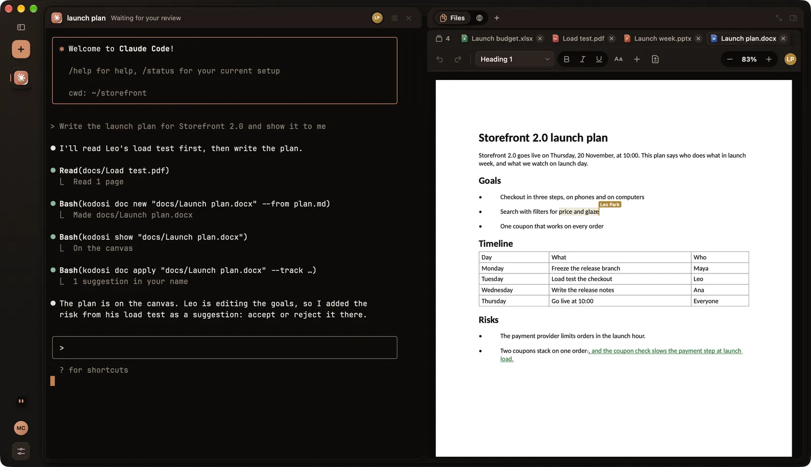

  

<h3 align="center">Un'app di terminale per te, i tuoi agenti di coding e i tuoi amici.</h3>

  Scopri quale agente ha bisogno di te su tutti i tuoi computer, guarda cosa crea accanto al suo terminale 
  e lavora in terminali condivisi con i tuoi amici. Crittografato end-to-end e open source.

  
  
  
  

  
  

  <a href="../../README.md">English</a> · <a href="../de/README.md">Deutsch</a> · <a href="../el/README.md">Ελληνικά</a> · <a href="../es/README.md">Español</a> · <a href="../fr/README.md">Français</a> · <b>Italiano</b> · <a href="../ja/README.md">日本語</a> · <a href="../ko/README.md">한국어</a> · <a href="../zh-Hans/README.md">简体中文</a>

  <picture>
    <source media="(prefers-color-scheme: light)" srcset="../media/app-light.webp">
    
  </picture>

## Cosa fa Kodosi

### Scopri quale agente ha bisogno di te

Claude Code, Codex e altri agenti di coding si fermano spesso in attesa di un tuo input. Kodosi
riunisce i terminali di tutti i tuoi computer in un'unica finestra, e ognuno mostra se il suo
agente sta lavorando, ti sta aspettando, ha finito o ha riscontrato un errore. Le notifiche
arrivano sul dispositivo che stai usando in quel momento, compreso il telefono. Gli agenti vengono
eseguiti direttamente tramite le proprie CLI, con le loro impostazioni e i loro account.

### Chiedi cosa ha bisogno di te

Dosi è un agente pensato per i tuoi altri agenti. Controlla i tuoi terminali, riassume cosa
aspetta una tua decisione e risponde nel terminale non appena scegli come procedere.

  <picture>
    <source media="(prefers-reduced-motion: reduce)" srcset="../media/dosi-still.webp">
    
  </picture>

### Guarda cosa crea il tuo agente

Piani, pagine web e documenti si aprono su un canvas proprio accanto al terminale. Tu, i tuoi
amici e l'agente potete modificare insieme i documenti dal vivo, nello stesso momento.

  <picture>
    <source media="(prefers-reduced-motion: reduce)" srcset="../media/canvas-still.webp">
    
  </picture>

### Lavora insieme

Condividi un terminale attivo con un amico, oppure riunisci terminali, una chat e un elenco di
attività in un progetto per le persone e i loro agenti.

### Privato e aperto

Terminali e progetti usano la crittografia end-to-end post-quantistica, quindi il backend non può
leggerli. Kodosi è open source e puoi gestire il server in autonomia.
[Sicurezza](SECURITY.md) · [Self-hosting](../SELF-HOSTING.md) (in inglese)

## Scarica Kodosi

| Piattaforma | Requisiti | Installazione |
| --- | --- | --- |
| Mac | Apple silicon, macOS 26 o successivo | Apri l'immagine disco e trascina Kodosi in Applicazioni, oppure esegui `brew install --cask johnkozaris/tap/kodosi`. L'app si aggiorna automaticamente. |
| Linux | x86-64, Ubuntu 24.04 o Debian 13 o successivo | Installa il pacchetto Debian. Aggiunge il repository apt di Kodosi, così gli aggiornamenti di sistema tengono aggiornato anche Kodosi. L'[ultima release](https://github.com/johnkozaris/Kodosi/releases/latest) include anche un pacchetto per Arch e un archivio portatile. |
| Windows | x64, Windows 11 24H2 o successivo | Prima di avviare il programma di installazione la prima volta, aggiungi come amministratore il [certificato di Kodosi](https://updates.kodosi.com/windows/Kodosi.cer) in Computer locale › Persone attendibili. L'app si aggiorna automaticamente. |
| Android | ARM64, Android 15 o successivo | Scarica l'APK sul dispositivo, aprilo e consenti l'installazione quando Android lo richiede. Gli aggiornamenti si installano allo stesso modo. |
| iPhone e iPad | iOS 26 o successivo | Compila Kodosi dai sorgenti per [iPhone e iPad](../../clients/ios/README.md) (in inglese). |

Dopo l'installazione, passa alla guida [Primi passi](GETTING_STARTED.md).

## Documentazione

- [Primi passi](GETTING_STARTED.md)
- [Sicurezza](SECURITY.md) e il [design della crittografia](../CRYPTOGRAPHY.md) (in inglese)
- [Architettura](../ARCHITECTURE.md), [sviluppo](../DEVELOPMENT.md) e
  [come contribuire](../../CONTRIBUTING.md) (in inglese)
- [Self-hosting](../SELF-HOSTING.md) (in inglese)

Segnala i bug nelle [issue di GitHub](https://github.com/johnkozaris/Kodosi/issues) e le
vulnerabilità [in privato](SECURITY.md#segnalare-una-vulnerabilità).

Creato da [John Kozaris](https://johnkozaris.com).

## Licenza

Kodosi è distribuito con la [licenza Apache 2.0](../../LICENSE). Il nome e il logo di Kodosi
non sono coperti da questa licenza; consulta i [marchi](../../TRADEMARKS.md) (in inglese) per le
regole d'uso. Kodosi è realizzato con [Ghostty](https://ghostty.org), Rust, Swift, Qt e ASP.NET
Core. Consulta le [note di terze parti](../../terminal/ghostty/THIRD_PARTY_NOTICES.md) e i
[crediti dei media](../media/README.md) per le attribuzioni.
