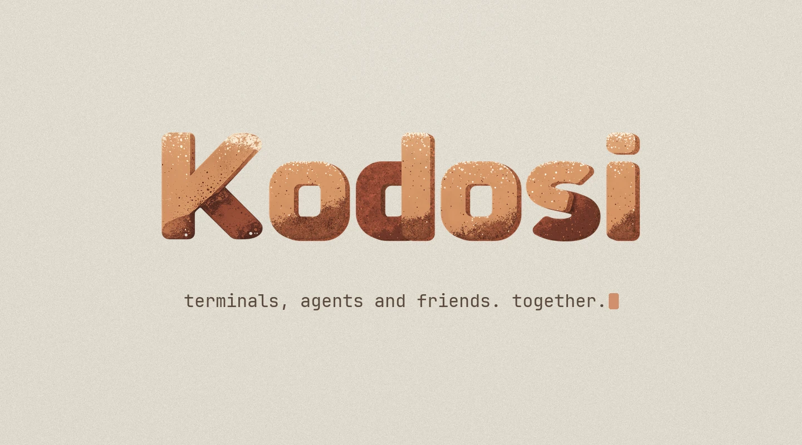
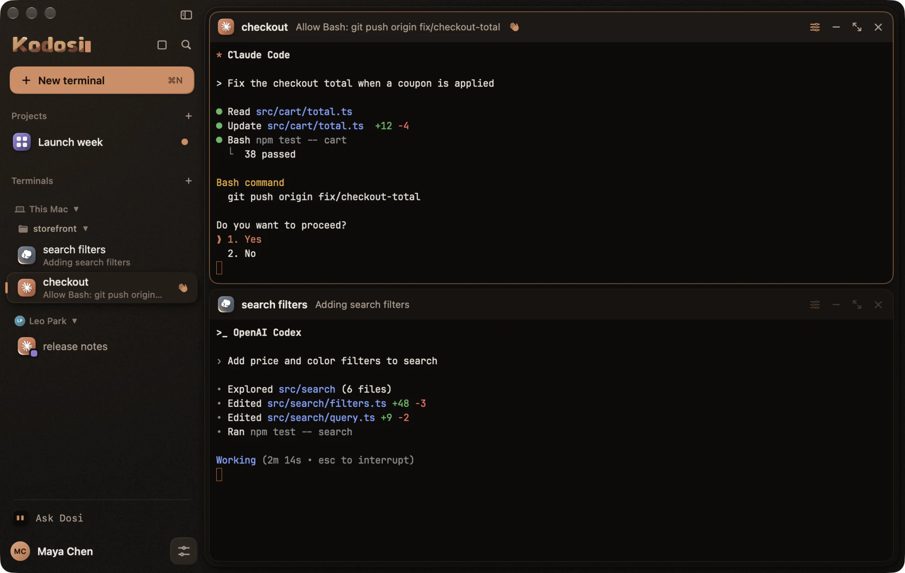
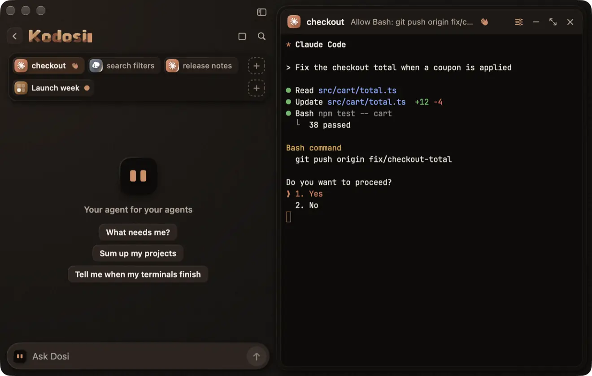
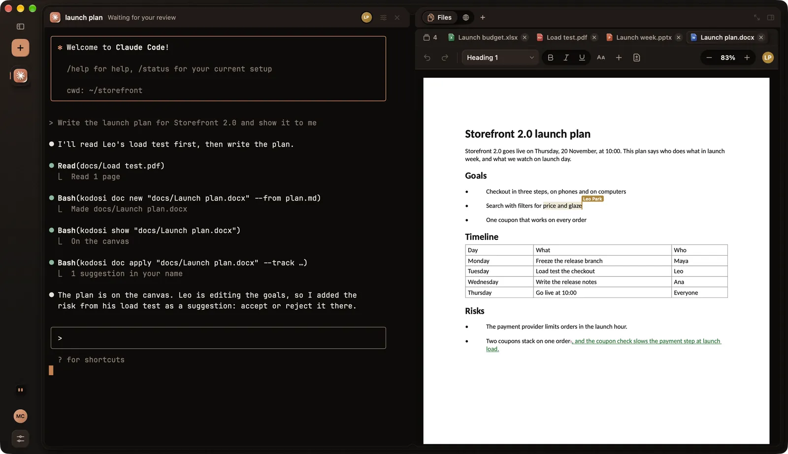
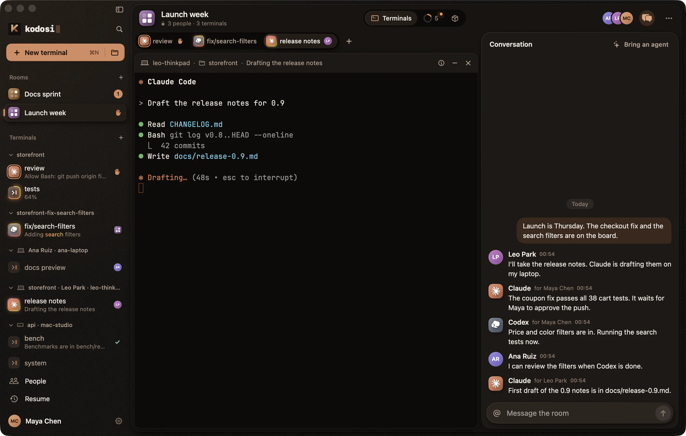

  

  <a href="../../README.md">English</a> · <a href="../de/README.md">Deutsch</a> · <a href="../el/README.md">Ελληνικά</a> · <a href="../es/README.md">Español</a> · <a href="../fr/README.md">Français</a> · <a href="../it/README.md">Italiano</a> · <b>日本語</b> · <a href="../ko/README.md">한국어</a> · <a href="../zh-Hans/README.md">简体中文</a>

  
  
  
  
  
  

[Kodosi](https://kodosi.com) は、Mac、Linux、Windows で使えるコーディングエージェント向けのターミナルアプリです。すべてのコンピュータのターミナルを 1 つのウインドウにまとめ、どのエージェントがあなたを必要としているかを示し、フレンドと同じターミナルで作業できます。ターミナルとルームはエンドツーエンドで暗号化されます。

  <picture>
    <source media="(prefers-color-scheme: light)" srcset="../media/app-light.webp">
    
  </picture>

## Kodosi でできること

**すべてのターミナルを 1 つのウインドウに。** Mac、Linux や Windows のコンピュータ、そしてフレンドのコンピュータのターミナルが 1 つのサイドバーに並びます。どれもそのコンピュータで動く本物のシェルで、同じウインドウから自分のどのコンピュータにも新しいターミナルを起動できます。

**どのエージェントがあなたを必要としているかがわかる。** Claude Code、Codex、Copilot CLI など、ターミナルで動くエージェントなら何でも使えます。各ターミナルには、エージェントが作業中か、承認待ちか、完了したか、失敗したかが表示され、Kodosi がバックグラウンドにあるときは通知でお知らせします。

**Dosi、エージェントのためのエージェント。** 何に対応が必要か Dosi に聞いてみましょう。Dosi はすべてのターミナルとルームを読んで答え、代わりに動きます。ターミナルに答えを入力し、エージェントを起動し、終わったものを閉じます。Dosi との会話はどのコンピュータにも引き継がれます。

  <picture>
    <source media="(prefers-reduced-motion: reduce)" srcset="../media/dosi-still.webp">
    
  </picture>

**動いているターミナルを共有。** 実行中のターミナルとそのエージェントのフル操作をフレンドに渡せます。

**各ターミナルの隣にキャンバス。** エージェントはページ、計画、画像をターミナルの隣に表示します。ドキュメント、シート、プレゼンテーション、PDF、テキストファイルはライブで、あなたとフレンドとエージェントが同じ実ファイルを同時に編集でき、エージェントの変更は承認または却下できます。エージェントはあなたと共有するブラウザも使います。その操作はライブ映像で見えて、同じページであなたもクリックや入力ができます。

  <picture>
    <source media="(prefers-reduced-motion: reduce)" srcset="../media/canvas-still.webp">
    
  </picture>

**人とエージェントのためのルーム。** ルームには共有ターミナル、会話、タスクがあります。エージェントは会話を読んで投稿し、タスクを引き受けます。GitHub や Gitea の Issue はタスクになります。

**エージェントごとにブランチを。** エージェントを専用の Git worktree の新しいブランチで起動すれば、2 つのエージェントが同じファイルを変更することはありません。

**iPhone と iPad でも。** コンピュータから離れているときも、ターミナルとルームを確認し、答え、操作できます。

**エンドツーエンド暗号化、耐量子。** 鍵はあなたのデバイスから出ません。デバイスはターミナルとルームを ML-KEM-768 と X25519 の組み合わせでエンドツーエンドに暗号化するため、サービス側で読むことはできません。[セキュリティ](SECURITY.md)

## Kodosi を入手

  
  
  

- **Mac**（Apple silicon、macOS 26.4 以降）：ディスクイメージを開いて Kodosi をアプリケーションフォルダに移動するか、`brew install --cask johnkozaris/tap/kodosi` を実行します。アプリは自動でアップデートされます。
- **Linux**（x86-64、Ubuntu 24.04 または Debian 13 以降）：Debian パッケージをインストールします。Kodosi の apt リポジトリが追加されるので、システムのアップデートで Kodosi もアップデートされます。[リリース](https://github.com/johnkozaris/Kodosi/releases/latest) には Arch 用パッケージとポータブル版のアーカイブもあります。
- **Windows**（x64、Windows 11 24H2 以降）：ダウンロードしたファイルを初めて開く前に、管理者として [Kodosi の証明書](https://updates.kodosi.com/windows/Kodosi.cer) をローカルコンピューター › 信頼されたユーザーに追加してください。アプリは自動でアップデートされます。
- **iPhone と iPad**：[iPhone または iPad](../../clients/ios/README.md) 向けに Kodosi をビルドします。

続いて[はじめに](GETTING_STARTED.md)をお読みください。

## さらに詳しく

- [はじめに](GETTING_STARTED.md)
- [セキュリティ](SECURITY.md)と[暗号化の設計](../CRYPTOGRAPHY.md)（英語）
- [アーキテクチャ](../ARCHITECTURE.md)、[開発](../DEVELOPMENT.md)、[コントリビュート](../../CONTRIBUTING.md)（英語）
- [セルフホスティング](../SELF-HOSTING.md)（英語）

バグは [GitHub の Issue](https://github.com/johnkozaris/Kodosi/issues) に、脆弱性は[非公開で](SECURITY.md#脆弱性を報告する)報告してください。

Kodosi は [John Kozaris](https://johnkozaris.com) が開発しています。

## ライセンス

Kodosi は [Apache License 2.0](../../LICENSE) で提供されています。Kodosi の名前とロゴはこのライセンスの対象外です。使い方は[商標](../../TRADEMARKS.md)（英語）をご覧ください。Kodosi は [Ghostty](https://ghostty.org)、Rust、Swift、Qt、ASP.NET Core を使っています。含まれるものは[サードパーティの表示](../../terminal/ghostty/THIRD_PARTY_NOTICES.md)と[画像のクレジット](../media/README.md)に記載しています。
