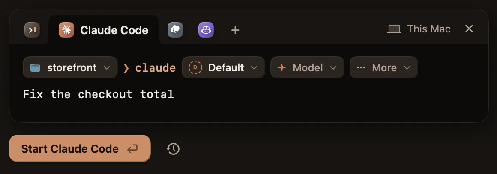

# 시작하기

[English](../GETTING_STARTED.md) · [Deutsch](../de/GETTING_STARTED.md) · [Ελληνικά](../el/GETTING_STARTED.md) · [Español](../es/GETTING_STARTED.md) · [Français](../fr/GETTING_STARTED.md) · [Italiano](../it/GETTING_STARTED.md) · [日本語](../ja/GETTING_STARTED.md) · **한국어** · [简体中文](../zh-Hans/GETTING_STARTED.md)

사용 중인 컴퓨터에 맞게 [Kodosi를 다운로드하세요](README.md#kodosi-받기). 아래 단축키는 macOS
기준이며, 별도 표기가 없는 한 Linux와 Windows에서는 ⌘ 대신 Ctrl+Shift를 사용하면 돼요.

## 1. 로그인

Kodosi를 열고 사이드바 아래쪽의 **로그인**을 클릭하세요. 브라우저가 열리면 거기서 로그인하면 돼요.
터미널에서 `kodosi auth login`을 실행하면 아무 브라우저에서나 입력할 수 있는 기기 코드를 받을 수도
있어요.

로그인하지 않아도 로컬 터미널은 실행할 수 있어요. 다른 컴퓨터를 연결하거나 친구를 추가하고
프로젝트를 사용하려면 로그인하세요.

## 2. 에이전트 시작하기

⌘N을 누르거나 **새 터미널**을 클릭해 런처를 여세요. 에이전트와 폴더를 고르고, 필요하면 계정,
모델, 추론 수준을 선택한 뒤 첫 프롬프트를 입력하고 Return 키를 누르세요. Kodosi가 새 셸에 실행
명령을 자동으로 입력해 줘요.

에이전트가 아직 설치되어 있지 않으면 런처에 설치 명령이 표시돼요.

### 터미널 빠르게 열기

- ⌘D (Linux와 Windows에서는 Ctrl+Shift+O)를 누르면 선택한 터미널의 폴더에서 일반 셸이 바로 열려요.
- ⌘T (Ctrl+Shift+T)를 누르면 선택한 터미널의 에이전트, 계정, 설정 그대로 새 터미널이 열려요.
- 사이드바에서 폴더 옆의 `+` 버튼을 클릭하면 그 폴더에서 이미 실행 중인 에이전트를 같은 계정과
  설정 그대로 실행하는 터미널을 하나 더 열어요. 실행 중인 에이전트가 없다면 일반 셸을 열어요.
- 셸 프롬프트에서 대기 중인 빈 터미널이라면 헤더의 동작 버튼(슬라이더 두 개)을 클릭해 설치된
  에이전트를 마지막에 사용한 설정으로 바로 시작할 수 있어요.

### 키보드 단축키

단축키는 Ghostty 기본값을 따르며 **설정 › 단축키**에서 바꿀 수 있어요.

- ⌘1~⌘9 (Linux와 Windows에서는 Alt+1~Alt+9): 위치에 따라 터미널 전환
- ⌥⌘ + 화살표 키 (Ctrl+Alt + 화살표 키): 인접한 터미널로 이동
- ⌘W: 선택한 터미널 닫기
- ⌘↑ 및 ⌘↓: zsh와 최신 bash에서 셸 프롬프트 간 이동 (macOS 기본 내장 bash 3.2 제외)

### 권한, 출력 상세도, 빠른 모드

- 에이전트는 기본적으로 제한 없이 시작하므로, 별도 확인 없이 파일을 수정하고 명령을 실행해요.
  예외로 Antigravity CLI는 자체 자동 모드로 시작하며, 되돌릴 수 없는 작업 전에는 먼저 확인을
  요청해요. 에이전트가 먼저 권한을 묻게 하려면 모델 선택기 다음에 있는 **더 보기**에서 **묻기**를
  고르세요.
- **더 보기**에서는 Claude Code, Codex, Copilot CLI, Antigravity CLI의 출력 상세도도 설정할 수
  있어요(기본값은 **간결**). Copilot CLI는 저장된 설정 파일에서만 상세도를 읽기 때문에, Copilot
  CLI가 **간결** 모드로 실행되는 동안 Kodosi가 Copilot 설정을 잠시 바꿨다가 종료 후 원래대로
  복원해요.
- Claude Code와 Codex는 비용이 더 드는 대신 더 빠르게 응답하는 빠른 모드를 지원하며, 모델 및 추론
  수준 선택기 옆에서 켤 수 있어요. 빠른 모드는 해당 실행에만 적용되고, 다음번 실행 때는 다시 꺼진
  상태로 시작해요.

### 계정 및 실행 중 설정 변경

- 새 계정을 추가하면 `~/.claude-work`처럼 분리된 설정 폴더가 부여돼요. Kodosi는
  `alias cw='CLAUDE_CONFIG_DIR=~/.claude-work claude'`처럼 셸 별칭(alias)으로 정의된 계정도
  자동으로 인식해요.
- 에이전트가 실행 중일 때도 헤더의 동작 버튼(슬라이더 두 개)으로 재시작 없이 모델, 추론 수준,
  빠른 모드, 그리고 지원하는 에이전트의 경우 권한까지 바꿀 수 있어요. Kodosi는 현재 차례가 끝난
  뒤 에이전트 자체의 슬래시 명령을 전달해요. 참고로 Claude Code는 여기서 바꾼 모델, 추론 수준,
  빠른 모드 설정을 이후 세션에서도 기억해요.

### 링크, 이미지, worktree, 테마

링크를 지금 사용 중인 기기의 기본 브라우저에서 열려면 ⌘를 누른 채 클릭하세요(Linux와 Windows에서는
Ctrl+클릭). 실행 중인 프로그램이 마우스를 점유하고 있다면 Shift도 함께 누르세요. iPhone에서는 링크를
탭하면 열리며, 프로그램이 마우스를 점유 중일 때는 탭으로 열리지 않아요. Kodosi는 링크를 다른 앱으로
넘기기 전에 먼저 확인을 요청하며, 실행 가능한 파일이나 다른 컴퓨터의 로컬 파일 경로 및 `localhost`
주소는 열지 못하도록 차단해요.

스크린숏이나 이미지를 에이전트에게 전달하려면 ⌘V로 붙여넣으세요(Linux와 Windows에서는
Ctrl+Shift+V, iPhone에서는 붙여넣기). Kodosi가 이미지를 터미널의 호스트 컴퓨터에 저장하고 그 파일
경로를 붙여넣어 에이전트가 첨부할 수 있게 해 주며, 원격 터미널이라면 업로드 진행 상황도 보여 줘요.
Claude Code의 Ctrl+V처럼 에이전트 자체의 붙여넣기 단축키는 에이전트가 실행 중인 컴퓨터의
클립보드를 그대로 읽어요.

에이전트에게 Git 저장소의 독립된 사본을 제공하려면 사이드바에서 저장소 폴더에 마우스를 올리고
브랜치 버튼을 클릭한 뒤 브랜치 이름을 입력하세요. Kodosi가 새 Git worktree에서 터미널을 열고,
변경 사항이 없다면 터미널이 닫힐 때 worktree를 자동으로 삭제해요. worktree가 저장되는 위치는
**설정 › 터미널**에서 바꿀 수 있어요.

각 터미널은 어느 기기에서 보더라도 호스트 컴퓨터의 Kodosi와 같은 라이트 또는 다크 모드로 표시되고,
터미널 안의 프로그램에도 테마 변경 알림이 전달돼요. 따라서 `/theme`를 Auto로 둔 Claude Code 같은
도구는 자동으로 테마를 맞춰요. Kodosi 앱이 라이트 모드일 때도 터미널은 어둡게 쓰고 싶다면
**설정 › 터미널**에서 **터미널을 항상 다크로 유지**를 켜세요.

### 닫기, 종료, macOS 권한

모든 터미널은 호스트 컴퓨터에서 실행되는 실제 셸이에요. **최소화**는 터미널을 실행 상태로 유지한
채 숨기고, **닫기**는 셸과 하위 프로세스를 모두 종료해요. 앱 창을 닫아도 Kodosi와 터미널은 메뉴
막대나 시스템 트레이에서 계속 실행돼요(단, 시스템 트레이가 없는 Linux 데스크톱에서는 창을 닫으면
Kodosi가 종료돼요). 창을 닫을 때의 동작은 **설정**에서 바꿀 수 있어요.

Kodosi를 종료하면 터미널이 멈추며, Kodosi는 각 터미널의 화면 상태를 서버가 아닌 내 컴퓨터에만
로컬로 저장해요. 다음에 Kodosi를 다시 열면 터미널이 이전과 같은 폴더, 프로젝트, 스테이지 위치에서
다시 열리고, 새 프롬프트 위에 직전 화면과 스크롤 기록이 복원돼요(Windows에서는 위로 스크롤하면
보여요). Claude Code, Codex, Copilot CLI는 진행하던 대화를 자동으로 이어 가며, macOS와 Linux에서는
선택한 모델, 추론 수준, 빠른 모드, 권한, 출력 상세도 설정도 유지돼요. 에이전트가 어떤 대화를 실행
중이었는지 Kodosi가 식별하지 못하면, 직접 골라 이어 갈 수 있도록 에이전트가 대화 목록을 보여 줘요.

macOS에서는 다른 터미널 앱과 마찬가지로 Kodosi 안에서 실행되는 프로그램이 Kodosi에 부여된 macOS
권한을 물려받아요. macOS가 어떤 프로그램의 다른 앱 수정을 차단한다면 **설정 › 일반**에서 열 수
있는 **앱 관리** 항목에서 Kodosi를 허용해 주세요. 앱을 자동화하거나 화면을 캡처하는 도구를 쓴다면
같은 곳에서 **기기 제어 및 데이터 접근**(macOS 27 이전에는 **손쉬운 사용**)과
**화면 및 시스템 오디오 녹음** 권한도 허용할 수 있어요.

## 3. 어떤 에이전트가 나를 기다리는지 확인하기

각 터미널의 아이콘은 현재 상태를 보여 줘요.

| 표시 | 의미 |
| --- | --- |
| 아이콘 주위를 도는 따뜻한 빛 | 작업 중 (진행률을 보고하는 경우 테두리가 채워지며 퍼센트 표시) |
| 손, 물음표 또는 열쇠 | 승인, 답변 또는 로그인을 기다리는 중 |
| 초록색 체크 | 완료 |
| 노란색 경고 삼각형 | 실패 |

초록색 체크와 경고 표시는 어느 기기에서든 해당 터미널을 열면 즉시 사라져요.

터미널이 입력을 기다리기 시작하거나, 완료되거나, 실패하면 Kodosi가 지금 실제로 사용 중인 기기에
한 번만 알림을 보내요.

- Kodosi 창이 활성화되어 있다면 상태 표시만 보여 줘요.
- 컴퓨터에서 다른 앱을 쓰고 있다면 그 컴퓨터에 데스크톱 알림을 띄워요.
- 모든 컴퓨터에서 자리를 비운 상태라면 휴대폰으로 푸시 알림을 보내요. 자리를 비울 때 아직 확인하지
  않은 대기 중 터미널이 남아 있다면 그때 휴대폰으로 알림이 전달돼요.

알림음은 입력을 기다리는 터미널에서만 울려요. 기기별 알림은 **설정**에서 끌 수 있어요. 프로그램은
[Program Status Protocol](https://www.superlogical.com/rex/docs/build/program-status)이나 표준
터미널 진행률 시퀀스로 상태를 알리며, 상태를 보고하지 않는 프로그램에는 별도 표시가 나타나지 않아요.

### 채팅 보기

Claude Code를 실행 중인 터미널이나 Kodosi로 시작한 Codex 및 Copilot CLI 터미널은 헤더에서 **채팅**
보기도 지원해요. 채팅 보기에서는 내가 보낸 메시지, 에이전트의 응답과 도구 실행 내역, 그리고 클릭
가능한 버튼이 달린 대기 중인 질문을 확인할 수 있어요. 채팅창에서 바로 답장하거나 에이전트를 멈출
수 있고, 에이전트가 질문하는 중에 직접 텍스트를 입력하면 선택지 대신 무엇을 해야 할지 지시할 수
있어요. 채팅에서 수행하는 모든 동작은 실제 터미널에도 똑같이 반영돼요.

## 4. 캔버스에서 에이전트의 작업 결과 보기

에이전트는 터미널 옆 **캔버스**에 HTML 페이지, Markdown, 이미지, PDF, 오피스 문서, 스프레드시트,
프레젠테이션, 실행 중인 웹 앱을 띄우고, 공유 브라우저를 제어할 수 있어요. 기본적으로 해당 터미널을
보고 있을 때 에이전트가 새 항목을 보여 주거나 업데이트하면 캔버스가 자동으로 열려요(직접 닫아 둔
경우는 제외). 직접 열 때만 열리게 하려면 **설정 › 일반**에서 **캔버스 자동으로 열기**를 끄세요.

Claude Code, Copilot CLI, Antigravity CLI는 수동으로 실행해도 캔버스 사용법을 자동으로 알고,
Codex, Cursor, OpenCode(macOS 및 Linux)는 Kodosi로 시작했을 때 사용법을 알아요. 그 밖의
에이전트에는 `kodosi skill canvas`를 실행하라고 안내하세요.

캔버스에 콘텐츠가 올라오면 터미널 헤더에 **파일** 버튼과 **브라우저** 버튼이 생기며, 새로운 항목이
있을 때는 구리색 점이 표시돼요.

- 어느 버튼이든 클릭하면 터미널 옆에 캔버스가 열려요.
- **더 넓게**를 클릭하면 캔버스가 스테이지 전체를 채우고, 터미널은 구석에 작게 배치돼요.
- 각 패널은 버튼의 `×`로 닫고, `+`로 다시 열 수 있어요.
- 동작 메뉴에서 **브라우저 열기**로 브라우저를 직접 열거나, **파일 추가…** 메뉴를 선택(또는
  캔버스에 끌어다 놓기)해 파일을 추가할 수 있어요. 추가한 파일은 터미널 폴더에도 복사돼요.
- iPhone에서는 터미널 막대에 캔버스 버튼이 있으며, 새 항목이나 업데이트가 생기면 **열기** 버튼이
  달린 배너로 알려 줘요.

### 실시간 문서와 페이지

- 문서(`.docx`), 스프레드시트(`.xlsx`), 프레젠테이션(`.pptx`), PDF, 텍스트 파일은 실시간으로
  동기화돼요. 디스크에는 일반 파일 그대로 유지되면서 나와 터미널을 공유하는 사람, 그리고 에이전트가
  동시에 편집할 수 있어요. 문서에 변경 내용 추적이 포함되어 있으면 도구 막대에 변경 사항을 수락하거나
  거부하는 버튼이 나타나요. **설정 › 문서**에서는 각 뷰어를 개별적으로 켜고 끄거나, 페이지 보기와
  흐름 텍스트 보기를 전환하고, 다크 모드에서 페이지 배경도 어둡게 표시할 수 있어요.
- 캔버스의 HTML 페이지는 네트워크 접근 없이 완전히 오프라인 상태로 실행돼요. 페이지, 문서, 시트,
  슬라이드, PDF 안의 링크는 터미널 링크와 동일한 보안 규칙에 따라 내 기본 브라우저에서 열려요(편집
  가능한 보기에서는 ⌘+클릭 또는 Ctrl+클릭, 그 외 영역에서는 일반 클릭, iPhone에서는 탭). 같은 파일
  안의 슬라이드나 셀을 가리키는 내부 링크는 해당 위치로 바로 이동해요.
- 페이지나 문서에서 텍스트를 드래그해 선택한 뒤 **이것에 대해 묻기**를 클릭하면 파일 이름과 선택한
  내용이 터미널에 바로 입력되어 곧바로 질문을 이어서 적을 수 있어요.
- 파일 탭을 오른쪽 클릭(모바일에서는 길게 누르기)하면 사본을 저장하거나, 해당 파일 또는 모든 파일을
  캔버스에서 제거하거나, 호스트 컴퓨터의 휴지통으로 옮길 수 있어요.

### 공유 브라우저

- 공유 브라우저에서는 일반 브라우저처럼 자유롭게 클릭하고 입력할 수 있어요. 에이전트도 같은 화면과
  로그인 상태를 보며, 에이전트가 다음에 실행하는 브라우저 명령의 출력으로 내가 브라우저를 사용했다는
  사실이 전달돼요.
- 10분 동안 사용하지 않으면 브라우저는 절전 상태에 들어가고, 나 또는 에이전트가 다시 사용할 때
  마지막 페이지를 다시 열어요. 컴퓨터에서 공유 브라우저를 처음 열 때는 Kodosi가 Kodosi Browser를
  자동으로 다운로드하므로 잠시 시간이 걸려요.
- 비공개 터미널에서 기존 브라우저의 로그인 정보를 그대로 쓰고 싶다면 **설정 › 브라우저**에서 해당
  브라우저 옆의 **복사**를 클릭하세요. **제거**를 누르면 복사한 데이터가 삭제되고, **모두 제거**를
  누르면 비공개 터미널에 저장된 모든 로그인 정보와 사이트 데이터가 초기화돼요. macOS에서 Safari처럼
  운영 체제가 브라우저 데이터 접근을 제한하는 경우, 해당 브라우저 옆의 **허용…** 버튼을 클릭해 전체
  디스크 접근 권한을 부여하세요.
- 터미널에 접근할 수 있는 사람은 누구나 그 캔버스를 보고 공유 브라우저를 함께 쓸 수 있어요. 터미널을
  닫으면 캔버스가 비워지고 공유 터미널 브라우저의 로그인 정보도 삭제돼요.

### 컴퓨터의 화면

- 휴대폰이나 다른 컴퓨터에서 컴퓨터를 보고 제어하려면 그 컴퓨터에서 공유를 켜세요. Mac에서는
  **설정 › 일반**의 **내 다른 기기에서 이 Mac을 보고 제어할 수 있게 하기**를, Linux와 Windows에서는
  **설정 › 계정**의 **내 다른 기기에서 이 컴퓨터를 보고 제어할 수 있게 하기**를 켜면 돼요.
  - Mac에서는 이어서 macOS가 Kodosi의 일부인 Kodosi Screen이 화면을 녹화하고 제어하도록 허용할지
    물어요. 이 권한은 Kodosi Screen만 가지므로 터미널의 프로그램은 갖지 않아요. macOS가 묻지 않으면
    같은 설정의 **허용…**에서 권한을 켜는 위치를 확인할 수 있어요.
  - Linux에서는 Wayland 환경의 KDE Plasma 6과 GNOME에서 공유할 수 있어요. KDE에서는 공유를 켜기만
    하면 되고, GNOME은 Kodosi가 화면을 공유해도 되는지 한 번 묻고 그 답을 기억해요.
  - Windows에서는 권한이 필요 없어요. Kodosi는 관리자 권한으로 실행되는 프로그램을 제어할 수 없고,
    Windows가 관리자 승인을 요청하는 동안에는 화면이 잠긴 것으로 표시돼요. 누가 보고 있는지 알려
    주는 아이콘은 고정하기 전까지 작업 표시줄의 ^ 안에 숨겨져 있을 수 있어요.
- 그 컴퓨터에 있는 터미널의 동작 메뉴에서 **화면 열기**를 고르거나, 에이전트가
  `kodosi show screen`을 실행하게 하세요. 화면 위에서 다른 디스플레이를 고르거나 Mac에서는 창 하나를
  고를 수 있고, 핀치로 확대하며, 컴퓨터 앞에 앉은 것처럼 가리키고 클릭하고 입력할 수 있어요.
  단축키는 누른 키의 글자를 기준으로 동작하며, Linux와 Windows에서는 ⌘가 Ctrl로 동작해요. 그곳에서
  복사한 텍스트는 내 기기로 오고, 붙여넣는 내용은 내 기기에서 가져와요.
- 화면을 보여 줄 수 없을 때는 그 이유를 한 줄로 알려 줘요. 컴퓨터가 잠겨 있거나, 잠자기 상태이거나,
  오프라인이거나, 다른 계정을 사용 중이거나, 공유가 꺼져 있는 경우예요. 상황이 바뀌면 화면이 저절로
  다시 나타나요.
- 화면은 내 기기에서만 보여요. 친구와 공유하는 터미널에서도 마찬가지예요. 누군가 보는 동안에는
  컴퓨터의 메뉴 막대나 시스템 트레이에 보고 있는 기기와 공유를 멈추는 버튼이 표시돼요. 멈추면 컴퓨터
  앞에 있는 사람이 다시 켤 때까지 공유가 꺼져 있어요.

## 5. Dosi에게 묻기

Dosi는 다른 에이전트들을 조율해 주는 에이전트예요. 사이드바 아래쪽의 Dosi 얼굴을 클릭하거나 ⌘J를
눌러 열어 보세요. Dosi는 Claude Code 또는 Codex로 실행되며, 사용할 에이전트와 계정, 모델, 추론
수준은 **설정 › Dosi**에서 설정할 수 있어요.

  <picture>
    <source media="(prefers-reduced-motion: reduce)" srcset="../media/dosi-still.webp">
    
  </picture>

무엇을 확인해야 하는지 Dosi에게 묻거나 원하는 작업을 맡겨 보세요. Dosi는 터미널과 프로젝트를
확인하고, 프롬프트에 답하거나 터미널을 시작 및 종료하며 메시지를 전달할 수 있어요. 결정이 필요할
때는 선택지 버튼과 함께 직접 답변을 적을 수 있는 입력창을 보여 줘요.

Dosi와의 대화는 모든 기기에서 동기화돼요. iPhone과 iPad에서는 입력창 바로 위에서 메시지를 보낼
컴퓨터의 Dosi를 고를 수 있어요(기본값은 가장 최근에 답한 컴퓨터). 오프라인 컴퓨터로 보낸 메시지는
해당 컴퓨터가 다시 온라인이 될 때까지 대기하며, 대기 중인 메시지는 **보내지 않기**로 취소할 수
있어요.

Dosi 얼굴 옆의 상태 줄은 Dosi가 작업 중인지, 답장했는지, 질문에 대한 답을 기다리는지 알려 줘요.
해당 컴퓨터에 아직 설치된 에이전트가 없다면 **Dosi 설정**이 표시되며, 클릭하면 **설정 › Dosi**가
열려요. 특정 컴퓨터에서 Dosi를 끄려면 **설정 › Dosi**에서 **Dosi 사용**을 비활성화하세요.

## 6. 다른 컴퓨터와 휴대폰 추가하기

새 컴퓨터에서 같은 계정으로 로그인하세요. 새 컴퓨터에 확인 코드가 표시되고 기존 기기들에 승인
요청이 떠요. 이미 승인된 컴퓨터에서 **승인**을 클릭해 코드를 입력하거나, 승인된 휴대폰으로 코드를
스캔하면 돼요.

휴대폰이나 태블릿은 스캔 한 번으로 추가할 수 있어요. 승인된 컴퓨터에서 **설정**을 열고
**기기 추가** 아래의 **코드 표시**를 클릭한 뒤 새 기기로 스캔하세요. 승인이 완료되면 모든 컴퓨터의
터미널이 모든 기기에 표시돼요.

### 원격으로 터미널 시작하기

다른 컴퓨터에서 터미널을 시작하려면 런처 막대 오른쪽에서 해당 컴퓨터를 고르세요. 그러면 폴더
메뉴에 그 컴퓨터의 최근 폴더 목록이 나타나고, **폴더 선택…** 메뉴로 홈 디렉터리를 탐색할 수
있어요. iPhone과 iPad에서는 **터미널** 화면이나 특정 컴퓨터 옆의 `+`를 탭하세요. 대상 컴퓨터에는
Kodosi가 열려 있거나 터미널에서 `kodosi host`가 실행 중이어야 해요.

내 기기 두 대가 서로 직접 통신할 수 있는 환경이라면 터미널과 브라우저 트래픽이 중계 서버를 거치지
않고 P2P로 직접 오가며 지연 시간이 줄어들어요. 로컬 네트워크에서는 macOS, iOS, Android가 로컬
네트워크 권한을 한 번 요청하며, 거부하면 중계 서버를 통해 연결돼요.

### 복구 키

**설정**에서 복구 키를 만들어 안전한 곳에 보관하세요. 혹시 모든 기기를 잃어버리더라도 새 기기에서
로그인한 뒤 "**내 복구 키 사용**"을 선택하면 친구와 프로젝트를 그대로 유지할 수 있어요. 분실한
기기는 남아 있는 다른 기기에서 제거하고, 도난당한 경우에는 제거 후 새 복구 키도 발급하세요.

## 7. 친구와 함께 일하기

계정 옆 메뉴에서 **친구**를 여세요. 내 초대를 보내거나 친구의 초대 또는 사용자 이름을 붙여넣으면
돼요. 초대를 사용하면 Kodosi가 친구의 신원을 자동으로 검증해 줘요. 모바일에서는 내 초대를 QR 코드로
띄워 친구가 카메라나 Kodosi 앱으로 스캔하게 할 수 있으며, 상대방이 신뢰를 확인한 뒤에 친구 요청이
전송돼요.

### 터미널 공유하기

터미널 헤더의 동작 메뉴를 열어 **공유**를 클릭하고 친구나 프로젝트를 선택하세요. 터미널을 공유받은
사람은 해당 컴퓨터에서 내 OS 권한과 동일한 전체 제어 권한을 얻게 되며, 나머지 터미널은 비공개로
유지돼요.

### 프로젝트

프로젝트는 어느 폴더나 컴퓨터에 있는 터미널이든 공유 채팅 및 작업 목록과 함께 하나로 묶어 주는
공간이에요. **프로젝트** 옆의 `+`를 클릭한 뒤 프로젝트 안에서 새 터미널을 시작하거나 기존 터미널을
공유하고, 준비되면 친구를 초대하세요.

- 모든 멤버가 공유 터미널을 사용하고 자기 터미널을 프로젝트에 공유할 수 있어요. 나중에 참여한
  사람도 프로젝트의 터미널과 전체 채팅 기록을 바로 볼 수 있으며, 파일은 각 터미널이 실행되는
  호스트 컴퓨터에 그대로 남아요.
- 누구나 가져갈 수 있는 작업을 만들고, 맡거나 맡기를 취소하고, 요약 메모와 함께 완료하거나 다시 열
  수 있어요.
- GitHub나 Gitea 저장소를 연결하면 이슈와 작업이 동기화되어, 연결된 작업을 수정하면 실제 이슈도
  함께 업데이트돼요. GitHub는 `gh` 로그인이나 Git 자격 증명 도우미(credential helper)를 사용하고,
  Gitea는 Git 자격 증명 도우미나 `KODOSI_GITEA_URL`과 함께 `KODOSI_GITEA_TOKEN`을 사용해요. 자격
  증명은 내 컴퓨터 밖으로 나가지 않아요.
- 채팅에서 `@<terminal-name>`처럼 터미널을 멘션하면 내 이름과 프로젝트 정보가 붙은 메시지가 해당
  터미널에서 실행 중인 에이전트에게 바로 전달되며, 어떻게 응답할지는 에이전트가 판단해요. Kodosi
  안에서 실행되는 Claude Code, Copilot CLI, Antigravity CLI와 Kodosi로 시작한 Codex, Cursor,
  OpenCode(macOS 및 Linux)는 자신이 Kodosi 안에 있다는 것을 자동으로 인식해요. 그 밖의 에이전트에는
  `kodosi skill`을 실행해 [skill](../../runtime/skills/kodosi/SKILL.md)(영어)을 출력해 주세요.
  Kodosi 터미널 안에서는 프로젝트 명령이 현재 프로젝트를 자동으로 감지하고, 외부에서는
  `--project <name>` 옵션을 붙여 지정할 수 있어요.
- 나 또는 내 에이전트가 작성한 메시지를 삭제하면 모든 멤버에게 삭제된 메시지 표시로 바뀌어요.
  **채팅 지우기**는 그 시점까지의 대화 기록을 내 모든 기기에서 숨기며, 다른 멤버의 기록에는 영향을
  주지 않아요.

## 8. 명령줄 사용하기

`kodosi` CLI는 데스크톱 앱과 완전히 동일한 터미널을 제어하며, 변경 사항이 앱에도 즉시 반영돼요.

| 명령 | 설명 |
| --- | --- |
| `kodosi terminal start --agent claude --prompt "fix the failing test"` | 마지막에 사용한 설정으로 에이전트를 시작해요. `--account`, `--model`, `--effort`, `--fast`, `--permissions`, `--output`으로 옵션을 바꿀 수 있어요. |
| `kodosi terminal start --directory <repository> --branch <name>` | 전용 Git worktree의 새 브랜치에서 터미널을 시작해요. |
| `kodosi terminal start --computer <computer> --directory <folder>` | 내 다른 컴퓨터에서 터미널을 시작해요. 상대 경로와 `~`는 해당 컴퓨터의 홈 디렉터리를 기준으로 해석돼요. 온라인 상태인 컴퓨터는 `kodosi devices list`로 확인할 수 있어요. |
| `kodosi agent list` | 설치된 에이전트, 등록된 계정, 마지막으로 사용한 설정 목록을 보여 줘요. |
| `kodosi agent usage` | 로그인된 Claude Code, Codex, Copilot CLI 계정의 현재 요금제 사용량과 초기화 시각을 보여 줘요. |
| `kodosi terminal list` | 터미널 목록을 이름과 ID와 함께 보여 줘요. 둘 중 어느 쪽이든 `<terminal>` 인자로 쓸 수 있어요. |
| `kodosi terminal read <terminal>` | 현재 화면 내용을 출력해요. `--history`를 붙이면 스크롤 기록까지 함께 출력돼요. |
| `kodosi terminal message <terminal> "Can you review my branch?"` | 보낸 사람과 출처 정보를 붙여 터미널의 에이전트에게 메시지를 전달해요. |
| `kodosi terminal agent <terminal> --model sonnet` | 실행 중인 에이전트의 모델, 추론 수준, 빠른 모드, 권한을 변경해요. |
| `kodosi terminal input <terminal> --enter "make test"` | 터미널에 텍스트를 입력해요. |
| `kodosi terminal keys <terminal> ctrl-c` | 터미널에 키 입력을 전송해요. |
| `kodosi terminal wait <terminal> --until done,failed` | 터미널이 지정한 상태 중 하나가 될 때까지 대기해요. |
| `kodosi terminal show <terminal>` | 앱에서 해당 터미널에 포커스를 맞춰요. |
| `kodosi dosi say "What needs me?"` | Dosi에게 메시지를 보내요. `kodosi dosi show`로 대화 내역을 출력하고, `kodosi dosi stop`으로 진행 중인 차례를 취소할 수 있어요. |
| `kodosi show <file>` | 이 터미널의 캔버스에 파일을 열어요. 캔버스는 이 터미널을 보고 있는 사람들에게 열려요. `kodosi show <address>`로 공유 브라우저에 URL을 열고, `kodosi show browser`로 브라우저를 현재 상태 그대로 띄우며, `kodosi show screen`이나 `kodosi show window <words>`로 컴퓨터의 화면을 주인의 기기에 보여 주고, `kodosi canvas`로 캔버스 항목 목록을 보고, `kodosi canvas remove <file>`로 항목을 제거할 수 있어요. |
| `kodosi browser open <address>` | 이 터미널의 공유 브라우저에서 URL을 열어요(다른 모든 agent-browser 명령도 함께 사용할 수 있어요). |
| `kodosi skill` | Kodosi에서 협업하기 위한 에이전트 skill을 출력해요. `kodosi skill canvas`는 캔버스용 skill을 출력해요. |
| `kodosi dosi skill` | 다른 에이전트가 Dosi처럼 동작하도록 하는 skill을 출력해요. |
| `kodosi host` | 앱을 종료한 뒤에도 터미널이 유지되도록 호스트를 독립 실행해요. 백그라운드 호스트를 멈추려면 `kodosi host stop`을 실행하세요. |

내가 해당 터미널에 직접 입력하고 있는 동안에는 `message`, `input`, `keys` 명령이 실행되지 않아요.
또한 에이전트가 사람의 응답을 기다리는 동안에는 `message` 명령도 실행되지 않아요.

## 연결이 안 될 때

- 터미널의 호스트 컴퓨터가 온라인이고 Kodosi가 실행 중인지, 그리고 해당 터미널이 여전히 공유
  상태인지 확인하세요.
- 새로 추가한 기기는 승인을 기다리고 있을 수 있고, 신원이 변경된 친구는 **친구** 화면에서 다시
  확인해야 할 수 있어요.
- 연결이 끊긴 뒤에는 Kodosi가 현재 상태를 다시 보여 줘요. 원격 터미널에 **오프라인**이라고
  표시된다면 현재 기기가 서버에 연결되지 않은 상태예요. 네트워크 연결을 확인하세요. Kodosi는
  자동으로 재연결을 시도하며, **다시 시도**를 클릭해 즉시 재시도할 수도 있어요.
- 호스트 컴퓨터가 오프라인이 되면, 그 사이 터미널이 종료되지 않는 한 컴퓨터가 다시 온라인이 될 때
  자동으로 재연결돼요. 오프라인 터미널을 목록에서 빼려면 `×`를 클릭하세요.
  **돌아올 때까지 숨기기**는 일시적으로 숨기고, **완전히 닫기**는 컴퓨터가 다시 연결될 때
  터미널을 영구적으로 닫아요.
- 입력 전달 여부가 불확실하다는 경고가 Kodosi에 표시되면, 명령을 다시 실행하기 전에 터미널 화면을
  먼저 확인하세요.
